**\[1강\] 안드로이드 개요 및 개발 환경 구축**

1.  안드로이드 개요

안드로이드는 많은 모바일 OS 중 하나

PC-\>모바일로 넘어오면서,

1.  웹뷰 - PC환경의 UI와 모바일 환경의 UI가 다른 것 (PC처럼 URL사용해 접속)

2.  네이티브 웹 – 안드로이드, ios 프레임워크만 가지고 프로그램을 만들어 나가는 것 (마켓에서 다운)

- 성능은 가장 뛰어나지만, 각각의 언어와 플랫폼을 학습해야 한다.

  1.  하이브리드 – 하나의 언어로 각각의 플랫폼에 맞는 앱을 동시에 개발

> Ex) React-Native 프레임워크로 자바스크립트로 안드로이드, ios두가지 버전 가능
>
> Ex) Flutter프레임워크로 Dart언어로 두가지 버전 가능

2.  JDK설치

JDK = Java Development Kit (자바 언어로 작성한 프로그램을 컴파일 하기 위해 필요)

3.  Path지정

4.  이클립스 설치

5.  ADT, SDK 설치

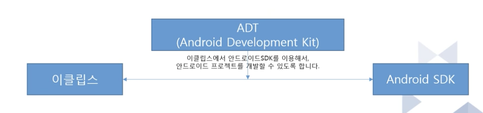

SDK = 안드로이드를 개발하는데에 필요한 라이브러리의 집합체

ADT = 안드로이드를 개발하는 도구(이클립스와 SDK를 연결)

**\[2강\] 안드로이드 프로젝트**

1.  전체적인 구성

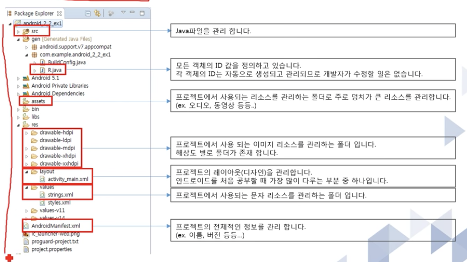

**\[3강\] 레이아웃1( = 뷰 그룹)**

1.  응용 프로그램 = 프로그램 하나

2.  엑티비티 = 화면 하나

3.  뷰 = 화면 안의 위젯들의 최상위개념

    - 응용 프로그램 안에 엑티비티 안에 뷰 그룹 ( 뷰, 레이아웃, 위젯 )

4.  레이아웃 종류

    1.  Linear - vertical

> 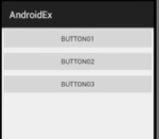
>
> Linear – horizontal
>
> 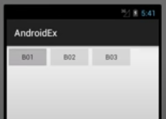

6.  뷰와 뷰그룹과 레이아웃 정리

    1.  뷰: 사용자와 직접적으로 상호작용하는 위젯으로, 뷰 클래스 상속도를 보면 화면에 보이는 뷰 요소들은 반드시 View클래스를 상속받아야 한다. 기존에 없는 뷰(커스텀 뷰)를 만드려면, View를 상속 받아서 구현해야 한다. 뷰는 자신이 화면 어디에 그려져야 하는가에 대한 정보가 없으므로, 이를 보완해 줄 뷰그룹 혹은 컨테이너가 필요하다.

> 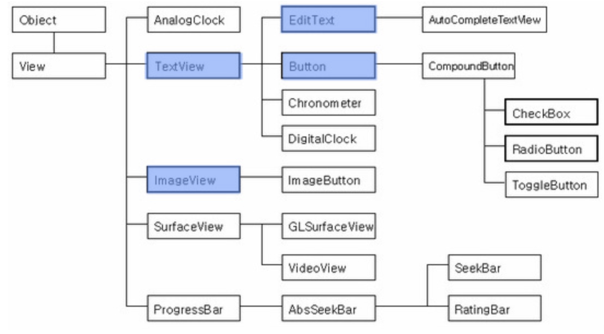

2.  뷰그룹: 고유한 배치 방식을 가지는 레이아웃의 형태. 대표적으로 리니어(수평, 수직), 프레임(겹쳐서), 릴레티브(상호관계 의존)등이 있다. 아래와 같은 뷰그룹 클래스 상속도를 가진다.

> 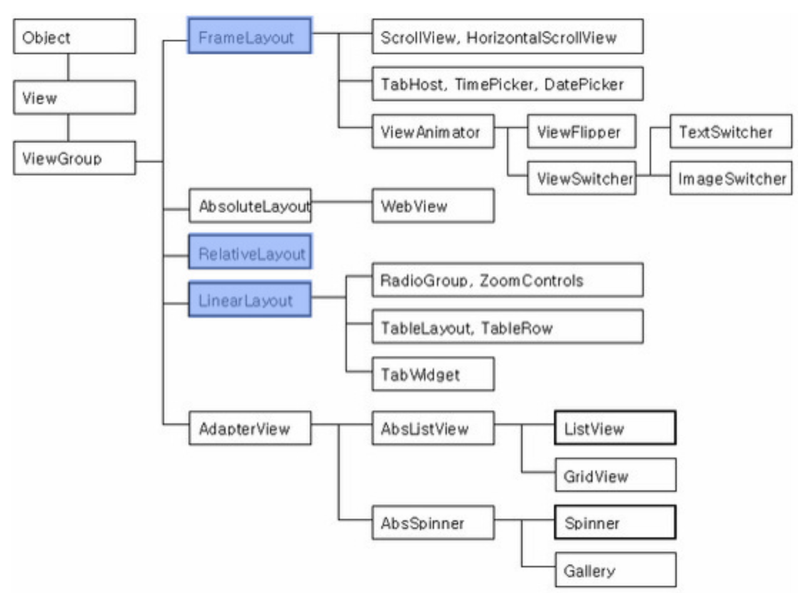

3.  정리: 안드로이드에서 뷰를 배치하기 위해 뷰그룹을 만드려면 반드시 뷰그룹을 상속받아야 한다. 뷰그룹 역시 뷰 클래스를 상속받고 있다. 뷰와 뷰그룹간의 관계는 아래와 같다. 뷰그룹 조차 뷰로 다룬다. 즉, 안드로이드 화면은 오직 뷰만으로 구성되어 있다고 할 수 있다.

> 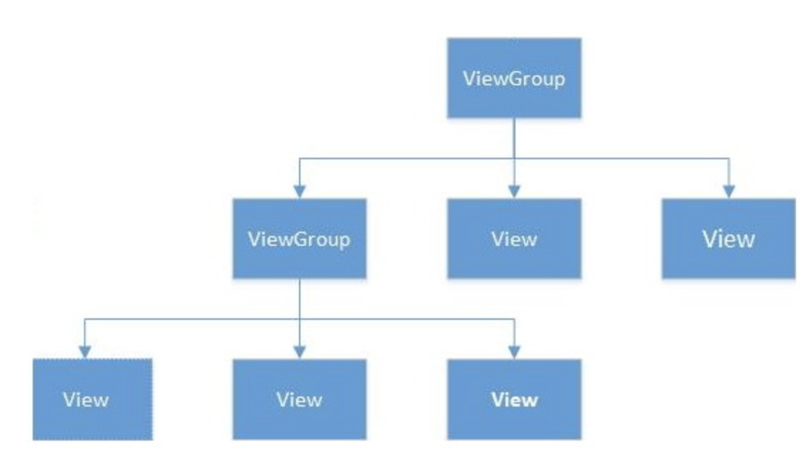

**\[4강\] 안들외드 기본 위젯**

1.  버튼

2.  텍스트뷰, 에디트텍스트 …

3.  이미지뷰

4.  토스트

**\[5강\] \[6강\] 레이아웃2, 레이아웃3**

1.  RelativeLayout: 위젯들 사이의 관계를 이용한 레이아웃 배치

2.  FrameLayout: 뷰를 쌓아올리는 방식(겹쳐서 쌓는다)

3.  TableLayout: 표 형식의 레이아웃(행과 열이 존재한다)

**\[7강\] 커스텀뷰(CustomView)**

1.  레이아웃 뷰그룹을 이용하지 않고 View클래스를 상속 받아 직접 뷰를 만든다.

> (즉, xml을 이용하지 않는다. .java파일로 생성한 후 onDraw함수를 overide한다. Paint함수 사용)

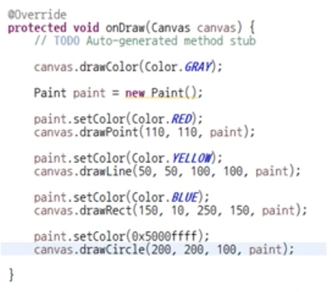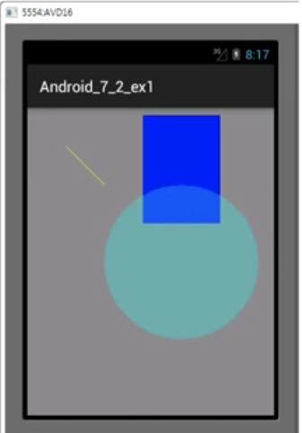

2.  Bitmap불러오기(이미지 불러오기)

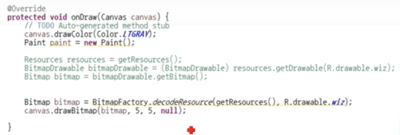

3.  Shader: 그라데이션 할 때 사용

4.  Bitmap Shader: 패턴을 만들 때 사용

**\[8강\] 어댑터(Adapter) 뷰**

1.  어댑터란?

: 무수히 많은 데이터들을 화면에 출력해 주는 방법으로, 데이터와 뷰를 중간에서 묶어준다.

(220V 어댑터와 용도가 같다.)

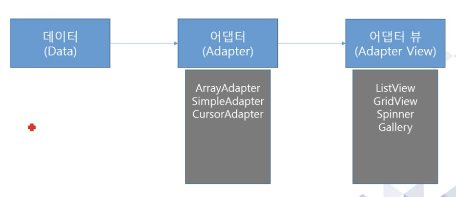

2.  ListView의 어댑터 구현

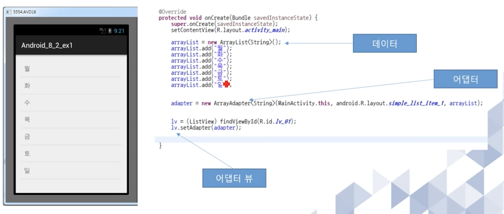

(Simple_list_item_1은 월/화/수 하나의 레이아웃을 뜻한다.)

3.  데이터 분리(XML)

: Java파일의 data를 xml파일을 이용하여 분리한다.

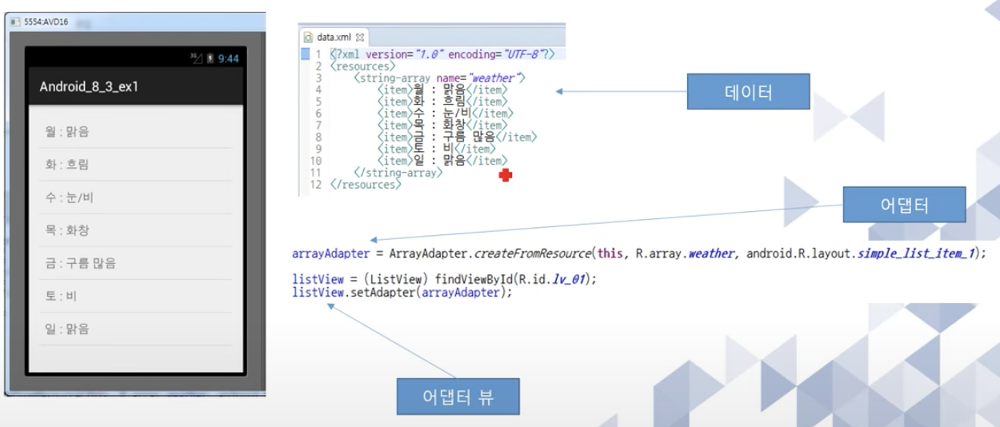

4.  ListView의 속성

: item하나 하나의 속성 지정 가능하다.

**\[9강\] 어댑터(Adapter) 뷰2**

1.  커스텀 뷰의 어댑터

**\[10강\] 어댑터(Adapter) 뷰3**

1.  ListActivity

: 리스트가 이미 포함되어있는 액티비티 setContentView사용하지 않는다.

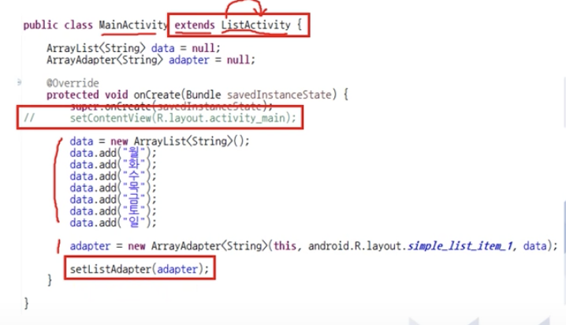

**\[11강\] 어댑터(Adapter) 뷰4**

1.  GridView: 리스트 뷰와 달리 데이터를 표형식으로 출력한다.

2.  HorizontalScrollView: 가로 형태의 스크롤 뷰

**\[12강\] 기타 위젯**

1.  check box: 중복 체크 가능

2.  Radio button: 하나만 체크

3.  Progress bar: 특정 작업의 진행 정도

4.  Seekbar: 재생 상태 조절( 음악 소리 조절 기능)

**\[13강\] 이벤트&리스너**

> : 사용자는 버튼 등의 GUI를 활용하여 이벤트를 발생시키고, 네트워크 상에서는 특정 작업의 진행에 따른 이벤트가 발생한다. 시스템 상태 변화에 따라서도 가능하다. 이벤트를 잘 다룰 수 있어야 효율적인 어플리케이션을 만들 수 있다. 콜백 메소드를 이용하거나 리스너를 이용한다.

1.  작동 순서

    1.  버튼이 눌림: 이벤트 발생

    2.  온클릭 이벤트 발생: 버튼의 특성에 맞는 이벤트 발생한다.

    3.  리스너가 동작을 취한다: 해당 이벤트에 맞는 동작 실행된다.

    - 이벤트 발생 시 리스너가 있으면 동작이 생긴다. 없으면 생기지 않는다. 여러 개 등록 가능

2.  네트워크 상의 이벤트 리스너

: 네트워크상의 데이터 다운로드 시작 또는 완료, 네트워크 불안전 등의 이유로 취소 및 롤백(되돌리기)

3.  시스템의 상태 변화에 따른 이벤트

: 배터리 없을 경우 화면 밝기 낮추기, 열이 날 경우 낮추기

4.  이벤트 처리 방법

: 기본 제공 이벤트 리스너의 기본 종류 및 방법에서 나아가서, 내가 위젯을 만들고 그 이벤트를 받을 수 있어야 한다. 커스텀으로

5.  커스텀 뷰의 콜백 메소드를 이용한 이벤트 처리

> : 이벤트가 발생하면 특정 메소드를 호출해 알려준다. (1개) 조건이 만족되었을 때 기능을 호출하기 때문에 효율적이다. 비동기로 조건에 대한 작업을 수행한다. 주로 시스템 측에서 이벤트를 발생시켜 이에 대한 처리를 해달라고 요청해오는 과정에서 콜백이 사용된다. 콜리가 콜러에게 요청한다. 다른 함수에 인수로 넣을 수 있다.

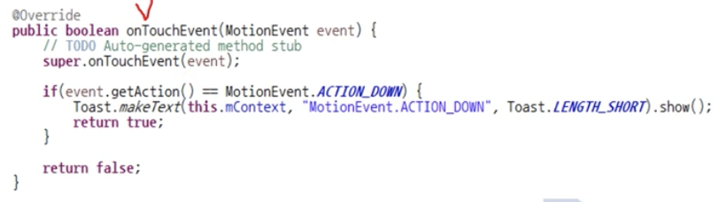

6.  리스너를 이용한 이벤트 처리

: 이벤트가 발생하면 연결된 리스너(핸들러)들에게 이벤트를 전달한다. (n개) 사용자의 상호작용으로 트리거 되었을 때 인터페이스를 호출한다. 이벤트 리스너 안에는 콜백 메소드가 있다. 즉, 리스너는 콜벡 메소드를 가진 인터페이스이다.

1.  

> 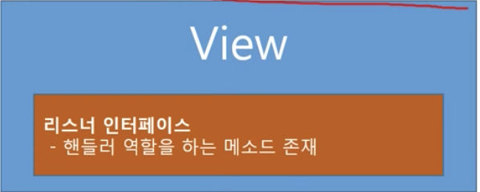

2.  추상 메소드 형태로 존재한다. overide해야한다.

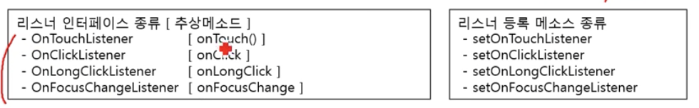

3.  익명 이너클래스

> 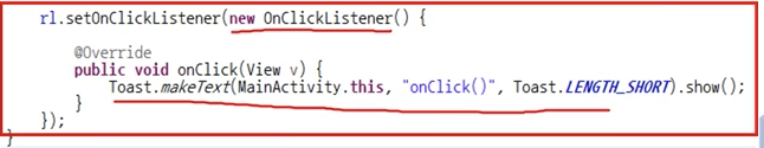

**\[14강\] 이벤트를 이용한 드로잉 - 패스**

**\[15강\] 액티비티**

1.  액티비티란?

> : 하나의 화면. 어플리케이션 안에 엑티비티 여러 개 존재. 엑티비티 안에 뷰(위젯) 혹은 뷰 그룹(레이아웃) 이 여러 개 존재한다.
>
> 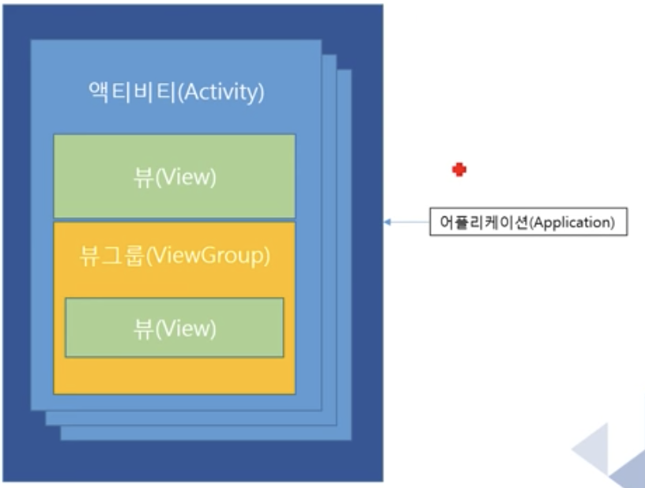 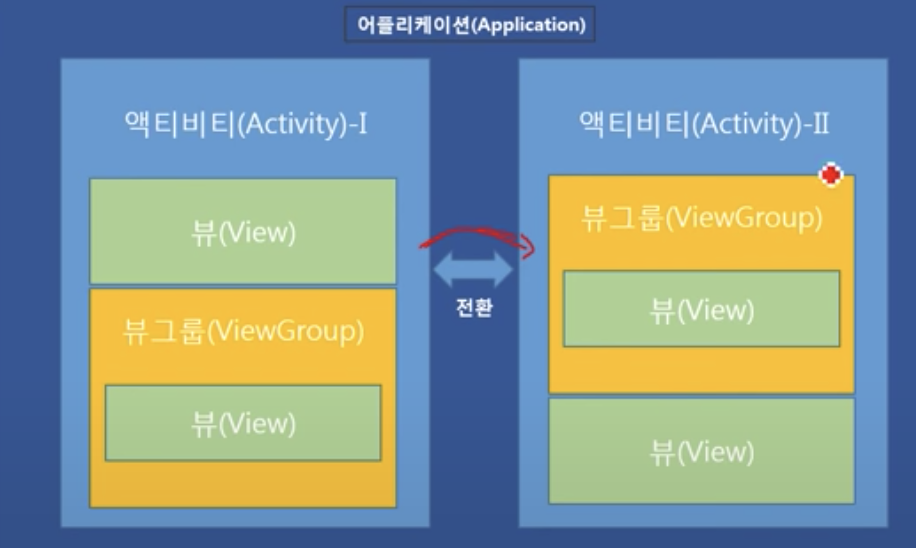

2.  새로운 액티비티로 전환

> 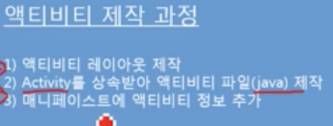 // 이클립스가 해주는 것일 뿐 해야한다!
>
> 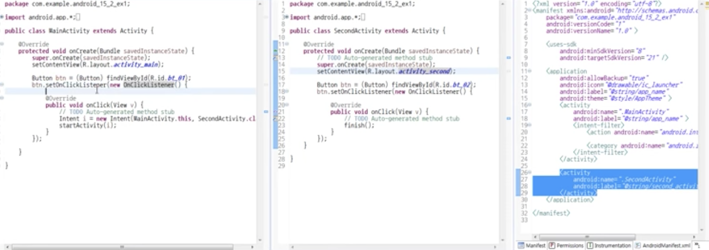

- 인텐트와 startActivity메소드 사용한다.

3.  생명주기

> : 모든 언어에는 Life Cycle이 있다. 상태에 맞게 로직을 구성해야 한다. 액티비티는 생명이 있다.

[<u>http://sunphiz.me/wp/archives/3005</u>](http://sunphiz.me/wp/archives/3005)

> 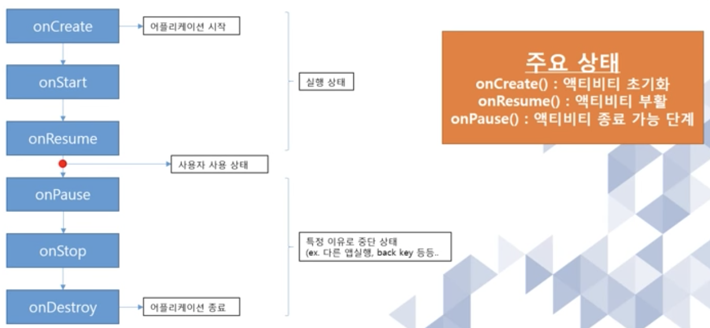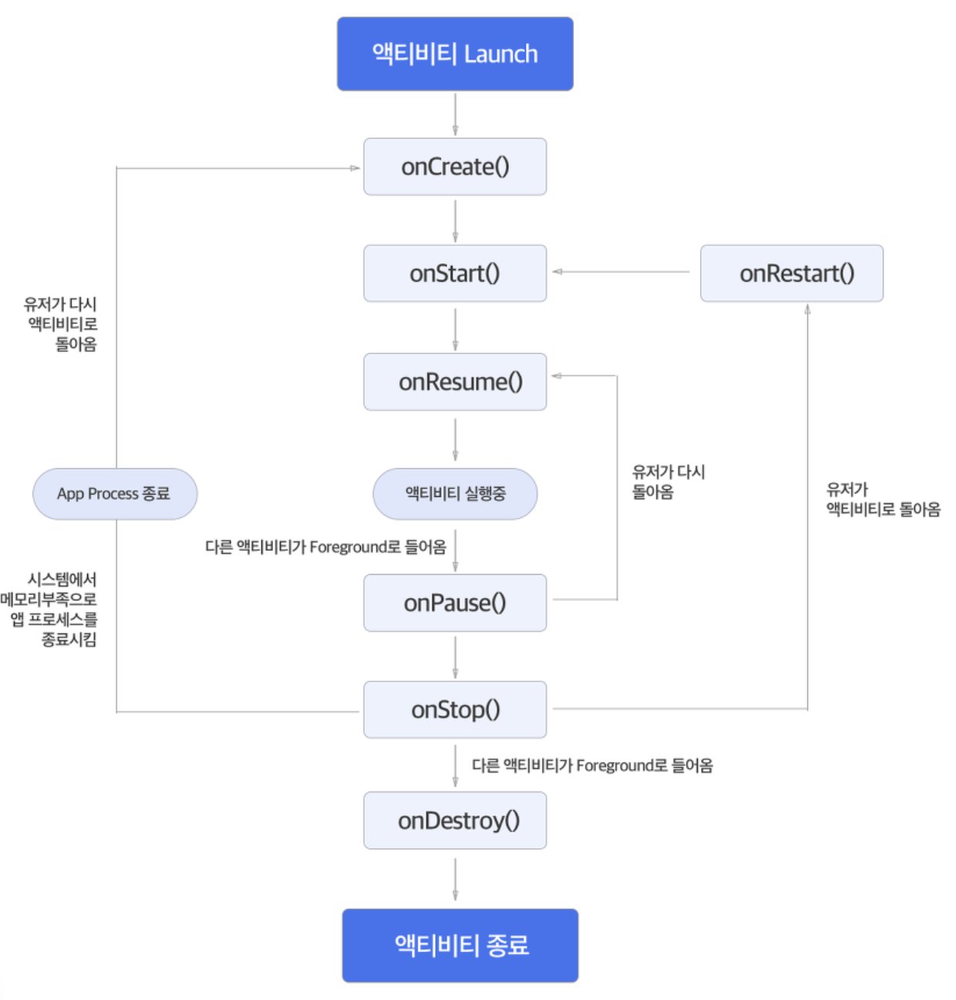 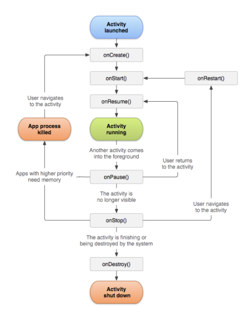

- 위의 주요상태 3개만 100% 실행이 보장된다.

  1.  onCreate: 어플리케이션이 시작하면 OnCreate가 시스템에서 호출된다. 주로 코딩을 하는 부분. 생명 탄생 (초기화)

  2.  onStart: 유저에게 액티비티가 보이도록 해준다.

  3.  onResume: 여기까지 되면, 화면이 나타난다. 이 이후 사용자 사용 상태가 된다. (부활)

> 1-3) 실행 상태

4.  onPause: 음악 재생하다 중단되듯, 잠시 홈버튼 누른 상태, 전화 온 상태. 아예 종료되지 않고 딤(화면 흐릿)처리 되어 백그라운드에 숨겨져 있다. 다시 불러 쓰면 최근 유아이 그대로 저장되어 있다. 아직 어플리케이션이 프로세스에서 내려오지 않았다. 동작 중이다. 그렇지만 화면상에 보이지 않는다. (종료가능단계 – 강제종료 시에도 반드시 거친다. 이 이후는 거치지 않을 수도 있다)

5.  onStop: 메모리 부족, 강제종료 등으로 어플리케이션이 종료 되는 경우. onPause에서의 시간은 매우 짧다. 곧바로 onStop이 호출된다. 액티비티 객체가 메모리에만 남아있고, 윈도우 메니저에는 attach되어있지 않아서, 데이터가 있다면 다시 복원할 수 있는 상태이다. 참고로 여기서 onSaveInstanceState()메소드를 호출하는데, 이 단계에서 key-value형태로 값을 저장하고 이 값은 onCreate에서 복원할 수 있다.

6.  onDestroy: finish되는 경우 호출된다. 한가지 주의 안드로이드에서 세로화면에서 가로화면으로 전환시키는 것은 내부적으로 현재의 Activity를 onDestroy하고 다시 onCreate를 호출하는 것이다.

<!-- -->

4.  화면 방향

> 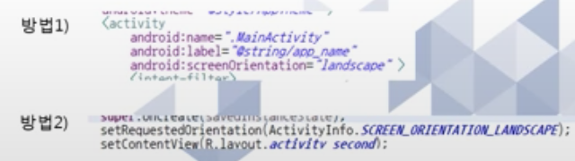­­­­

5.  추가적으로 로그 종류

> 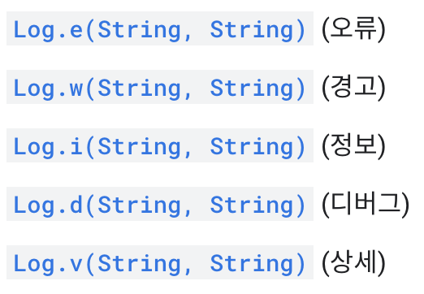

**\[16강\] 인텐트**

1.  인텐트란?

: 액티비티 전환시 정보를 전달하는 목적으로 만들어진 장치

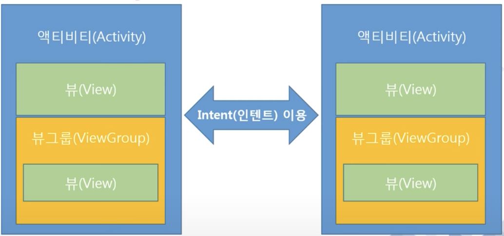

2.  인텐트 사용방법

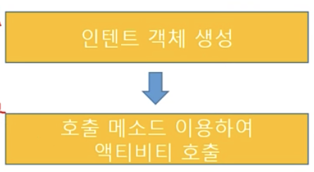 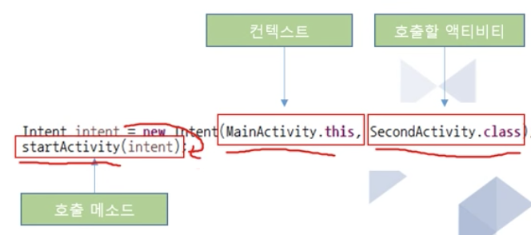

3.  인텐트 종류

    1.  명시적 인텐트: 호출 대상(액티비티)가 명확한 경우

    2.  암시적 인텐트: 호출 대상이 정해지지 않은 경우

> ex) url 터치할 경우 호출 대상을 고르라는 팝업 창이 뜬다.

4.  액티비티 통신

    1.  put Extra

> 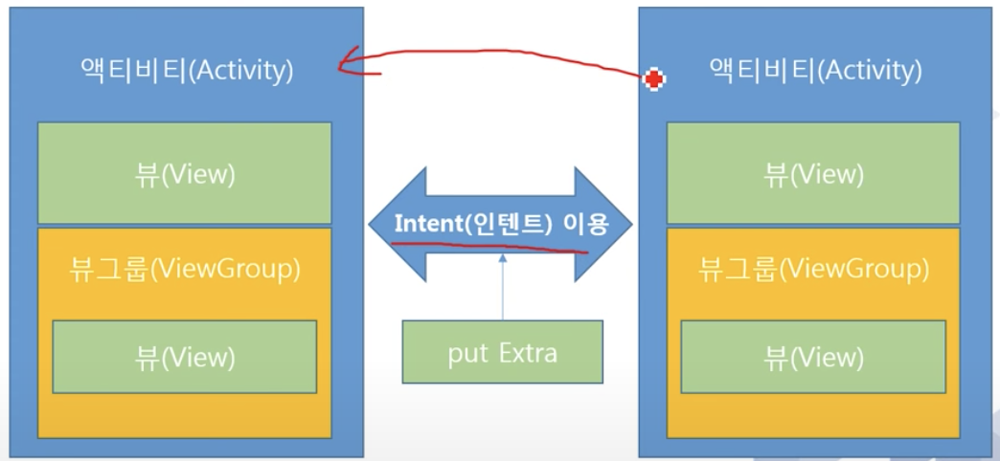

2.  getIntent()

> 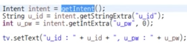

- 셋째 줄 0은 디폴트 값

**\[17강\] 프레그먼트**

1.  개요 및 구현

1\) 프레그먼트

> : 일종의 뷰로, 액티비티처럼 생명 주기가 있다. 즉, 생명 주기가 있는 뷰
>
> 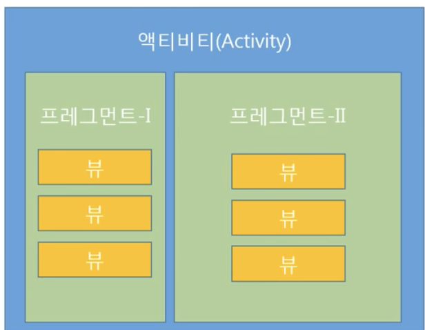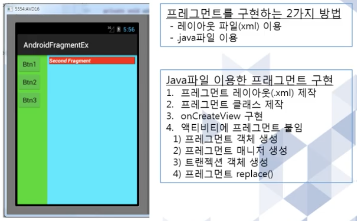

2\) 코드 구현

: extends Fragment하고 onCreateView구현하며 return view

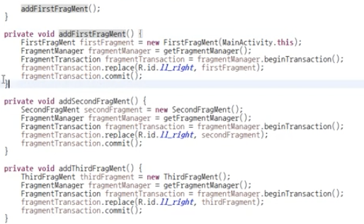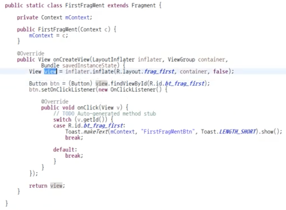

- 프레그먼트 트렌잭션: 어떤 대상에 대해 추가, 제거, 변경 등의 작업이 발생한는 것.

- 프레그먼트 매니저: 프래그먼트를 관리한다.

2.  프레그먼트 생명 주기

> : 프레그먼트 자체가 액티비티 안에 존재하므로 액티비티의 생명주기와도 연관된 주기를 추가적으로 가진다. 프레그먼트는 액티비티 위에 올라가 있을 때만 동작 가능하다. F와 A는 서로간의 메소드 호출 방식으로 사용된다. 왜냐하면, 인텐트 사용이 불가능하기 때문.
>
> 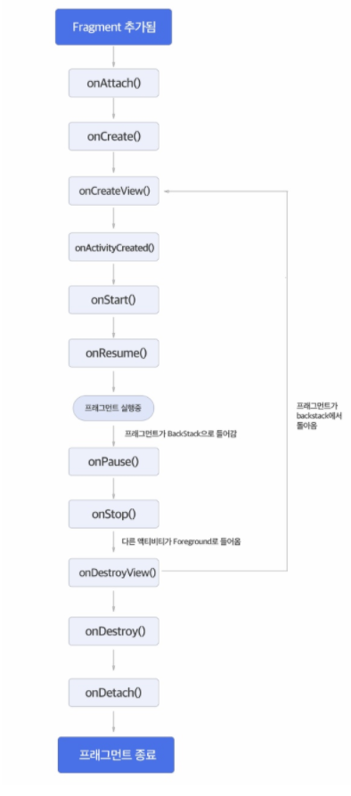

1.  onAttach(): 프레그먼트가 액티비티에 attach될 때 호출된다.

2.  onCreate(): 초기화 리소스를 초기화한다. 단, ui초기화는 진행 불가

3.  onCreateView(): 레이아웃을 인플레이트 한다. view객체를 얻어올 수 있으므로, 여기서 뷰와 관련된 버튼이나 EditText등을 초기화 할 수 있다.

4.  onActivityCreated(): onCreateView()와 액티비티의 onCreate()가 호출되고 난 후 호출된다. 액티비티와 프레그먼트가 모두 생성된 상태로 뷰를 변경 가능

5.  onStart(): 유저에게 보이게 해준다.

6.  onResume(): 유저와 상호작용 하는 부분

7.  onPause(): 프레그먼트의 부모 액티비티가 아닌 다른 액티비티가 foreground로 나오면 onPause를 콜하며 백스택으로 들어간다.

8.  onStop(): 다른 액티비티가 화면을 완전히 가리게 되면 onStop()을 콜한다. 복구 가능 상태가 된다.

9.  onDestroyView(): 프레그먼트 관련된 뷰가 제거되는 단계

10. onDestroy(): 9번에서 뷰를 제거하고 onDestroy호출한다. 생성과는 반대

11. onDetach(): 프레그먼트가 액티비티로부터 해제되어질때 호출

<!-- -->

3.  백스택 이해하기

: 프래그먼트 add하고 뒤로가기 누르면, 액티비티에서 onBackPresed()된다. 백스택을 이용하면 뒤로가기 눌렀을 때 액티비티를 종료시키는 것이 아니고 스택에 쌓여진 프래그먼트를 없애주므로 프래그먼트를 제거할 수 있다. 이는 프레그먼트 매니저 이용 자바코드로 가능하다.

4.  프레그먼트의 변경에 따른 생명 주기

: 3번 프레그먼트에 로그 있다고 가정하면,

1.  프레그먼트 3-\>1

> onPause -\> onStop -\> onDestroyView

2.  프레그먼트 1-\>3

> onCreateView-\> onStart-\> onResume

**\[18강\] 액션바&옵션메뉴**

1.  액션바

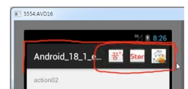

+) 툴바

: 예전에는 ActionBar가 기본으로 있었고 그것을 커스텀해서 각 앱에 맞게 변경해서 사용했다

그러다 Toolbar가 나타나게 되었다. 액션바는 Object를 상속받고, Toolbar는 ViewGroup을 상속받기 때문에 어디든 붙이기 쉽고, 애니메이션 적용도 쉽다. 툴바 사용을 위해선 액션바를 없애는 작업이 필요하다.

2.  옵션 메뉴

: 메뉴 버튼을 눌렀을 때 나오는 것

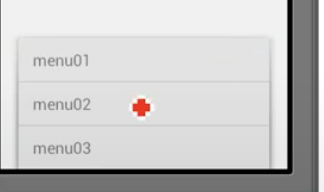

**\[19강\] 팝업 대화상자**

1.  AlertDialog: 선택

2.  CustomLayoutDialog: 간단 보이기

3.  ProgressDialog: 진행 상황

**\[20강\] 노티(Notification) 바**

1.  노티바(상태바): 최상단에 잠시 보여지는 메세지

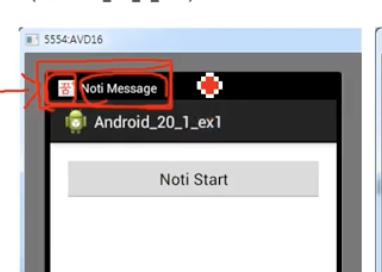

+) PendingIntent: 앱이 종료된 후에도 noti기능이 작동할 수 있도록 한다.

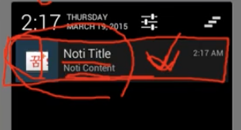

1.  Message

2.  Missed Call

<!-- -->

2.  알람

    1.  1회만 발생

    2.  주기적으로 발생

**\[21강\] 스레드-1**

1.  기본적인 스레드 구현

지금까지의 코드는 Main Thread에서 작업된다. 그러나 시간이 걸리는 작업을 할 때엔, 별개의 thread로 작업 즉, 멀티 스레드

1.  Thread 객체에 run 메소드 구현: Thread를 상속 받는다.

> 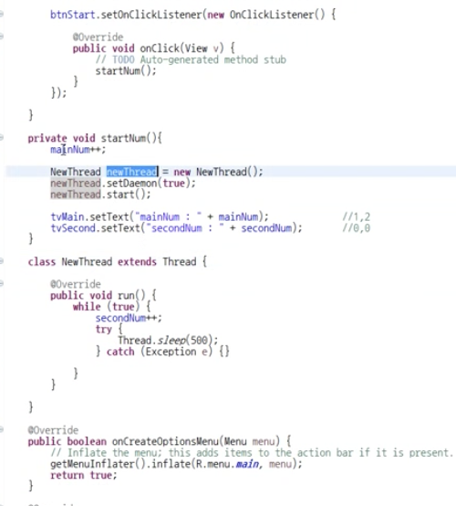

- Thread를 상속받아서 run method를 구현한다.

> NewThread를 실행하면 자동적으로 run이 실행된다.
>
> 위의 코드에서 클릭하면 숫자가 변한다. 그러나 클릭 시에만 변한다. 그 이유는 메인 스레드에서만 유아이를 변경시키고 있기 때문.

2.  Runnable 객체의 run 메소드 구현: Thread 객체 생성에 parameter로 넣어준다.

> : 오른쪽 코드는 람다 코드.
>
> 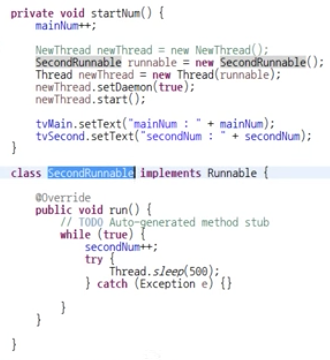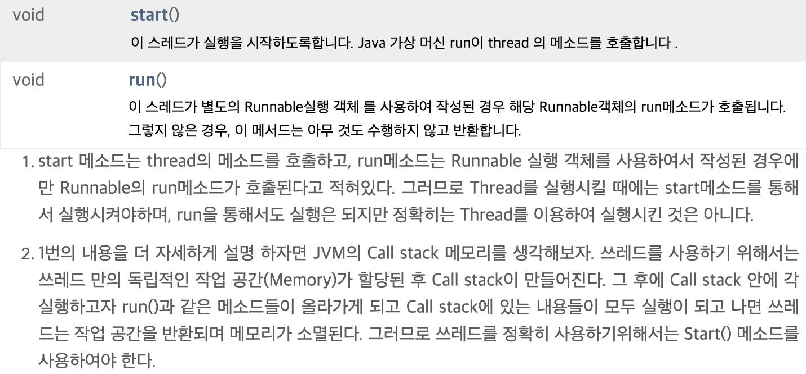
>
> 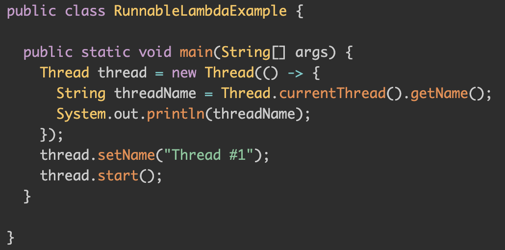

- runnable interface를 implements한 클래스를 만들고 그 객체를 생성하고, Thread 객체를 직접 생성하여 runnable class의 객체를 담아준다. runnable interface를 implements하면 반드시 run 메소드를 overide해야한다.

> +) 동일하나 thread클래스를 확장하는 것이 미세하게 더 간단하다. 그러나 다중 상속을 지원하지 않는 자바의 경우에선 확장성이 떨어진다. 반면 러너블 인터페이스의 구현 시엔 다른 인터페이스를 구현할 수 있을 분 아니라 상속도 받을 수 있다. 따라서 확장성이 중요하다면 러너블이 바람직하다. 실제로 러너블이 주로 이용된다.

2.  핸들러

: 스레드 간에 통신 매체이며, New Thread에서의 작업 내용을 메인 Thread로 전달하고자 할 경우 사용. 타 thread에서 ui를 변경하는 것은 불가능하기 때문.

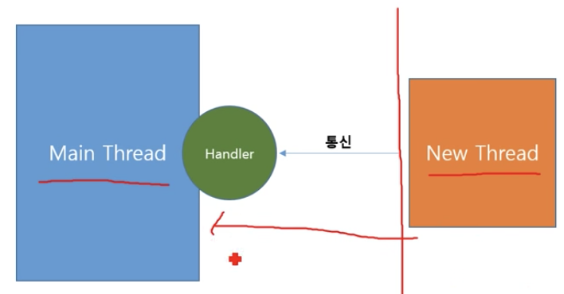

ex1)

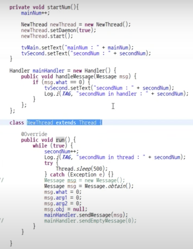

- mainHandler의 sendMessage를 호출하면, handleMessage가 자동으로 호출된다. 그 안에서 param으로 들어오는 message값을 이용해서 구분한다. 따라서 메인 thread와 통신 가능해진다

> ex2) 핸들러 사용하지 않고, new thread에서 직접 엑티비티 값 변경하는 경우 error
>
> 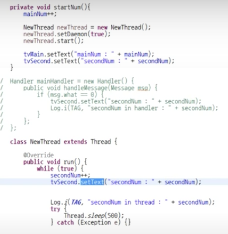

- fetal error발생!!!!! 이유: main thread( ui thread)와 다른 thread는 그냥 thread라고 하는데, ui를 control하는 것은 main thread만 가능하다. 연산은 other thread에서도 가능. 접근 방법 handle말고는 없다.

3.  메시지

: 핸들러를 통한 통신을 할 때, 메시지 객체를 이용하여 정보를 전달한다. 즉, 메세지 객체에 정보를 실어 전달한다. 즉, 핸들러를 이용할 때 담아서 주는 정보 객체이다.

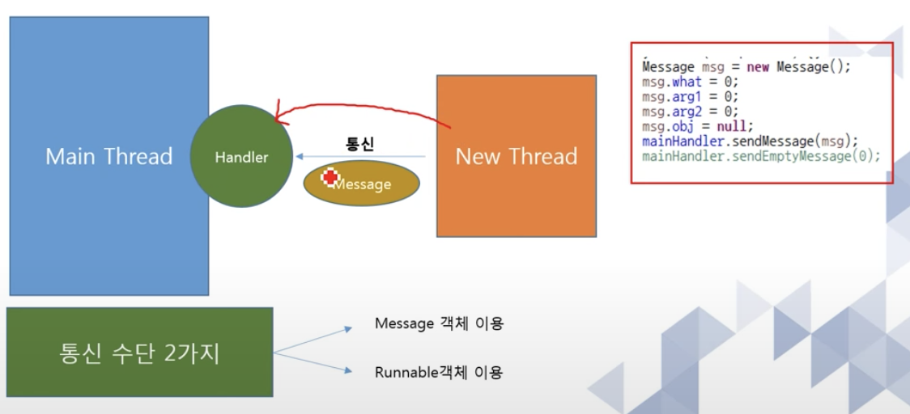

4.  runOnUiThread메소드

: 핸들러를 통하지 않고, UI thread의 작업을 진행 할 수 있다. 즉, ui thread에서 돌아가라는 뜻 그대로!

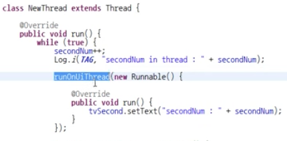

+) 메인 핸들러에 post로 러너블 전달하는 것도 가능하다.

**\[22강\] 스레드-2**

1.  스레드 클래스 분리

: thread클래스를 상속 받아 만든 thread의 파생클래스를 Main스레드의 클래스 파일과 분리하여 코딩한다.

2.  루퍼

: 메세지를 핸들러에게 전달해 주는 기계

- 큐에 쌓인 메세지 중 가장 먼저 쌓인 메세지를 핸들러로 전달해 주는 역할이다. 그러나 이는 메인 스레드에서만 자동 생성되고, 새로 만드는 스레드에는 루퍼가 존재하지 않는다. 따라서 사용해야 할 경우 직접 루퍼, 핸들러 만들어서 달아줘야 한다. (ex 메인스레드에서 새 스레드로 정보르르 줘야 하는 경우)

3.  ANR & 메세지 큐를 이용한 작업 시간 조정

: 핸들러는 큐에 쌓여있는 순서대로 작업을 진행한다. 이러한 일반적인 작업 스케줄 외에 작업수서를 다소 변경할 수도 있다.

1.  ANR: Application Not Responding : 어플리케이션이 응답하지 않는다는 에러

> input이벤트에 5초 이내에 반응하지 않을 때, 브로드캐스트 리시버가 10초 이내 실행 완료되지 않을때-\> os가 관여하여 anr창을 띄운다. 즉, 메인 스레드가 일정시간 어떤 테스크에 잡혀 있을 때. 그러나 요즘은 메인 스레드에서 오래 걸리는 작업 코드도 못짜게 되어있다ㅏ.

2.  먼저 들어온 일 일정한 시간 뒤에 작업하기 나중에 들어온 일 먼저 작업하기

> : sendMessageDelayed를 이용하여 메세지를 큐에 넣는 작업을 딜레이 시킬 수 있다.
>
> 왜? 팝업창 뜬 상태로 계속 잡고 있으면 안되므로. 일단 팝업창은 사라지게 한다.
>
> 

**\[23강\] 스레드-3**

1.  AsynchTask

: 지금까지 살펴본 thread의 경우 UI를 관리하는 메인스레드 외에 백그라운드 스레드에서 메인스레드의 UI를 접근하려면 핸들러를 사용했다. 즉, 새로운 스레드를 만들고 핸들러를 만들어서 통신했다. 그러나 이러한 여러 작업을 Android OS에서는 AsyncTask객체로 만들어 두었다. 즉, 클래스 하나에 thread와 handler의 기능이 콜백 메서드로 모두 존재한다.

1.  onPreExecute(): run이 실행되기 전에 준비단계(바로 직전)

2.  doInBackground(): run 안에 기술하는 부분(시작 되자마자)

3.  onProgressUpdate(): 작업이 진행되어지는 양이 업데이트(진행중)

4.  onPostExcute(): (스레드의)작업이 끝난 이후, 호출(끝나고)

5.  onCancelled(): 작업이 중간에 stop되었을 때 호출(stop)

- 이는 내가 구현하는 것이 아니고 override만 하면 된다.

**\[24강\] 브로드캐스트 리시버**

1.  브로드케스트 리시버

: OS는 여러 가지 상황에서 다양한 메시지를 방송(브로드캐스트) 한다. 예를 들어, 배터리 부족, 전원 공급장치 변화, 네트워크 환경 변화 등등이 이에 해당한다. 이러한 시스템의 환경 변화에 따른 방송을 응용프로그램에서는 항상 참고하여 적절히 대응해야 한다. 응용프로그램에서 시스템의 방송에 귀를 기울이는 것은 BR(브로드캐스트 리시버) 라고 한다.

- 응용 프로그램에서는 관심이 있는 BR에만 반응한다. 즉, OS에서의 발신을 브로드캐스트라고 하며, 응용프로그램에서의 수신을 브로트캐스트 리시버라고 한다.

2.  브로트케스트 리시버 구현

1.  위 코드와 함께 manifest.xml에 리시버 등록한다.( 더 많이 사용한다.)

> 
>
> if else문을 통해 필요한 브로드캐스트만 처리
>
> intent-filter에 받을 브로트캐스트 정의해준다.

2.  위 코드와 함께 Java파일에 receiver 등록(onReceive함수)한다.

> 

3.  sendBroadcast(송신)

: 응용 프로그램에서 송수신 전부 한다. OS에서 송신된 내용을 개발자가 수신할 수도 있지만, 개발자가 직접 송신을 할 수도 있다.

- 

실행시키면, manifest에서

찾는다.

**\[25강\] 데이터-1**

1.  Files디렉토리를 이용한 I/O

: 영구적으로 관리해야 되는 데이터가 있는 경우 안드로이드에서 제공하는 files폴더를 이용하여 데이터를 관리할 수 있다.

2.  Resources를 이용한 데이터 처리

3.  프리퍼런스(SharedPreferences)

: 데이터 영구 관리. 모든 액티비티에서 공유해서 사용 가능. 초기값 설정 또는 초기값 관리 용도로 사용

**\[26강\] 데이터-2**

1.  Token파싱

: 로컬 또는 네트워크 상의 데이터를 이용할 때 데이터의 상태에 따라 적절히 파싱해야 한다. 토큰은 가장 오래된 방법으로 가독성이 떨어져 사용 빈도가 줄어들고 있다. 그러나 간단한 데이터에는 사용

2.  XML파싱

: 데이터 분류에 용이하지만 데이터가 커지면 속도가 급격하게 느려진다.

3.  JSON파싱

: 가독성과 속도 문제를 한번에 해결한 형태이다. 현재 가장 많이 사용한다.

**\[27강\] 데이터베이스**

1.  SQLite

: 소형 디바이스에 최적화 된 가벼운 DB이다. 안드로이드에서는 SQLite라는 경량급의 DB를 사용한다. 이는 RDB다. 기본적으로 안드로이드 프레임워크에 라이브러리와 함께 포함되어있어 별도의 설치 없이 사용가능하다. C언어로 되어있다. 오픈 핼퍼, 핼퍼 클래스 상속받아서 정의하면 된다.

2.  CP(Content Provider)

: 내가 가지고 있는 DB를 다른 어플리케이션에 공개하는 방법. A어플에서 가진 데이터를 B어플에 공유하는 방법.

**\[28강\] 맵(구글 맵)**

1.  맵을 이용하기 위한 설정

1.  SHA 키 인증 값을 구글 서버에 등록한다. -\> 인증 절차

2.  구글 사이트에 접속하여 code.google.com

3.  google map android API

> 

4.  새 키 만들기

> 

5.  키 선택

6.  인증서지문, 패키지명 쓴다.

> 

7.  이클립스에서 import -\> browser -\> AppData-\> android-\> google-\> googlePlayservice import

8.  Google Play Services 라이브러리 추가

> 

9.  메니페스트 설정

> 

2.  위치 추적(트래커)

    1.  위치 추적

> 

- 구글 맵을 불러온 후 지도를 내가 위치한 곳, 특정 곳으로 이동한다. 최초 마커를 설정한다. 위치 제공자는 안드로이드 프레임워크 라이브러리에 있다. 이를 구하고 위치 정보 리스너(단말과 네트워크 서비스에서 오는 값과 비교) 등록한다.

> ex)
>
> 

- 위경도 구해서 (LatLng객체로 구한다) 이후 객체를 moveCamera에 넣어주면 이동한다.

- 마커(크래커)는 MarkerOption객체를 이용한다.

> 

**\[29강\] 네트워크**

**:** 네트워크상에 있는 데이터를 다운로드하는 방법 (API사용)

1.  HttpURLConnection

- 윗 부분은 네트워크 접속/아래부분은 데이터 읽어 오기

2.  서버 JSON파일 가져오기

:서버에 데이터를 요청하고 응답 받은 데이터를 파싱하는 방법

3.  이미지 다운로드

:문자가 아니므로 바로 출력한다.

**\[30강\] 마켓**

1.  앱 서명(Sign)

: 앱을 마켓에 등록하기 위해서는 보안상의 이유로 앱을 서명해야 한다. 우리가 PC상에서 볼 수있는 공인인증서 정도의 보안장치라고 생각하면 된다.

2.  마켓 등록(Google Play Store)

> 1\) Exprot
>
> 2\) Keystore selection: 보안 키 값을 만든다.
>
> 3\) Alias정한다. 지속 년도 정한다.
>
> 
>
> 4\) 구글이 운영하는 마켓(Google Play Store)에 서명된 앱을 등록하기 위해서는 우선 구글 개발자 등록을 해야 한다. (최초 한번 25\$비용 발생)
>
> 
>
> 5\) 서명된 앱을 업로드 한다.
>
> : apk와 캡쳐 화면 2개 이상 필요하다.
>
> 
