\<1-2강\>

1\. CPU performance

- 무어의 법칙 : 반도체 메모리의 성능, 속도는 적용되지 않는다. (반도체 용량, CPU성능만 적용된다.)

- 어떤 비행기가 좋을까? 속도, 탑승객 수, 가격 그때그때 중요하게 고려하는 성능이 다르다.

- **Response time** (= execution time = elapsed time) : 어떠한 작업을 시작한 후 끝날 때까지 걸리는 시간

- **Throughput** (= bandwidth) : 단위시간당 처리되는 작업의 양

- **Performance** = 1/execution time

- **CPU time** = User CPU time + System CPU time

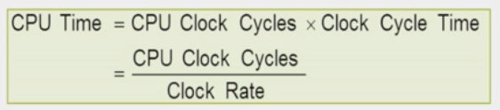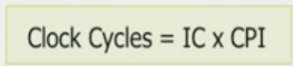

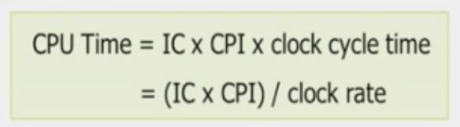

- CPU performance = 1/CPU 실행 시간.

- **IC** (instructions count) = 프로그램을 수행하는데 필요한 instruction개수

- CPU time = 프로그램을 실행시키는데 걸리는 시간 (동일한 일에 CPU time 이 적을수록 성능이 좋은 것.)

- CPU clock cycle = instruction count = 어떤 일을 수행하는데 CPU가 몇 개의 clock을 사용하는지

- **Clock cycle time** = 한 clock당 수행 시간

- Clock rate = Clock frequency = 클럭 속도( 보통 rate를 많이 사용한다. )Hz로 나타낸다.

- **CCT** = CPU clock cycle \* clock cycle time = **1/clock rate**

- Instruction count = 프로그램 실행을 위해 사용한 instruction 개수 (명령러 실행 개수)

  (여러가지 영향을 받으며 달라질 수 있다. 컴파일러, 프로그램, 명령어 수)

- **CPI** = Average Cycles Per Instruction = 한 명령어 당 평균 몇 클락 걸렸는지

  (CC / instruction개수)

> 따라서, 컴퓨터의 성능을 개선하려면
>
> 1\) instruction count를 줄이거나( 똑같은 일에 필요한 명령어 개수를 줄이거나)
>
> 2\) CPI를 줄이거나 (명령어 하나 당 필요한 clock수를 줄이거나)
>
> 3\) 클락을 빠르게 하거나
>
> -\> 그러나 서로 엮여 있어서 하나를 좋게 하면 다른 쪽이 나빠지는 관계가 있다. 주의
>
> 80년대 중반까지는 instruction의 개수를 줄이기 위해 큰 트럭 사용-\> 다른 효율 나빠짐
>
> 공학적으로 분석하여 쓰면 IC와 CPI에 영향을 미치는 것은,
>
> 1\) 알고리즘. 명령어에 따라 클락 수가 다르다.
>
> 2\) 프로그래밍 언어. 어떤 기계어를 주로 사용하느냐
>
> 3\) 컴파일러. 어떻게 기계어로 번역하느냐
>
> 4\) ISA(instruction set architecture)

2\. Instructions

- Instructions = 기계어의 단어

- 프로세서가 실행하는 하나의 작업 즉, CPU는 instruction하나씩 실행한다.

- ISA( instruction set of architecture) = 실행할 수 있는 명령어의 집합

- Instruction = Opcode(무슨 일을 할꺼냐) + Operand(어떤 데이터로 할꺼냐)

3\. RISC & CISC

80년대에는 SW 언어와 기계어 간의 격차(시맨틱 갭)을 줄이기 위해 연구했지만 효과 없다.

1)  RISC = reduced instruction set computer

복잡한 명령어를 제거하여 CPU time을 줄이고, CPU performance를 향상시키는 방식 즉, 명령어 자체가 축소되고 간단하다.

모든 연산은 하나의 클럭으로 실행된다.

ex) MIPS(Microprocessor without Interlocked Pipeline Stages: 밉스 테크놀로지의 RISC ISA), ARM

2)  CISC = complex instruction set computer

    명령어(instruction)를 복잡하게 만들어 명령어의 개수를 줄여 CPU time을 줄이고, CPU performance를 향상시키는 방식 그러나, 반도체의 크기 중 복잡한 명령어의 사용 빈도는 10%인데, 80%의 자원을 투자한다 알게 됨-\> 중지

    4\. MIPS

- Opcode + Destination operand 먼저 쓴 후 source operands 쓴다. (sw제외) 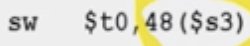

- 모든 명령어의 길이가 32bit ( 4B )

- Source와 destination은 레지스터이다.

- 32개의 register가 있다. (대표적으로 변수 저장 s0…s7까지 8개, 임시 저장 t0…t9까지 10개)

  - Smaller is faster= 레지스터가 적으면 clock이 빨라진다.

- lw = load word = 메모리에 저장되어있는 값을 register에 load

- sw = store word = register 32bit를 메모리에 저장

- addi(add immediate) = 상수 직접 나온다. Operand중 하나를 상수로 한다. (**subi없다, 상수는 \$없다 주의**)

- g = h + A\[8\]의 표현 ( base address에 n을 더해서 나타낸다.)

  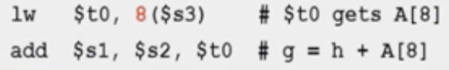//32로 써야 맞다.

  1\) lw \$t0, 32(\$s3) // \$s3+8의 의미이다. 8\*4(**바이트 어드레싱 이므로 \<-\> 워드 어드레싱**)

  2\) lw \$t0, 308 //308에 A\[8\]있다고 가정(직접 주소)

  tip) for문을 구현한다고 생각할 경우 확실히 1)이 편하다.

<!-- -->

- lui(load upper immediate) instruction

  \$s3 에 FF33 A098넣으려 한다. 그런데 이미 FF33 A098가 32bit이다. 따라서 2개로 나누어 진행.

  lui로 왼쪽 절반에 데이터를 넣을 수 있다. ori(or immediate)로 오른쪽 절반 넣는다.

  5\. Alignment restriction (= memory alignment)

<!-- -->

- nB의 메모리를 항상 n의 배수로 시작하게 하는 것. (MIPS는 Alignment 사용한다. )

- Aligned하지 않을 경우(Pentium) 성능이 떨어질 수 있다. 아래의 사진에서 두 번 메모리 읽어야하는 경우가 생김.

  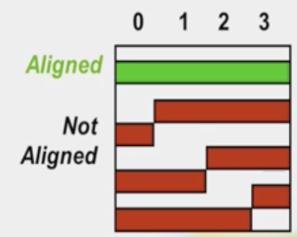

  \<3강\>

  6\. Endianness문제

  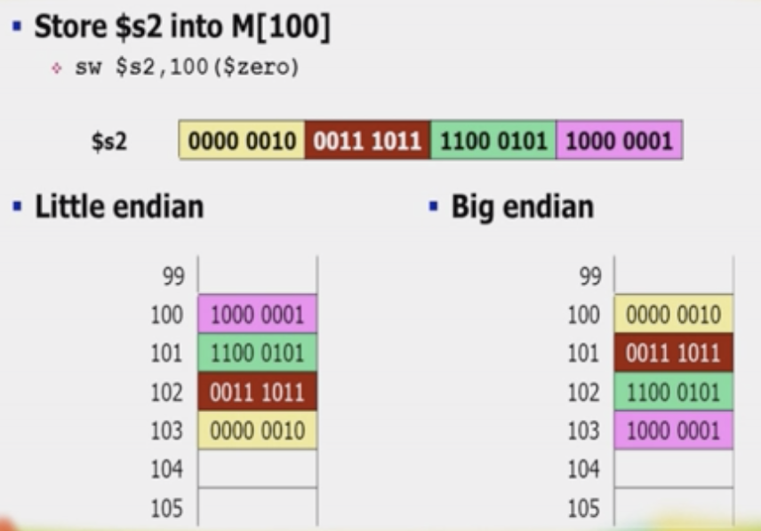

<!-- -->

- 주소 4개여서 생기는 문제이다.

- Big endian = 최 상위 바이트를 대표 주소로 사용. (MIPS)

- Little endian = 최 하위 바이트를 대표 주소로 사용. (Pentium)

- Bi endian = 선택가능

<!-- -->

- **메모리 관련해서 Byte addressing/Alignment restriction/Endianness 총 3 가지의 문제가 있다.**

Tip) Amdahl(암달)의 법칙 = common case를 개선해야 효과가 좋다.

7\. machine instruction

- RISC에서는 모든 명령어가 32비트이다.

<!-- -->

- MIPS에서는 word size가 32bit이다. 주소도 32bit

- 5개의 addressing = **immediate, register, base, PC-relative, pseudodirect**

- **3개의 type**

8\. R - type(register type)

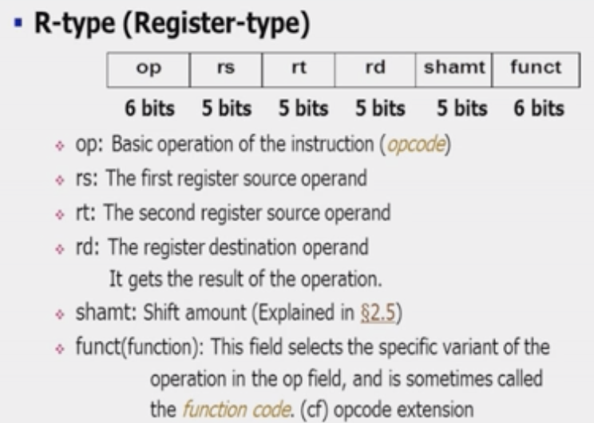

Shamt : shiftleft, shiftright 할 때 몇 자리 이동할지

s다음 알파벳이 t이므로 rs다음 rt

9\. I - type(immediate type)

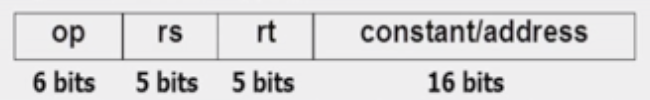

- Constant에 16bit에 -2의 15승부터 +2의 15-1까지 나타낼 수 있다.

- Add, sub, addi, lw, sw가 I type에 해당한다.

- 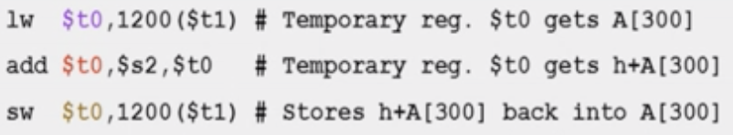

\<4강\>

10\. shift operation 3가지 존재한다.

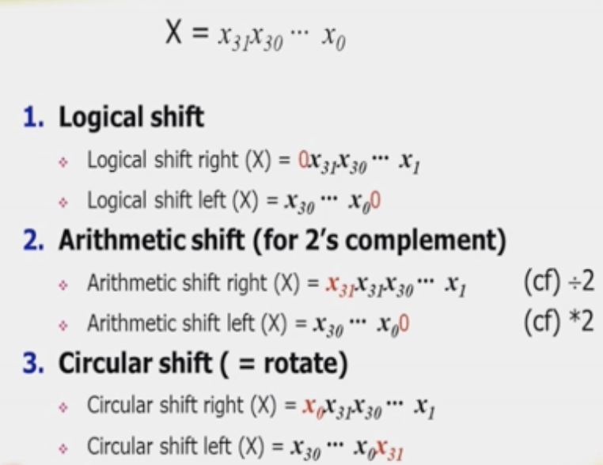

- MIPS에서는 sll(shift left logical), srl, sra(shift right arithmetic)

11\. conditional branch (=jump) instruction (조건부 분기)

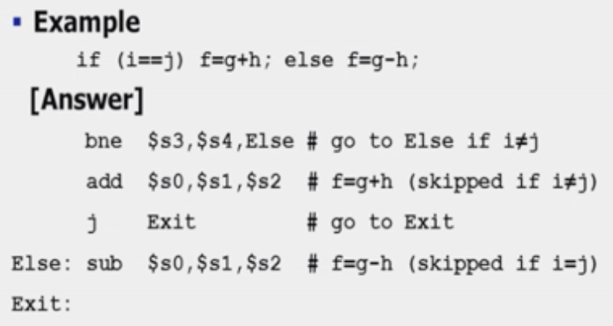

bne, beq, jr(jump register) **= PC relative addressing**

12\. J-type instruction format

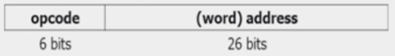

실제 메모리 주소는 32bit이다. 어떻게 집어넣나? (32-26 = 6bit줄여야 한다.)

- 4의 배수이므로 맨 끝자리는 항상 00이다. -\> 끝의 00을 빼면 /4와 같은 효과 -\> **word Addressing (-2)**

- 굉장히 먼 거리로 jump하지 않을 것이므로 PC에서 4비트 가져온다 -\> **PC-relative Addressing (-4)**

- 현재 주소 기준으로 (PC+4)+-2^15 가능

\<5강\>

Ex) Showing Branch Offset

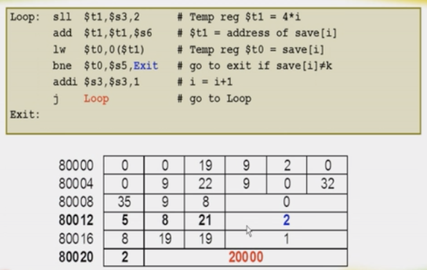

- 왜 2인지? 80024-80016 =\> 8(/4)=2

- 왜 20000인지? 80024-\> 80000으로 가야한다. =\> 8000(/4)=2000

  0000 /**0010/00 00/00 00/00 00/00 00/00 00/00 00**/00

13\. Decoding machine language

- R-type

  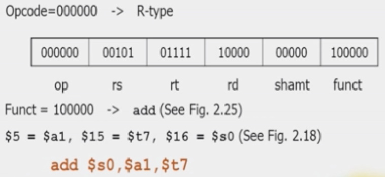

14\. Addition and Subtraction

- MSB : 가장 앞의 bit(Most significant bit)

- LSB : 가장 뒤의 bit(Least significant bit)

- 2^32까지의 숫자 나타낼 수 있다(양수만 나타내면)

- -2^31부터2^31(음수 포함)

15\. 음수 나타내기

1)  **MSB를 부호로** 사용한다. -\> 연산할 때 불편

2)  **1의 보수** (a+b = 1)로 바꾸어 사용한다. b는 a에서 숫자를 다 뒤집는다.

- **end-around carry문제 발생**

3)  **2의 보수**를 사용하면 문제 해결-\> 1의보수+1

- **+0=-0 이므로 0이 1개가 된다. 더불어 2^31-2를 나타낼 수 있게 됨.**

16.Overflow

- Overflow나는지 detection = **CarryInto MSB != CarryOut from MSB 면 Overflow**

  Ex) 7 + 7 = 0111 + 0111 = 1110 = -2 (overflow)

- 부호가 다를 때는 Overflow가 안 생긴다. (**항상 CarryInto MSB == CarryOut from MSB)**

\<9강 MIPS Processor\>

**CPU가 하는 일은 1, 2, 3의 반복이다**

1\. instruction fetch (=**instruction을 메모리에서 CPU로 가져오는 것)**

-\> PC를 instruction 메모리에 보내고 read, READ 시그널을 보낸다. PC = PC + 4 (adder)

2\. decoding (=**opcode를 보고 명령어 알아내는 것)**

-\> Opcode decoding 과 더불어 Register prefetch

3\. opcode 에 따른 실행

- Memory-reference instruction: **lw, sw (I-type)**

<!-- -->

- ALU연산 후 결과를R에 write

<!-- -->

- Arithmetic-logical instruction: **add, sub, and, or, slt (R-type)**

<!-- -->

- +면 앞에 0, -면 앞에 1 붙여준다. = Sign extention

<!-- -->

- Branch instruction: **beq, j (J-type)**

**+) Harvard architecture : instruction M와 data M가 구분되어 있는 architecture \<-\>Princeton architecture**

17\.

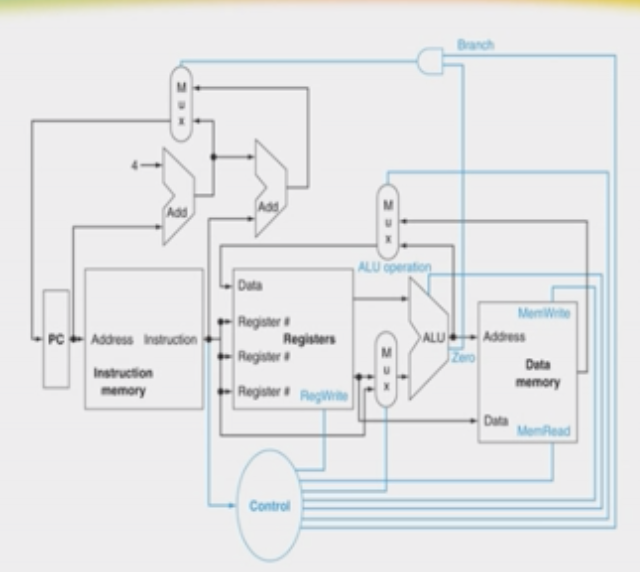 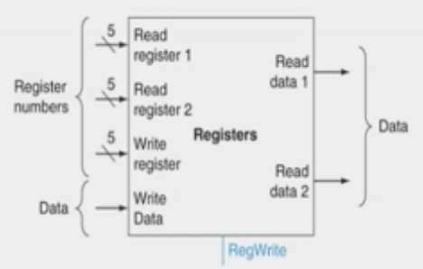

중간중간 line이 겹치는 부분 =\> 멀티플렉서 처리

18\. CPU performance = IC \* CPI \* Clock cycle time

- CPI 는 모두 1인데 (instruction하나 당 1), Clock cycle time이 굉장히 오래 걸린다.

<!-- -->

- **Single-cycle datapath**

  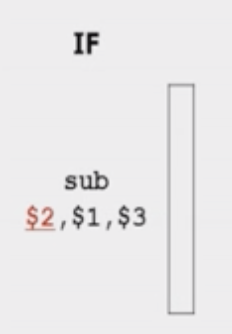**-\>** 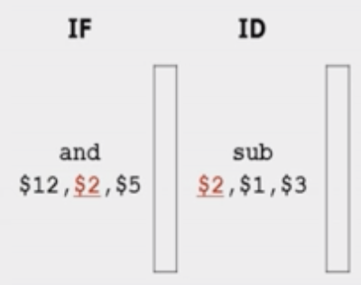**-\>… -\>** 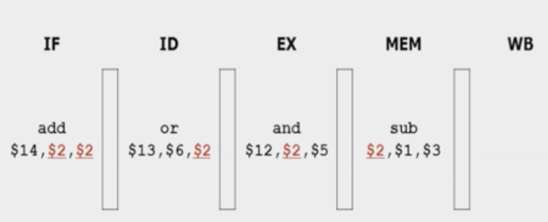

<!-- -->

- 가장 오래 걸리는 연산으로 Clock cycle time을 잡아야 한다. (시간 낭비, 비효율적)

<!-- -->

- **Multi-cycle datapath** = CPI를 늘려서 잘게 쪼개고(단계 하나 당 1) 대신 Clock cycle time을 줄여서 효율 증가시킨다.

  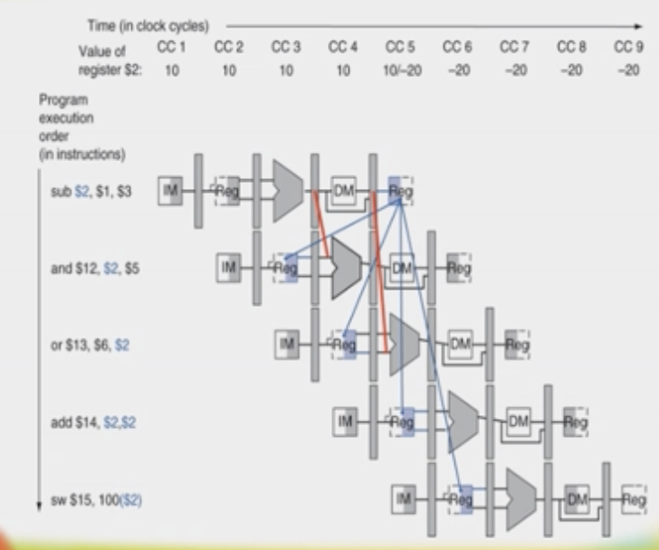

18\. **Pipelining**

: 프로세서에서 성능을 높이기 위해서 명령어 처리 과정으로 명령어 처리를 여러 단계로 나누어 단계별로 동시에 수행 하여 병렬화를 시켜 throughput을 증가시키는 방법.

- ILP(Instruction level parallelism)을 허용하는 기술. 즉, instruction수준에서의 병렬성을 허용하는 기술

- \+ ) superscalar : CPU내에 파이프라인을 여러 개 두어 명령어를 동시에 실행하는 기술

- Latency (각각의 명령어 수행 시간)가 줄어들지는 않지만, throughput(시간 당 처리하는 instruction수)가 증가한다.

- 가장 오래 걸리는 단계로 clock cycle time을 잡아야 하므로

  **1) 일 안하는 cycle생긴다. 2) 빨리 끝나는 단계에선 낭비되는ps(피코)가 있다.**

  **따라서 Pipeline stage개수만큼의 성능 향상을 얻을 수 있지만, 실제로는 조금 떨어진다.**

\` 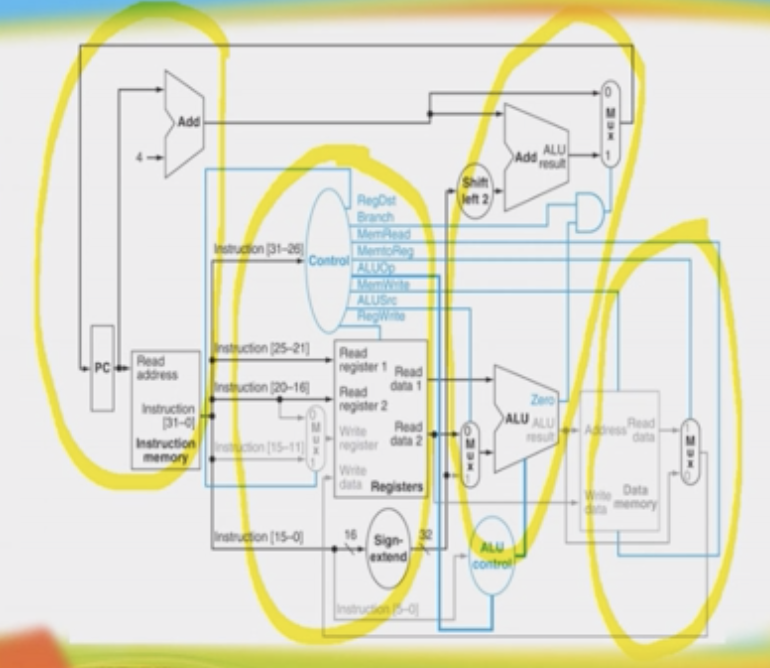

**1) IF(Instruction fetch): 명령어 fetch**

**2) ID(Instruction decode and register file read): 읽고 decoding (control unit과 Register free fetch)**

**3) EX(Execution and address calculation - ALU operation): 주소 계산과 ALU연산**

**4) MEM(Data memory access - Data access): 데이터 메모리 접근 (lw, sw만)**

**5) WB(Write back - Register write): 결과를register에 작성**

19\. Pipeline Hazards

: 다음 stage로 넘어가지 못하는 상황 (= Pipeline stage개수만큼 성능 향상을 얻을 수 없는 이유 )

1\) Structural hazards: 서로 다른 stage의 명령어들이 같은 resource를 사용하려 하는 경우

-\> 문제점: bubble이 생기고 stalling(정체)된다. (MIPS에서는 발생하지 않는다)

-\> 해결: instruction M와 data M 따로 분리한다. 즉, pipeline을 잘 설계하면 structural hazard는 발생하지 않는다.

**2) Data hazards: 앞 명령어의 실행 결과를 다음 명령어가 사용해야 하는 경우(데이터 의존성)**

**3) Control hazards: branch가 있는 경우**

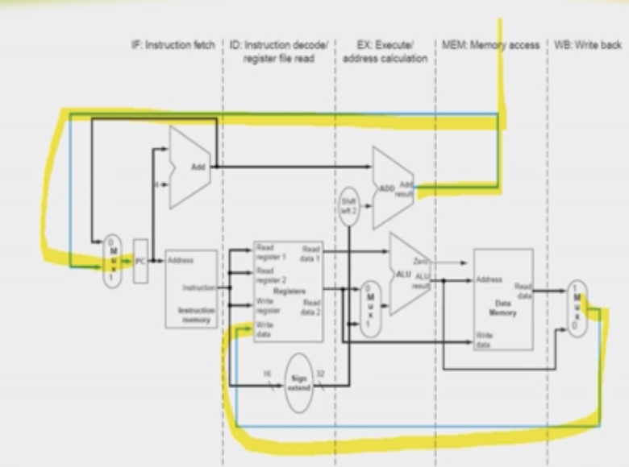 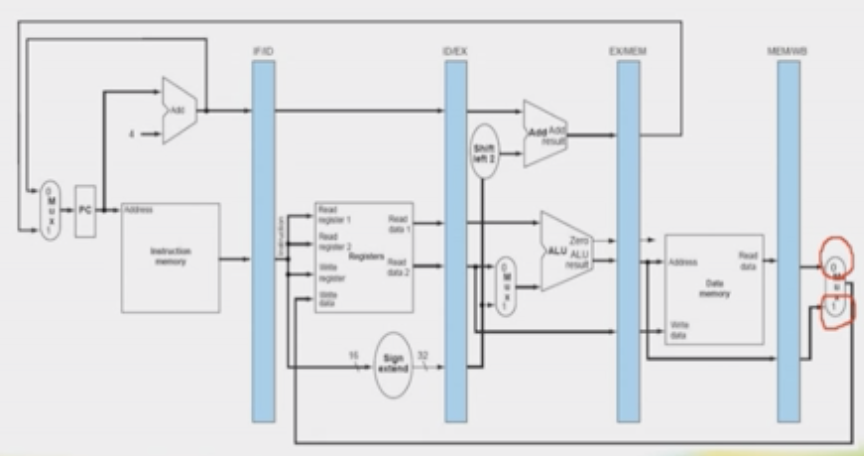

2+) Data dependence가 있으면, hazard가 발생할 수 있다. (무조건 발생은 아님)

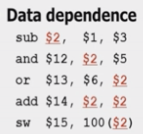 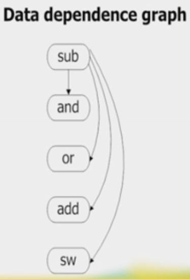

1)  위의 예시에서 sub-\>and의 \$2 = **RAW hazards** (read after write hazards)

2)  명령어가 순서대로 실행되지 않을 경우, **WAR hazards** (Write after read hazards)도 있다.

3)  **WAW hazards**도 있다. 같이 쓰는 경우. (output dependence)

20\. hazard의 solution

1)  **Stalling**: bubble을 삽입한다. 가장 기본적이지만 clock낭비+HW가 필요한 해결책

- 성능 손실이 있다. Clock낭비+HW낭비

  **Pipeline interlock** ( =hazard를 detect하고 해결될 때 까지 pipeline을 정지시킨다.)

2)  **Insert nop:** 컴파일러가 미리 알고 bubble위치에 nop추가한다.

    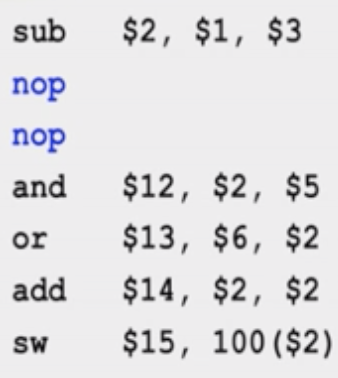**//nop(=no operation)**

- Clock낭비는 있지만, HW가 필요 없고 SW에서 처리 가능

3)  **Scheduling:** 컴파일러가 순서를 바꿔서 dependency가 없는 instruction먼저 처리한다.

    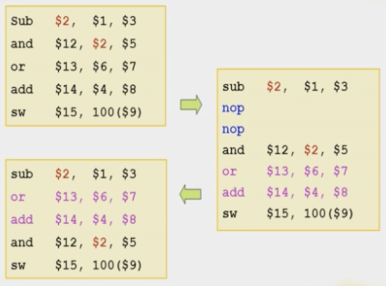//위의 2+ 3개의 dependency없어야 가능하다.

    **+) 컴파일타임에 컴파일러가 하므로 static scheduling \<-\> 런타임에 HW가 하면 dynamic scheduling**

- Clock낭비도 없고, HW가 필요 없고 SW에서 처리 가능

4)  **Forwarding(=Bypassing): R에 저장하기 전에 계산 완료된 값을 명령어들끼리 주고받는다.** (MIPS가 실제로 사용하는 방법)

21\. data hazard conditions 4가지 detection //**(IF-ID-EX-MEM-WB)**

Type1a) EX/MEM.rd = ID/EX.rs

Type1b) EX/MEM.rd = ID/EX.rt

Type2a) MEM/WB.rd = ID/EX.rs

Type2b) MEM/WB.rd = ID/EX.rt

**+ 단, 앞의 instruction의 RegWrite=1이어야 한다. (0이면 hazard아니다.)**

**+ 0번 register는 무시한다. (0번 register에 write해도 값이 바뀌지 않는다. )**

- **Hazard발생 시 type에 따라 Forwarding unit A, B가 01,10 된다.**

**+ type2가 발생하려면, Double Data hazard상황이 아니어야 한다.**

22\. Double Data hazard

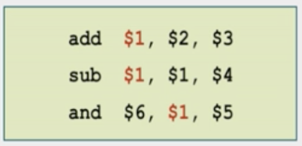

1)  add와 and간의 type2 hazard -\> ForwardA =01

2)  sub과 and간의 type1 hazard -\> ForwardA =10

- 모순이 발생한다.

- type1과 type2가 동시에 발생하면, type2를 무시한다. (최근 값이 우선)

23\. Load-use data hazard

: lw후 R의 data를 사용하는 경우, 3 stage완료 후 값을 얻을 수 없다. 4 stage에서 메모리에 접근해야 값을 읽어온다.

- Forwarding으로 해결할 수 없다. (forwarding은 3완료 후 값을 얻는다는 가정이었으므로)

- **Pipeline 1 cycle stall이 필요하다.(control signal이 0 이 되게 하여 제자리에 있게 한다.)**

- **Control signal이 모두 0이면 bubble (=nop)**

- **lw의 목적지 R은 rd가 아니고 rt이다 주의**

24\. Delayed Load

: load-use data hazard를 해결하기 위한 SW solution

= load와 상관이 없는 independence instruction을 오게 하여 bubble을 넣지않게 하는 것.

26.control hazard의 해결

1)  Stall on branch: stage2의 decoding결과로 beq, bne가 나올 때까지 bubble만 만든다.

- **Branch penalty 3 clock발생.**

2)  Delayed branch

3)  Branch prediction: 확률이 높은 쪽의 instruction을 fetch한다.(정확도 90~95%나 된다.)

- 틀리면 pipeline에 들어온 잘못된instruction 지운다.

- branch penalty를 줄여보자. **Branch penalty 1 clock으로 줄임.**

  **R다음에 전용 comparator을 두고, branch target Address계산을 1 stage앞당김**

  **1) branch execution을 2 stage에서 한다.**

  **2) branch adder을 2 stage에 둔다.**

  **-\> 잘못 들어온 명령어를 지울 땐, 명령어를 nop로 바꾼다.(FF의 clear,즉 전부 0으로 바꾼다)**

27\. CPI계산하기

Hazard없다고 가정할 때, 기본CPI=1이다.

Branch가 나타날 확률 17%(예측이 맞을 확률), 나타나면 1 clock delay -\> 17% delay

Average CPI = 1 + 0.17\*1(=branch penalty) = 1.17

- MEM에서 실행하면 0.17\*3이 된다.

- 예측 확률을 높여서 효율 높이자.

28\. branch prediction

1)  Static branch prediction

    : compile time에 예측한다. 이 프로그램과는 상관없이 통상적인 통계 이용.

    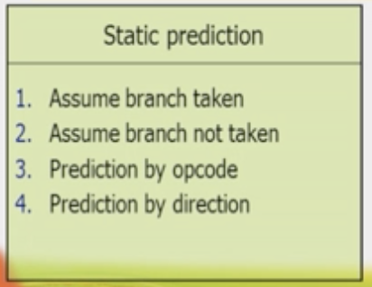

    //3은 과거의 프로그램을 분석해서 컴파일러의 습성을 파악하여 확률적으로 많은 쪽으로 예측하는 방법

    //4는 역방향은 보통 branch함을 이용하는 방법(loop의 습성)

2)  Dynamic branch prediction

    : run time에 예측한다. 이 프로그램의 결과(**BHT:branch history table) 이용**. (처음 실행 시에는 알 수 없다.)

    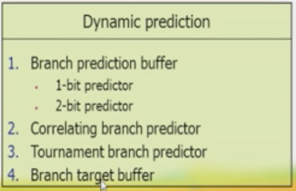

- BHT의 크기가 문제.

  : 주소 중에 일부만 (하위 10~12bit) BHT로 만든다. ( 주소 4의 배수이므로, 뒤는 항상 00이다.)

  **+) Aliasing문제 발생 가능 ( 주소 일부만 같은 다른 주소의 충돌) but, 1% 정도로 별 차이 없다.**

- **예측이 틀리면 pipeline비우고 표를 바꾼다.**

1\) 1-bit predictor (0과 1)

2\) 2-bit predictor(00, 01, 10, 11): 연속성 기록

3\) Correlating branch predictor: 프로그램 안의 branch들과의 연관관계 이용

> 3\) Delayed Branch
>
> : branch명령어의 의미를 다시 정의한다. Branch의 조건이 한 명령어 뒤로 지연된다. Safe instruction(항상 실행되는 명령어)을 먼저 실행한 후 branch를 실행한다.

- **Branch하든 안하든 penalty 없다.**

- **간단하고 효율적이나, pipeline이 길어지고 superscalar되면서 branch delay가 길어졌다.**

29\. Exception & interrupt

: 실행중인 program이 중단되기 위함. 실행중인 process와 상관없는control signal 이 필요하다.

**즉, branch나 jump가 아니면서, control signal에 의해 정상적인 instruction의 실행 순서를 바꾸는 예상치 않은 사건**

- SW가 예측할 수 없는 HW-generated function call

- **Interrupt는 exception중에서 원인이 process밖에 있는 것.**

1)  **Asynchronous (interrupt = external interrupt**) //실행 시마다 예외의 위치가 바뀐다. 외부원인

    - I/O device의 요청

    - 타이머 완료

    - 정전

    - HW고장

2)  Synchronous (exception = **trap** = internal exception) //오늘 내일 똑같은 곳에서 똑같은 에러 발생.내부원인

- 정의되지 않은 opcode

- 실행되지 못하는 프로그램 실행하려 할 때

- Overflow

- 가상 메모리 예외

- SW예외

30\. 예외 발생 시 MIPS

1)  PC+4를 EPC에 저장

2)  지정된 OS의 영역으로 jump

    : Cause R에 원인 저장-\> 이에 따라 OS에 저장되어있는 처리 루틴으로 jump

- Non-vectored interrupt: 항상 같은 곳으로 jump한 후 원인을 SW로 찾아서 그 장치의 서비스 루틴으로 간다. 원인 파악에 시간이 걸린다. (**Polling 기법**)

- Vectored interrupt: 그 원인을 바로 CPU에게 알려준다. interrupt vector사용한다.

  (**interrupt 기법**)

<!-- -->

- Interrupt response time 에 차이가 있다.

3)  EPC에 저장된 주소를 PC에 넣어서 다시 돌아온다.

- 정전이나 undefined opcode의 경우 돌아오지 않는다. –\> 프로그램 중단.

\<5장 Large and Fast\>

: Cache M 와 Virtual M

- CPU의 속도는 향상되는데 M의 속도가 따라가지 못한다. CPU가 기다려야 한다. 따라서 중간에 버퍼를 두는 것이 Cache M이다. (2 level cache, 3..등등)

1\. Memory Hierarchy

: 빠른 메모리를 CPU가까이에 둔다. 느리고 큰 메모리는 멀리 둔다.

2\. Principle of Locality //공간적, 시간적

1)  Spatial Locality: 프로그램은 전체 address중에서 작은 부분만 사용한다. + 가까운 부분만 사용한다.

2)  Temporal Locality: 최근에 사용한 address또 사용한다.

3\. Memory Technology

: 빠르기 순서

- R \> TLB(일종의 R) \> 1차 Cache \> 2차.. \> Main M \> Secondary M

4\. 반도체 메모리

1)  SRAM(static Ram)

    빠르고 복잡 전력소모 높다. 비휘발성 -\> Cache M

2)  DRAM(Dynamic Ram)

    속도 느리고 싸다. 휘발성 -\> Main M

3)  Flash M

5\. Hit and Miss

- Block (= line): 데이터 계층의 최소 단위

  한 Block씩M로 옮긴다. (100번지 가져다 놓을 때 104 번지도 미리 갖다 놓는다.)

- Hit rate(= hit ratio)

- Miss rate: Miss 날 확률

- Miss penalty: Miss 때문에 추가되는 시간.

6\. Process가 보는 M의 성능(동작 속도)

1)  Hit time: hit이 되었을 때, 얼마나 빨리 데이터를 보내주느냐

2)  Miss penalty: Miss일 때 추가로 드는 시간

    ( 아래 Lev읽고+ 상위Lev로 보내고+쓰고+ Process에 보내주는 시간)

3)  **AMAT**(Average memory access time): 전체의 Access time

    **= Hit time + miss rate \* miss penalty**

7. Direct-Mapped Cache

: Cache hit인지 어떻게 알까? -\> CPU주소를 바로 Cache주소로 바꾼다. (**Address mapping**)

Mod n을 사용한다. 따라서 n=4일 경우 4, 16번갈아 들어오면 계속 miss난다. (Conflict Miss)

+) Tag: mod값이 같은 주소들의 원래 위치를 알기 위한 정보 -\> 같이 저장해야 한다.

+) Valid bit: Cache값이 의미 있는지 나타낸다. 담겨있으면 1

- 오른쪽부터 2bit는 사용하지 않는다. (word addressing)

- 그 다음 n bit가 index (block의 번호가 index)

- 32 – (n + 2) = tag

- Total number of bits = 2^n \* (valid bit + tag + block size) = 2^n \* (63-n)

<!-- -->

- 공간적 지역성 사용하지 못하고 있다.

8\. Multiword Block Direct Mapped Cache

: 블록size를 한 word가 아닌 여러 word로 늘려준다.

- Block offset이 필요하다. (1 block이 4word면 2bit)

- Index와 Tag로 hit알아내고 Index와 Block offset으로 Data가져온다.

- 32 – ( n + m + 2 ) = tag

- M = block offset

9\. 성능

: 블록이 크면 miss rate가 줄어들지만, 너무 크면 블록 개수가 부족해져서 miss rate가 증가한다.

+) Block 크면 Miss penalty는 무조건 증가한다.

Cache 성능 향상 방법

1)  Associativity이용 (Miss rate 줄이기)

2)  Multilevel caching 이용(Miss penalty 줄이기)

10\. Cache miss

1)  Instruction cache miss

2)  Data cache miss

11\. Write buffer

: Store의 경우 새로운 값 M에 몰아서 쓰기 위함. 계속 쓰면 miss와 마찬가지이므로.

12\. Write-Back

: Store의 경우 새로운 값 Cache에만 쓰고 M에는 안쓴다.

쫓겨날 때에 M에 쓴다. Modify bit을 두고 write한 경우 1로 바꿔주고, 1인경우만 M수정한다.

- 멀티 코어의 경우 문제가 생긴다.

13. Set-associative Cache

: Cache miss를 줄이는 방법

들어갈 수 있는 곳을 여러 곳으로 하고 그 중에 골라서 가자. (n-way: n개중 고른다)

- n을 크게 하면 miss rate가 줄어들지만 hit time이 늘어난다.

14.Fully associative Cache

: M block이 아무 곳이나 위치할 수 있다. 전체를 전부 비교해야 하는데 search할 순 없으니 특별한 HW가 찾아준다.

+) Block size가 커지면(한 번에 가져오는 word증가) offset이 커지고 index가 줄어든다.

+) Associative를 늘리면 set의 개수가 줄어들고 index가 줄어들고 tag가 늘어난다. 전체 cache M(cost)증가. 성능은 좋아진다.

15\. Replacement algorithm

: 누굴 쫓아낼까 (direct mapped cache에선 고민할 필요가 없다) 1 clock이내에 결정하기

1)  LRU(least recently used): 사용한지 오래된 것을 내보낸다.

16\. Multi-level cache

지금은 3차캐시까지 다들 있다더라 요즘은 4개

3차 캐시부터는 shared cache

- Global miss rate: (\>local miss rate)전체로 보았을 때, CPU에서 나온 것 중 n차 캐시에서의 rate

- Local miss rate: n-1에서 나온 것 중 n차 캐시에서의 rate

1)  Primary cache: CPU와 바로 붙어있다. **hit time을 빠르게 하는 것에 중점**을 두어야 한다.

2)  Secondary cache: M에 안 가게 하는 용도이다. **Miss rate를 줄이는 것에 중점**을 두어야 한다.

17\. virtual Memory

: M의 용량이 충분치 않으므로 충분하다고 가정하는 것.

Disk중에서 P가 자주 사용하는 것을 M에 둔다고 생각하면 된다.

**CPU-R-Cache-M-VM-Disk**

- 동기: 프로세서, 프로그램, 프로그래머에게 더 큰 물리적 M를 가지는 것으로 가정하기 위함

- Virtual address space: 0 ~ 2^32-1 (32bit)

- Physical address space(실제 메모리): 0 ~ 2^30-1 (30 bit)

  가상 메모리 공간의 일부만 메인 메모리에 들어와 있다.

\<6장 Input and Output\>

1\. Process와 I/O연결

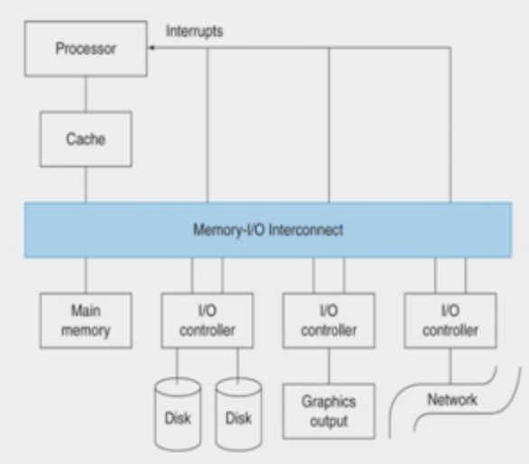

- Bus: 여러 개의 장치를 하나의 선에 묶은 것.

- **입출력 방식 3가지: Polling, interrupt, DMA**

2\. Polling and Interrupt

Polling 은 loop돌면서 CPU time 낭비한다. Idle loop이다.

Interrupt는 CPU에게 직접 signal.

+) Interrupt와 exception의 차이

원인이 내부에 있으면 exception 외부에 있으면 interrupt

- 비동기적 항상 다른 위치 다른 시간.

3\. DMA(=Direct Memory Access)

: 직접 메모리 접근

메모리에서 바로 I/O로 간다.CPU나 R거치지 않는다. Device controller가 바로 M와 data공유한다.

에러나 입출력 끝났을 때 interrupt한다.

+) DMA controller

: CPU와 상관 없이 memory transfer해준다.

4\. 3 가지의 차이점

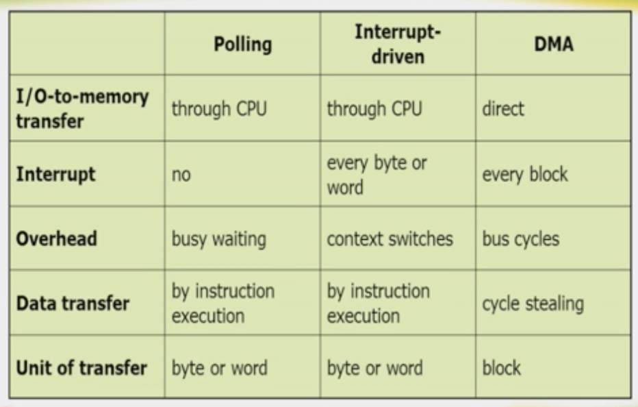
