1.  데이터베이스의 사용 이유

:기존 엑셀로 작성된 문서를 DB를 통해 저장하고, 저장된 데이터를 웹사이트에 불러와서 사용하기 위함

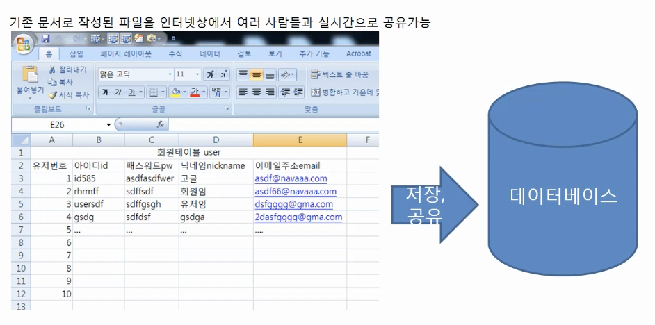

2.  테이블 생성 및 삭제

테이블 = 유저의 내용을 저장할 수 있는 틀

CREATE TABLE로 생성한 후 TABLE이름 적는다. (구조체처럼)

1)  INT – 숫자 저장을 위한 자료형

2)  VARCHAR – 문자열을 저장하기 위함 (VARCHAR2는 필요한 공간만큼만 사용하여 효율이 올라간다)

> +) 괄호 안의 숫자는 데이터의 개수 (배열과 같다)

3)  PRIMARY KEY – 고유 키 (동일한 값을 가질 수 없다. 테이블의 대표 기준이 되는 키)

> +) PRIMARY KEY(USERNO,USERID)로 해서 두 가지를 PRIMARY KEY로 사용 가능하다.

4)  -- 는 주석

5)  DROP TABLE MYUWER - 테이블 삭제

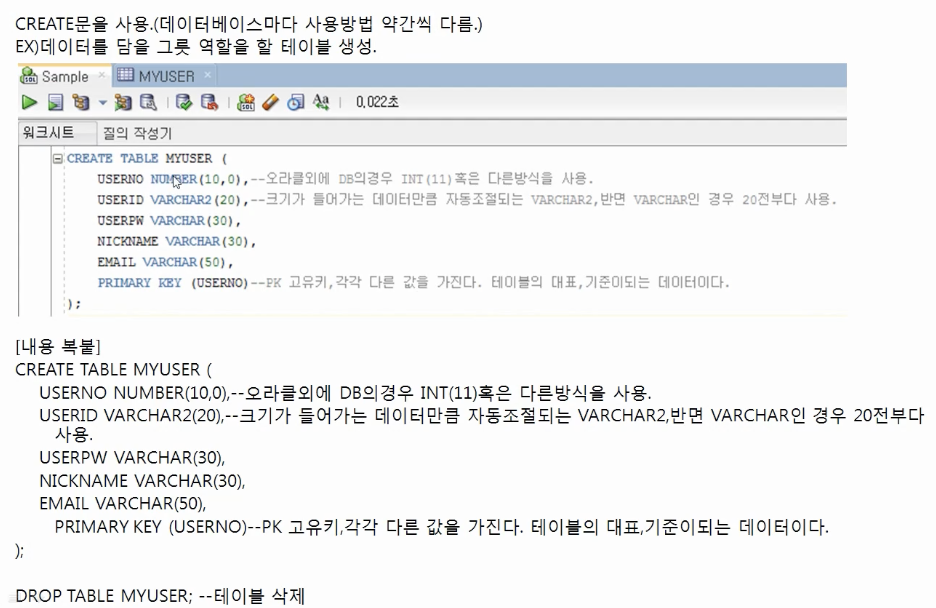

3.  데이터 넣기

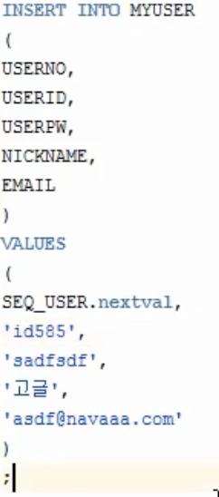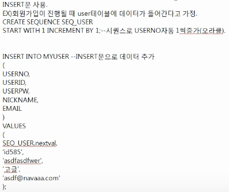

// 시퀀스로 USERNO자동 1씩 증가(오라클)

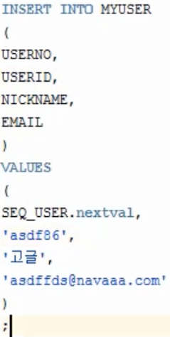

- USERPW 빼고 저장한 경우 아래와 같이 null로 저장된다.

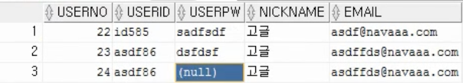

즉, INSERT INTO \[TABLE NAME\] (\[COL1\]…) VALUES (\[DATA1…\]);의 형태로 쓴다.

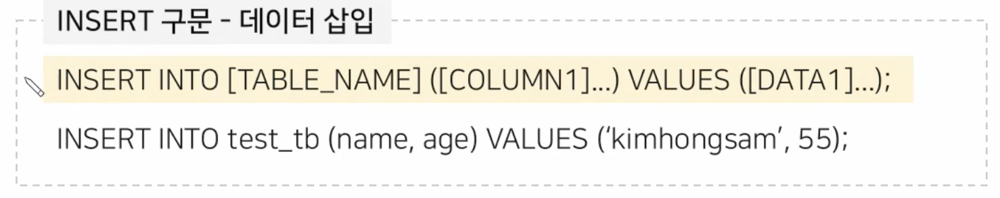

4.  데이터 조회

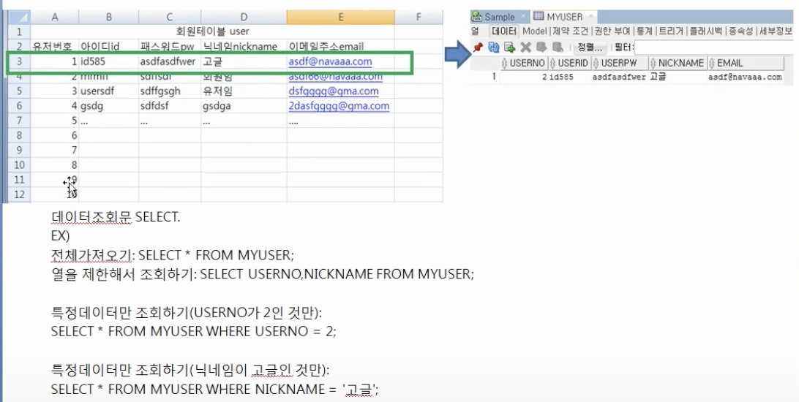

1.  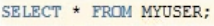 - 전부 조회

> 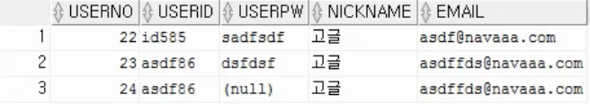

2.  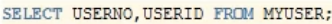 - 필요한 열만 선택하여 조회

> 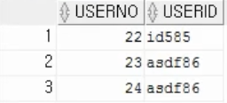

3.  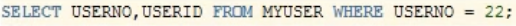 - 특정 값 조회(조건절 WHERE)

> 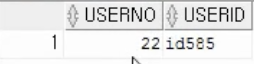
>
> 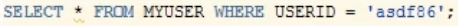
>
> 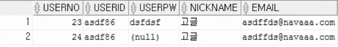

4.  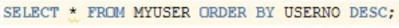 - 정렬(ORDER BY) 내림차순(DESC)

> 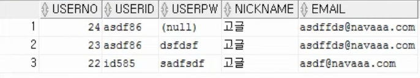

5.  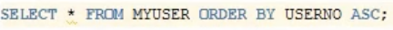 - 정렬(ORDER BY) 오름차순(ASC)

> 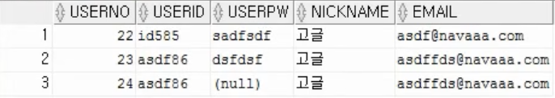

- 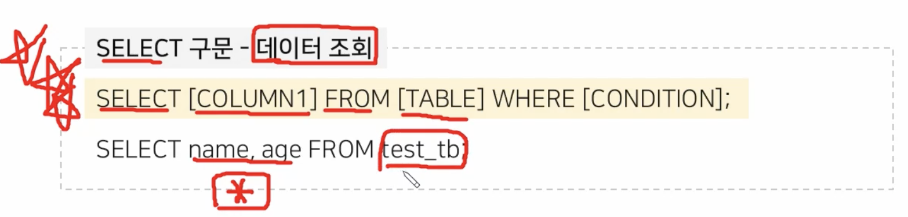

- \*은 전부 가져오는 것!!

- WHERE은 해당 조건의 데이터(특정 COL)만 가져오는 것!!

5.  데이터 수정

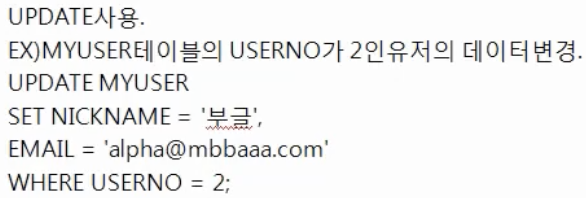

1.  USERNO가 24인 것의 USERID를 abcdefg로 변경하고,

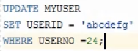 //WHERE없으면 모든 USERID가 변한다.

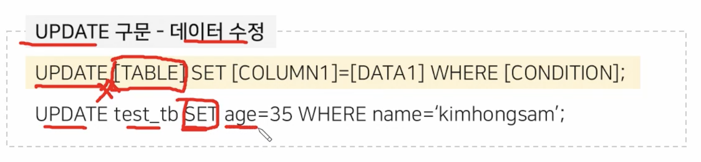

2\) 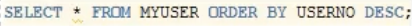 로 확인해보면

3\) 변경된 것을 확인할 수 있다.

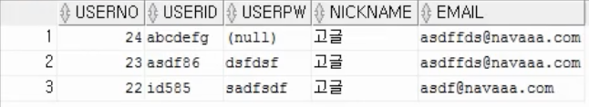

6.  데이터 삭제

    1.  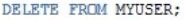 - 데이터 전체 삭제

> 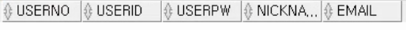

2.  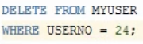 - USERNO가 24인 것만 삭제

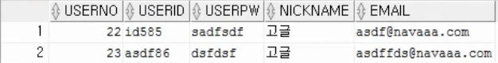

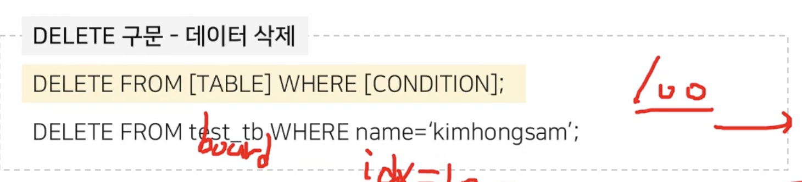

7.  논리 연산자

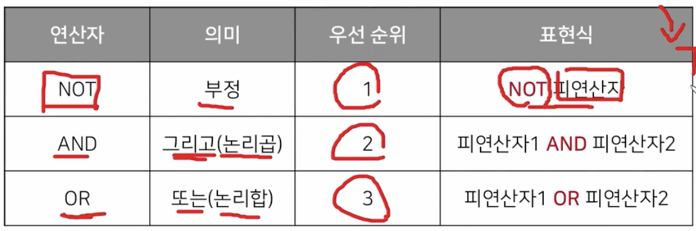

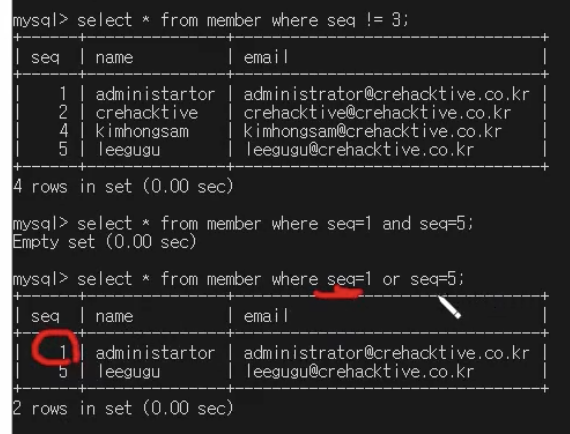

8.  비트 연산자 중 공백 기능

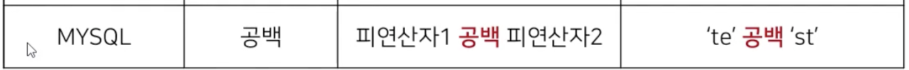

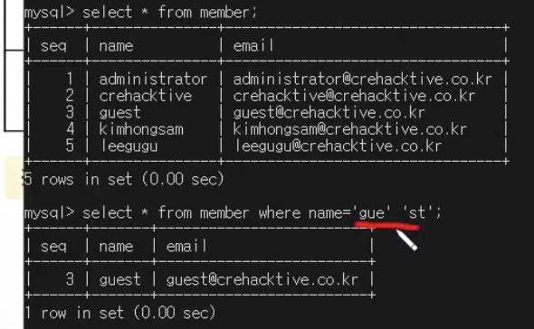

9.  연산자

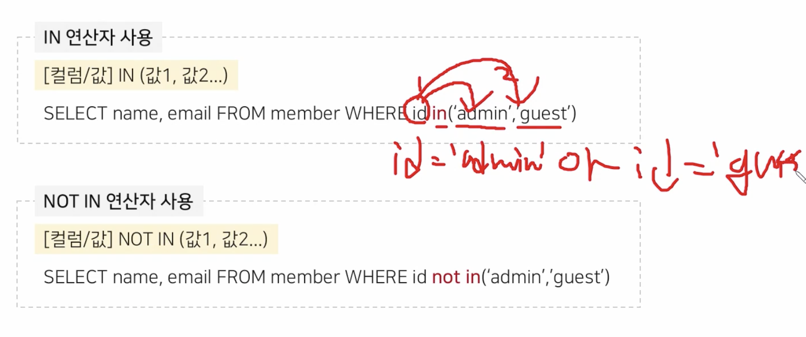속도나 가독성 \|\| 보다 좋다.

10. like 연산자

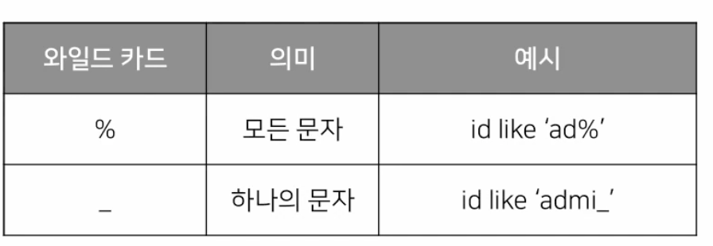

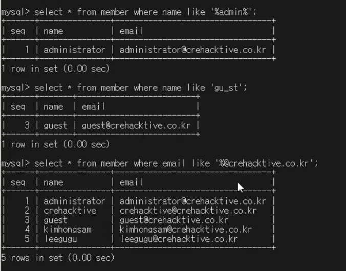

11. string 함수

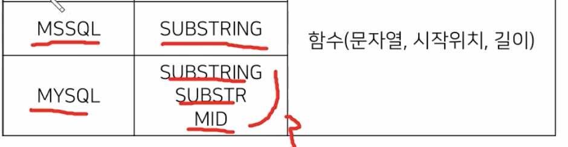

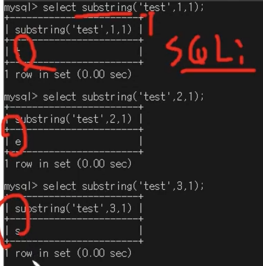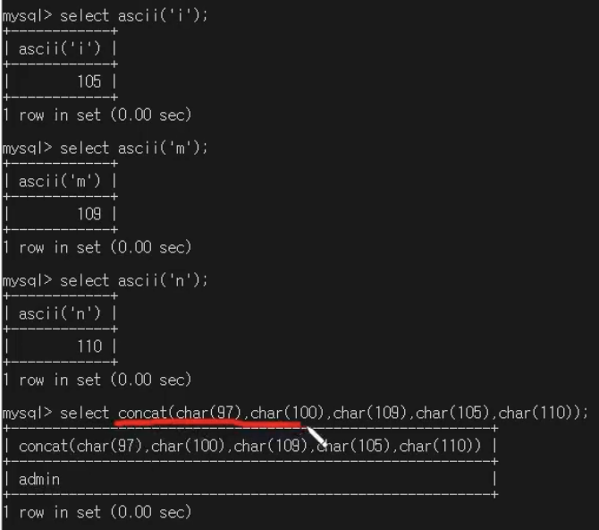

12. count함수 //몇개의 행

> 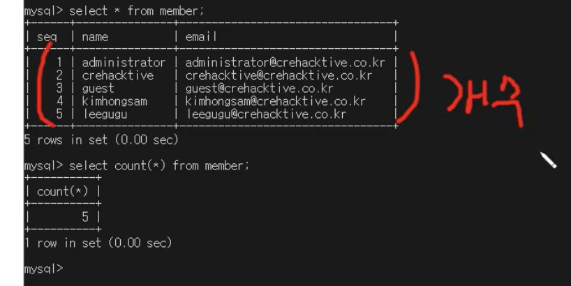

13. length함수// 글자의 길이

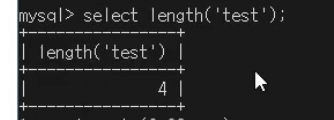

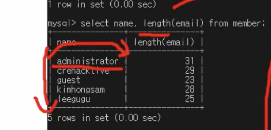

14. 조건문

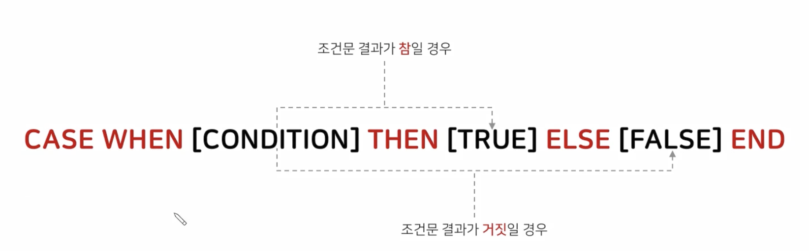

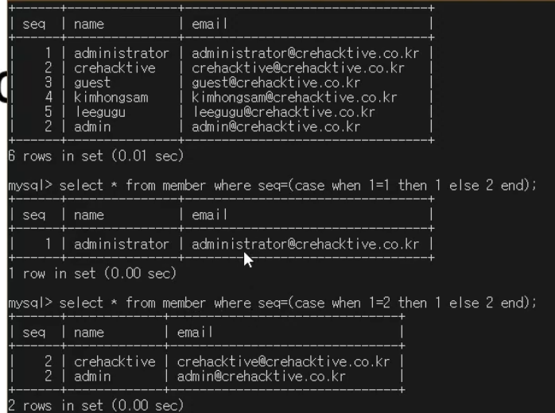

15. 서브쿼리

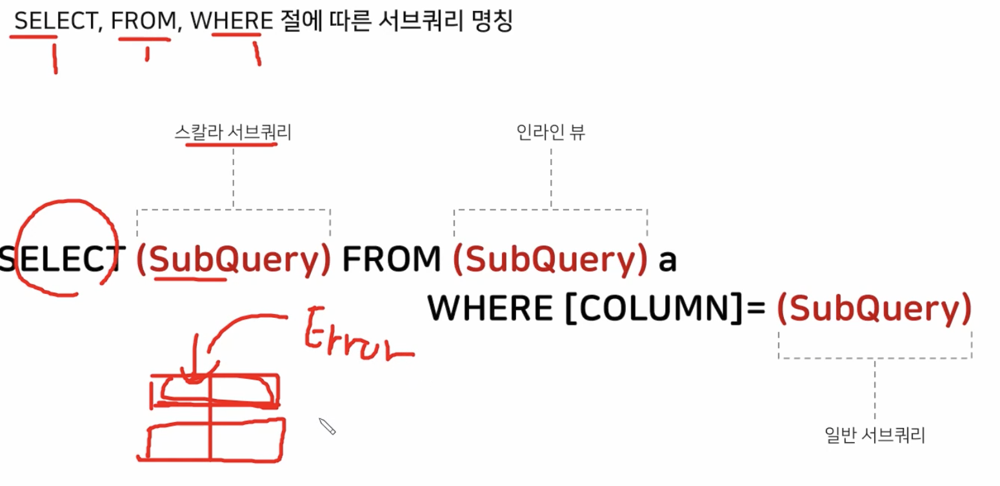

16. 출력 개수 제한

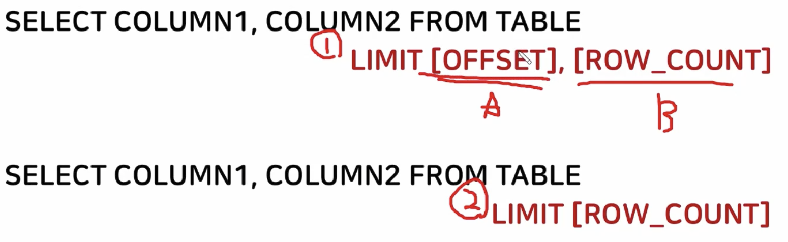

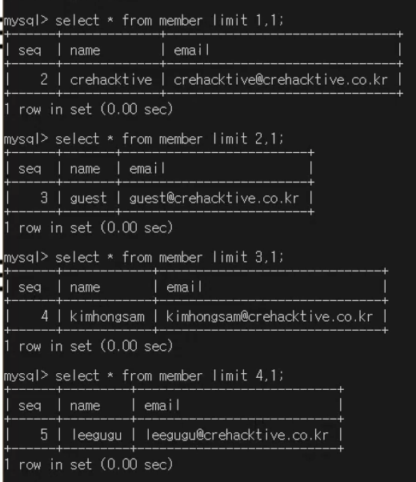

17. 중복 제거

DISTINCT

18. GROUP BY//타입 별로 그룹 만들기

19. 집계함수(COUNT)의 경우 WHERE 못쓴다. 따라서 HAVING을 사용한다.

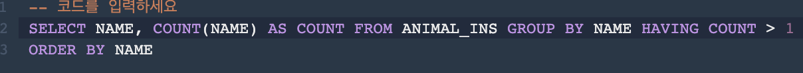

20. DATETIME의 경우 HOUR함수 사용하여 시간만 가져올 수 있다.

