\< Introduction to Operating Systems \>

1\. 운영체제란 = 하드웨어 바로 위에 설치되어있는 소프트웨어

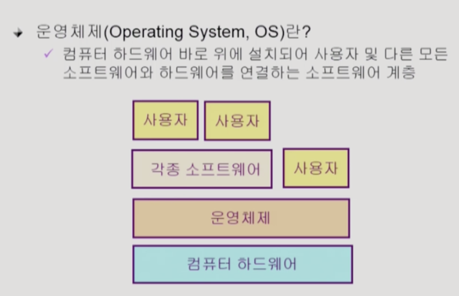

- 사용자가 직접 하드웨어에 접근하지 않으면서, 실행되도록 하는것.

- 운영체제의 기능을 두 가지로 생각할 수 있다.

1.  하드웨어와의 소통 = 컴퓨터 시스템의 자원(한정된 메모리, CPU) 을 효율적으로 관리해주는 역할

2.  SW와 사용자와의 소통 = 여러 프로그램이 컴퓨터를 효율적으로 사용하게 해주는 역할

- 운영체제는 컴퓨터를 편리하게 사용할 수 있는 환경을 제공한다.

2\. 운영체제의 의미

> 좁은 의미 : 커널 -\> 운영체제의 핵심적인 부분으로 전원을 킨 이후부터 부팅이 일어난 후 항상 메모리에 상주하는 부분을 일컫는 말.
>
> 넓은 의미 : 커널을 포함한 각종 주변 시스템 유틸리티를 포함한 개념( 윈도우를 설치할 때, 각종 추가 파일)

3\. 운영체제의 목적

- **컴퓨터 시스템의 자원(CPU, 메모리, 입출력장치)을 효율적으로 관리하는 역할** 즉, 하드웨어와 소프트웨어 자원을 효율적으로 관리하는 역할. (효율성)

  하드웨어 자원 : 프로세서, 기억장치, 입출력장치

  소프트웨어 자원 : 프로세스, 파일, 메시지

- **컴퓨터 시스템을 편리하게 사용할 수 있는 환경을 제공한다**. (형평성)

- 주어진 자원으로 최대한의 성능을 내도록

- 사용자간의 형평성 있는 자원 분배

4\. 운영체제의 분류

- 동시 작업 가능 여부

> 1\) 단일 작업(예전꺼) – 한 번에 하나의 작업만 처리 (싱글 프로세스)
>
> 2\) 다중 작업(지금꺼) – 동시에 두 개 이상의 작업 처리

- 사용자의 수 (컴퓨터 한 대 즉 하나의 계정을 여러 사용자가 동시 접속, 접근할 수 있는지)

  1\) 단일 사용자 (MS-DOS, MS Windows)

  2\) 다중 사용자 (UNIX, NT server)

- 처리 방식

  1\) 일괄 처리(**배치 프로세싱**)

  작업 요청의 일정 양을 모아서 한 번에 처리하는 시스템

  작업이 완전 종료될 때까지 기다려야 한다.

  (프로그래밍을 청공카드로 한다.)

  2\) 시분할(**타임 셰어링**) – 현재 우리의 컴퓨터

  여러 작업을 수행할 때 컴퓨터 처리 능력을 일정한 시간 단위로 분할하여 사용

  일괄 처리 방식보다 짧은 응답 시간을 가진다.

  즉, CPU로부터 interactive한 서비스를 받는다. (사람이 느끼기에)

  (여기 조금, 여기 조금씩 CPU제공)

  3\) 실시간(**리얼타임 OS**)

  데드라인이 존재하여 정해진 시간 안에 어떠한 일이 반드시 종료됨을 보장하여야 하는 시스템을 위한 OS 즉, special purpose system을 위함.

  Hard realtime system : 원자로, 공장제어, 미사일 제어, **반도체 장비**, 로보트 제어

  Soft realtime system : 영상 스트리밍, 네비게이션, 블랙박스

  **반도체 tip)**

  삼성 전자의 반도체 공장에서 정전 발생. 엄격한 기준이 있으므로 주가가 떨어지고 사표..

  처음 공정 단계를 진행할 때 반도체가 파이프 라이닝으로 진행된다. 하나의 공정 끝나면 그 다음 공정으로 넘어가고 또 끝나면 그 다음 공정으로 넘어가고.. 그런데 하나의 공정마다 데드라인이 존재한다. 한 달 정도 걸리지만 매일 반도체가 하나씩 완성이 된다. 그러나 한 공정 단계가 느려지면, 전체 공정이 영향을 받는다. 납품을 제대로 못한다. -\> 즉 정전이 나면 중간의 것을 꺼내서 버려야 한다.

5\. 몇 가지 용어

- 멀티 테스킹 : 여러 작업이 동시에 진행 되는 것. 엄밀히 말하면 CPU는 매 순간 하나의 작업만 실행 중이다. 하나의 작업이 끝나기 전에 다른 작업이 수행 가능한 것

- 멀티 프로그래밍 : 메모리를 강조한 측면의 멀티 테스킹. 메모리에 여러 프로그램이 동시에 올라가는 것. 멀티 테스킹에서는 멀티 프로그래밍이 지원 되어야 한다.

- 타임 셰어링 : CPU를 강조한 측면의 멀티 테스킹

- 멀티 프로세스 : 실행 중인 프로그램

- **멀티 프로세서** : 보통 CPU를 말한다. CPU가 여러 개 있는 컴퓨터를 말한다. 다른 용어들과 HW적으로 다른 시스템이라는 것에 주의해야 한다.

6\. 운영체제의 구조

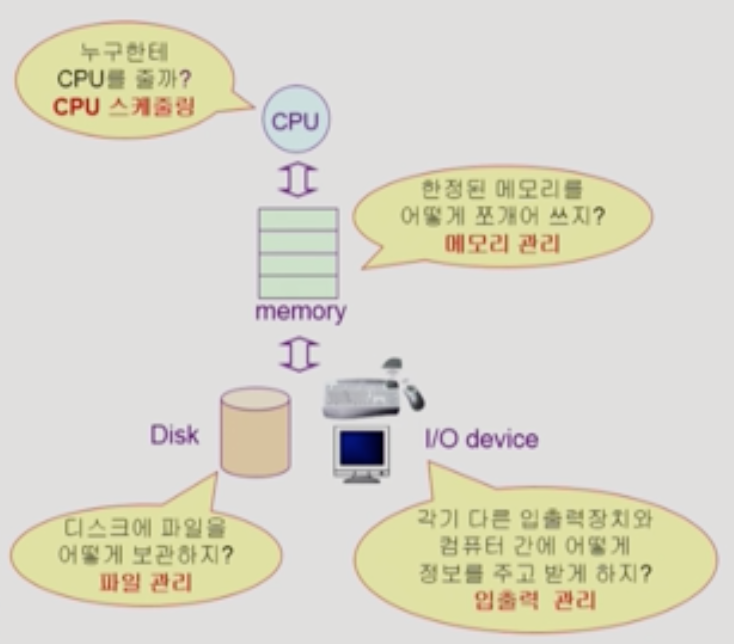-\> 입출력 관리는 인터럽트로 관리한다

\< System Structure & Program Execution \>

7\. 컴퓨터 시스템 구조

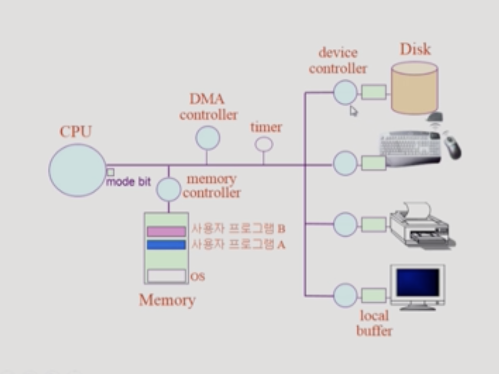

-\> 크게는 CPU/memory/IO device로 구성되어 있다.

-\> CPU의 작업 공간이 메모리이기 때문에, **매 클럭 사이클 마다 메모리에서 instruction 즉, 기계어를 하나씩 읽어서 수행하게 된다.**

-\> 하드디스크는 보조 장치로 이야기 하지만 I/O디바이스로의 역할도 한다. 메인 메모리에서 데이터를 읽기도 메모리에 데이터를 저장하기도 한다.

-\> 각 디바이스바다 디바이스 컨트롤러가 붙어 있어서, 디바이스마다 전담하는 CPU역할을 한다.

-\> 타이머는 특정 프로그램이 CPU를 독점하는 것을 막기 위해 존재하는 HW다. 타이머 값이 0 이 되면 timer interrupt가 발생하여 실행 중이었던 프로세스로부터 CPU를 뺏는다.

-\> 인터럽트가 들어오면 CPU제어권이 운영체제에게 넘어가게 된다. 이 때만! 운영체제에게 제어권이 넘어간다. 나머지는 사용자 프로그램이 쓰고있다. 즉, **PC가 가리키는 매 instruction을 수행하던 중 인터럽트가 있으면 운영체제에게 제어권이 넘어가고, 없다면 사용자 요청 수행.**

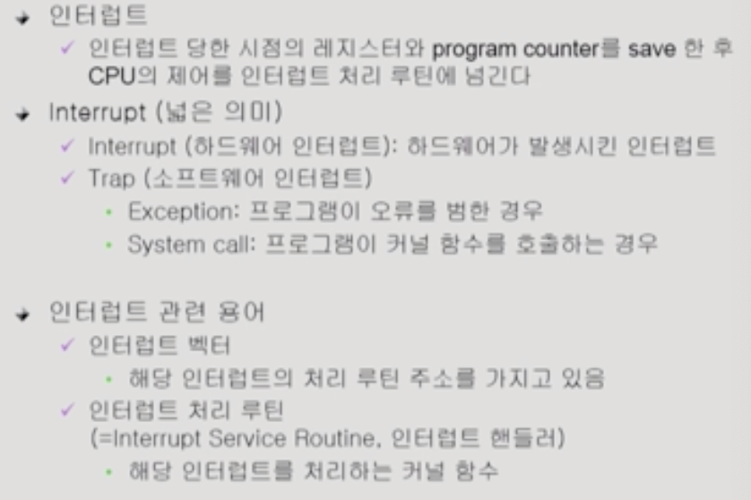

보통 interrupt는 하드웨어 인터럽트 : IO controller의 인터럽트, timer interrupt

넓은 의미에선 trap을 포함한다.

1\. 각각의 interrupt마다 무슨 일을 할지는 정해져 있다. 코드로 = **인터럽트 루틴**

2\. 그 함수들의 주소를 정리해놓은 테이블 = **인터럽트 벡터**

Tip)IO를 하기 위해서 필요한 interrupt는 소프트웨어 or 하드웨어 인터럽트냐?

둘다 필요하다. 요청할 때는 SW 끝날 때는 HW interrupt필요하다.

-\> 모드 bit = CPU제어를 운영체제가 가지고 있는지 또는 사용자가 가지고 있는지를 나타낸다.

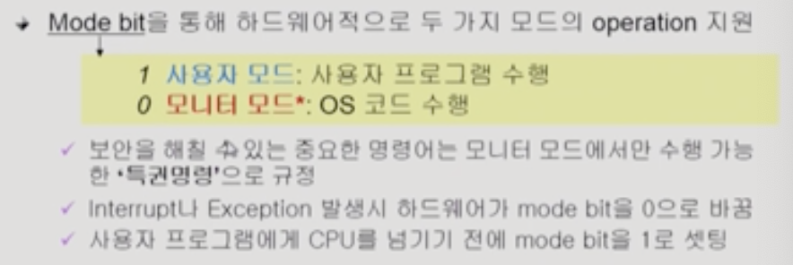

0일때는 운영체제가 CPU를 가지고 있으므로 모든 instruction사용 가능하다. IO접근하는 instruction도 사용 가능하다. 사용자 프로그램이 CPU를 가지고 있을 때는 1로 바꾸어놓은 후 전달한다. 따라서 한정된 instruction 만 사용 가능하다.

-\> CPU가 인터럽트를 너무 많이 당한다. DMA. controller를 두어서 CPU와 DMA가 메모리에 접근 가능하게 하고, 메모리 컨트롤러가 동시 접근을 막는다. DMA controller는 IO디바이스에서의 내용을 메모리에 복사하는 일 까지 해준다. 그 작업이 끝났을 때 CPU에게 인터럽트를 한번만 걸어서 인터럽트의 빈도를 줄여 CPU가 일을 효율적으로 할 수 있게 해준다.

Tip) **디바이스 드라이버 VS 디바이스 컨트롤러**

**디바이스 드라이버 :** 각 디바이스를 처리하기 위해 즉, 디바이스의 인터페이스에 맞게 접근할 수 있도록 설치하는 소프트웨어 모듈 하나의 하드웨어를 붙이면 그 장치에 접근하기 위한 디바이스 모듈을 설치해야 한다.

**디바이스 컨트롤러 :** 각 디바이스를 전담하기 위한 작은 HW장치, 작은 CPU

CPU의 역할은 PC(Program counter)가 가리키는 다음에 실행할 주소에 접근하여 일을 수행.

그리고 그 instruction중에서 IO장치를 접근해야 하는 상황이 되면 디바이스 드라이버를 통해서 읽고 쓰기의 명령을 한다. 디바이스 드라이버가 실제로 읽고 쓰는 코드는 아니다. 그 코드는 디스크 컨트롤러가 그 코드의 지시를 받아서 일을 하는 것이고, CPU는 메모리 안에 있는 지시를 받아서 일을 하는 것이다. 디바이스는 디바이스 드라이버가 아닌 디스크 안에 펌웨어에 있는 곳에서 읽어와서 명령어를 실행한다. 디바이스 드라이버는 CPU가 실행하는 장치를 수행하기 위해서 필요한 코드를 담고 있다.

8\. 입출력의 수행

1\) 시스템 콜 : 사용자 프로그램은 직접 IO할 수 없다. 즉 운영체제에게 부탁해야 한다. 사용자 **프로그램은 시스템 콜로 운영체제에게 IO를 요청한다.**

IO 디바이스를 접근하는 모든 실행은 mod bit가 0일 때만 실행 가능하다. 즉 운영체제만 실행할 수 있게 막아놓았다. 사용자 프로그램이 CPU로 instruction을 실행하다가 IO 디바이스를 실행하려고 하면 직접 못하므로, 운영체제에게 요청해야 하는데 요청하려면 PC가 OS의 주소 영역으로 점프해야 하는데 이는 mod bit이 0일 때는 불가능하다. 따라서 사용자 프로그램이 운영체제에게 서비스를 요청할 때는 시스템 콜을 한다. 운영체제에 있는 함수를 사용자 프로그램이 요청하는 것. 의도적으로 인터럽트 라인을 세팅한 후 CPU가 하던 일을 멈추며 제어권이 운영체제에게 넘어가게 된다.

9\. 입출력에서의 동기식(synchronous I/O)과 비동기식(asynchronous I/O)

완료 결과를 눈으로 확인한 후 다음 작업 진행 = 동기식 입출력

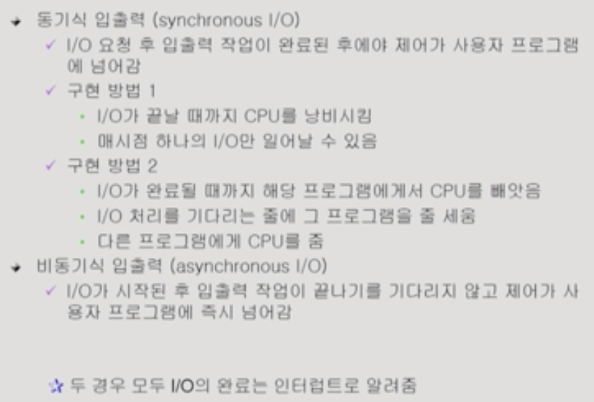 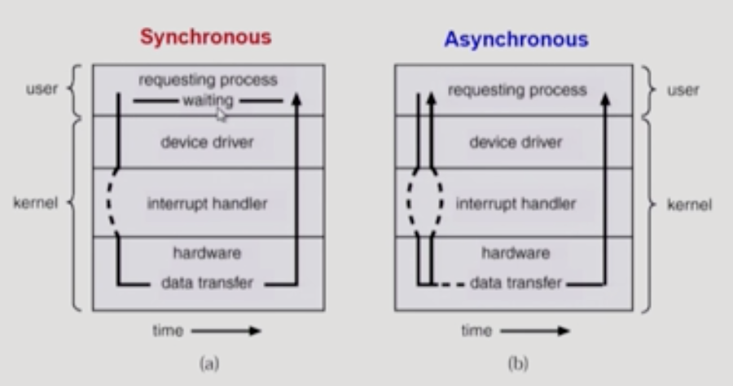

a\) 결과를 보고 해야하는 다음 작업

b\) 읽어온 데이터와 상관없이 할 수 있는 작업

10\. DMA(direct memory access)

\- 빠른 입출력 장치를 메모리에 가까운 속도로 처리하기 위해 사용한다. (인터럽트 많으므로)

\- 바이트 단위가 아니라 블록 단위로 인터럽트를 발생시킨다.

원래는 메모리에 접근할 수 있는 장치는 CPU뿐이지만, CPU가 인터럽트를 너무 많이 당하므로 overhead발생한다. 따라서 DMA도 메모리에 접근할 수 있도록 한다. 작은 일들은 (버퍼가 차기 전까지의 일들)은 DMA가 처리한 후 device buffer storage가 찰때마다 DMA가 CPU에게 말해주는 방식으로 진행한다.

11\. 저장장치 계층구조

가장 위에 CPU/레지스터

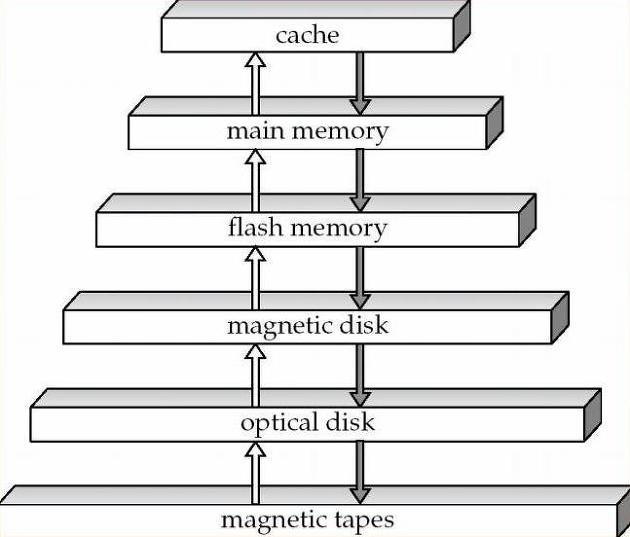

- 위로 올라갈수록, 빈도 높다. 속도 빠르다. 가격 비싸다. 용량 적다.

- 메인 메모리까지 휘발성/아래 비휘발성

- CPU는 메인 메모리까지 접근이 가능하다. (excutable하다)

- Caching : 재사용을 목적으로 더 빠른 저장 시스템에 정보 저장하는 것.

12\. 프로그램의 실행

\- 프로그램은 실행파일 형태로 파일 시스템(하드디스크)에 저장되며, 실행파일을 실행시키게 되면 메모리에 올라가서 프로세스가 된다.

\- 어떤 프로그램을 실행시키게 되면, 가상 메모리에 프로그램의 메모리 주소 공간이 형성된다.

(스택, 데이터, 코드를 담고있다. )

\- 코드는 CPU에서 실행할 기계어 코드, 데이터는 전역변수, 자료구조, 스택은 함수 형태 저장

\- 실행될 부분만 물리 메모리에 load하여 사용한다. Swap area는 메모리의 연장선 즉 휘발성.

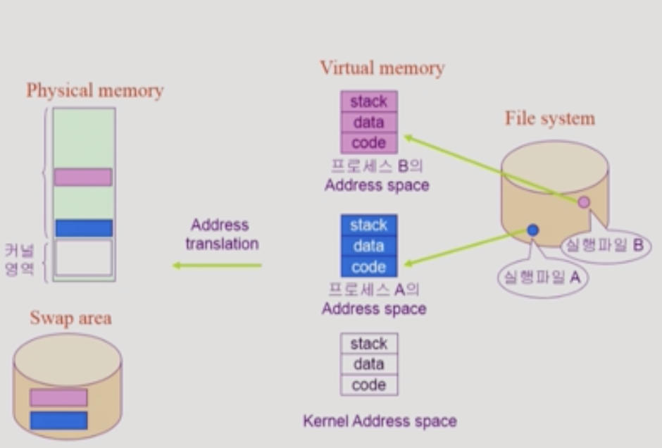

VM에서 0으로 시작하지만 PM에선 아니므로 Address translation

13\. 운영체제 커널 주소 공간의 내용

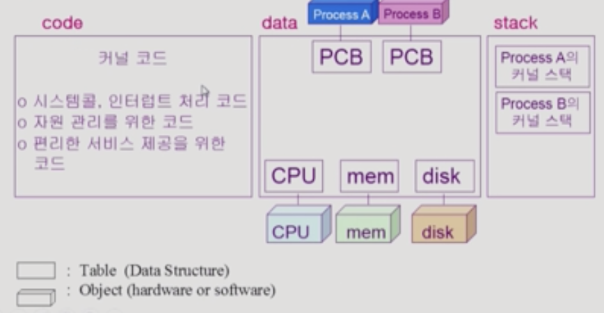

Code: 각각의 인터럽트마다 해야할 일이 함수로 들어있다.

Data : 운영체제가 사용하는 여러 자료구조가 정의, HW의 종류마다 자료구조가 있을 것.

각 프로그램마다 관리하기 위한 자료구조( PCB = process control block)

Stack: 함수의 호출과 return 시 사용. 사용자 프로그램마다 커널 스택을 따로 사용한다.

14\. 함수의 종류 (유저모드와 커널모드)

- 사용자 정의 함수 : 직접 작성한 함수 (내 주소공간 안의 code에 존재)

- 라이브러리 함수 : 갖다 쓴 함수, 실행 파일에 포함되어 있다. (내 주소공간 안의 code에 존재)

- 커널 함수 : 운영체제 안에서 정의된 함수. 시스템 콜(커널 함수의 호출)을 통해 가져다 쓸 수 있다. 인터럽트 라인 세팅 후 CPU제어를 넘기면서 넘어가야 한다. (운영체제 주소공간 안의 code에 존재)

\< 3장 Process \>

1\. 프로세스의 개념

- process is a **program in execution**( 실행 중인 프로그램 )

- **context** : 프로그램이 무엇을 어떻게 어디까지 실행했고, 어떤 상태에 있는지를 나타낸다.

(PC가 나타내는 독자적인 주소공간으로) 아래의 3가지가 있다.

1)**HW**의 context : HW의 수행상태를 나타낸다. Ex) PC, 각종 register

2\) **프로세스**의 주소공간 : stact, data, code

3\) **OS**의 context : PCB(Process Control Block)프로세스 하나 당 ㅖ츄가 있다,

\+ kernel stack (프로세스마다 있는 운영체제 함수 호출이 이루어질 때의 stack)

2\. 프로세스의 상태

- Running : CPU를 사용중인 process

- Ready : CPU를 기다리는 상태, 메모리위에 올라와있는 상태

  Ready 상태의 process들이 번갈아가면서 CPU를 잡으면 = **time sharing**

- Blocked (wait, sleep) : CPU를 주어도 당장 instruction수행이 어려운 상태

  메모리에 올라와 있지 않고, 디스크에 있다. Ex) 디스크에서 파일을 읽어오는 경우

- New : 프로세스가 생성 중인 상태

- Terminated : 수행이 끝나 process가 정리중인 상태

  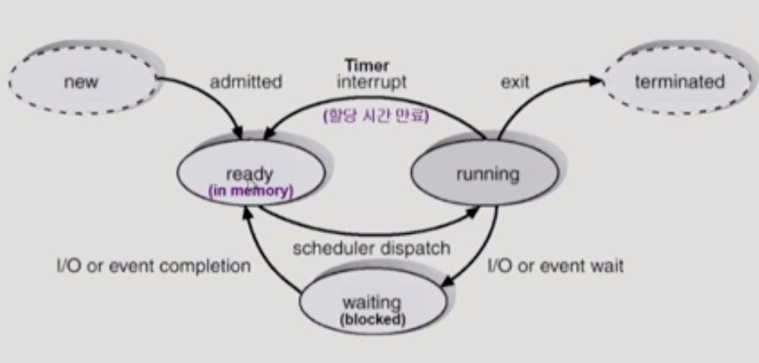

  **Ex) Running중에 디스크에서 무언가를 읽어와야 한다면, 또는 입력 받을 때의 시뮬레이션**

  프로세스 상태가 Running -\> Blocked로 바뀌면서 디스크IO queue에 줄선다. 디스크가 queue안에 있는 것을 순서대로 처리한다. 작업이 끝나면 Disk controller가 CPU에게 interrupt를 건다. (요청한 IO작업이 끝났으므로) 그럼 CPU제어권이 OS로 넘어가고 프로세스의 메모리 영역에 데이터를 넘겨준 후 Blocked-\>Ready로 바꾸어 대기상태로 바꿔준다.

  \+ 공유데이터에 접근할 때도 다른 P가 사용중이면 blocked상태로 queue에 넣는다.

<!-- -->

- **어떠한 프로그램이든 실행될 떄, CPU burst와 I/O burst를 반복하면서 실행된다. 단, 프로그램의 종류에 따라 빈도가 다르다. 사람과의 interaction이 많을수록 I/O burst가 증가한다.**

- **I/O빈도가 많은 프로그램 = I/O bound job**

- **CPU빈도가 많은 프로그램 = CPU bound job (계산 위주의 job)**

- **job = process**

  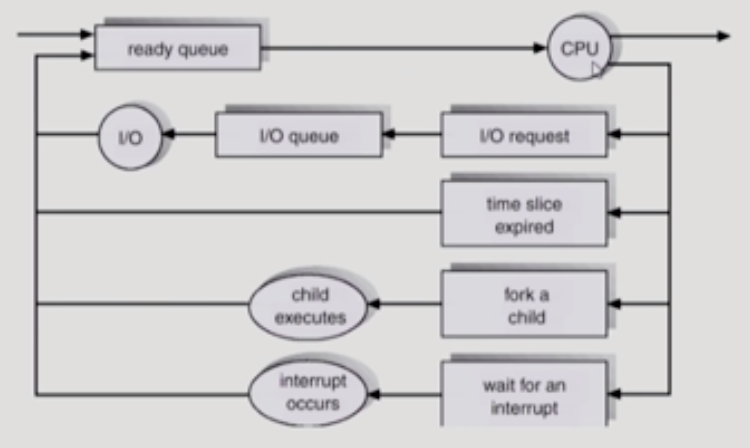 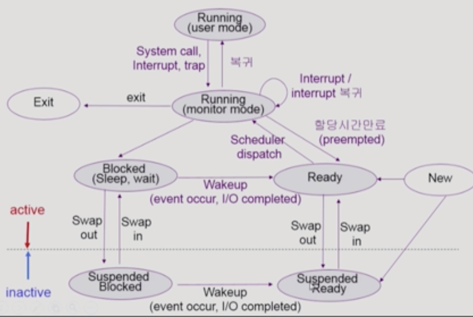

  3\. PCB : 운영체제가 각 프로세스를 관리하기 위해 프로세스 당 유지하는 정보

1)  OS가 관리상 사용하는 정보 : Process start(ready, running), Process ID, scheduling information, priority

2)  CPU 수행 관련 HW값 : PC, R

3)  메모리 관련 : Code, Data, Stack위치

4)  파일 관련 : Open file descriptions

    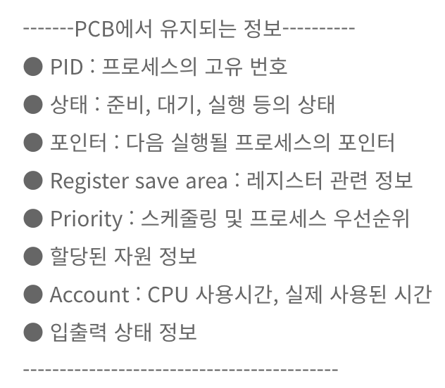

    4\. Context Switch : 한 P에서 다른 P로 넘겨주는 과정

    OS가 마지막 단계를 PCB에 save해놓은 후 switch

    **주의**) System Call, interrupt발생은 Context switch아니다. (Cache메모리 안지운다)

    5\. Queue정리

- Job queue : 현재 시스템 내에 있는 모든 프로세스의 집합 (Ready Q, Device Q 포함)

- Ready queue : 현재 메모리 내에 있으면서 CPU를 잡아서 실행되기를 기다리는 프로세스의 집합

- Device queue : I/O device의 처리를 기다리는 프로세스의 집합

  6\. 스케줄러

1)  CPU scheduler(Short-term scheduler) : 어떤 프로세스를 다음에 running시킬지

2)  Job scheduler(Long-term scheduler) : P중 어떤 것을 ready queue에 보낼지, P에 M를 주는 문제 관리

3)  Swapper(Medium-Term Scheduler) : M에 너무 많은 P가 있으면 일부 디스크로 보낸다.

    - Suspended (Stopped)상태 : 수행이 정지되고 P통째로 디스크로 Swap out된 상태. (ex:ctrl+c)

       (외부 : 사용자가 임의로)

      7\. thread : Process 내부에 CPU수행 단위가 여러 개 있는 경우

      -\> 공통 부분 (=task) : code, data, OS resource는 같다.

      -\> CPU 수행 단위가 여러 개이므로 스택, R, PC여러 개 있어야 한다. (CPU수행 관련 정보는 여러 개 별도로)

      Tip) 여러 개 thread = lightweight Process라고도 한다. / 하나의 thread만을 가지는 것 = heavyweight process

<!-- -->

1)  장점

    **빠른 응답성** : Thread하나가 blocked상태일 때, 다른 thread가 응답할 수 있다.

    Ex) 웹 페이지 읽어올 때 까지 다른thread가 화면을 보이기라도 한다. 텍스트라도 보여서 덜 답답하다.

    - IO작업을 보고 출력하지않고 텍스트라도 먼저 출력 즉, **일종의 asynchronous**

      **자원 절약** : 동일한 일을 하는 다중 스레드를 형성하여 높은 처리(throughput)과 성능 향상을 얻을 수 있다.

      (같은 code인데 각각의 P 아니므로 자원을 공유하여 자원 절약)

      **경제적** : Process를 하나 더 생성하지 않아도 된다. 오버헤드 큰 Context Switching하지 않아도 된다.

      **시간 절약** : 병렬성을 높일 수 있다. (CPU가 여러 개인 컴퓨터만 가능)

2)  Thread의 종류

- Kernel Threads (ex:Unix) : 운영체제가 안다.

- User Threads (ex:Solaris thread) : 운영체제가 몰라서 제약이 있다.

  \<4장 Process management\>

  8\. 프로세스의 생성과 종료

<!-- -->

- Parent P가 children P를 만든다. -\> 부모의 주소 공간을 복사한 후 그 공간에 새로운 프로그램을 올린다.

  **fork() 후 exec()** : 복제 후 덮어씌우기

- 자원을 일부 공유 할 수도 있고 아닐 수도 있다.

- 부모가 자식의 종료를 기다릴 수도 있다.

- **exit()** system call이 main함수가 종료될 때 컴파일러가 자동으로 넣어준다.

  - 자식이 먼저 종료된 후 부모에게 데이터를 보내준다.**wait()** 를 통해서

- abort() : 부모가 자식의 수행을 종료 시킴

- 부모 프로세스가 종료되는 경우는 말단부터 단계적인 종료가 일어나야 한다.

  **Tip)** Copy-on-write(COW) : write가 발생하였을 때 copy하겠다.

  리눅스에서는 일단 카피 하지 않고, PC만 카피하여 똑같은 위치를 가리키면서 주소 공간을 공유하며 대기

  - 내용이 달라질 경우 write()진행.

    **Tip)** fork() 도 system call이다. (커널 모드로 바뀌는 것은 전부 System call)

    9\. fork(), exec(), wait(), exit() system call

    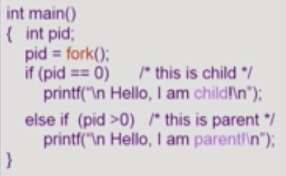

<!-- -->

- 자식 프로세스는 code, context를 그대로 복사한 후, PC도 복제되므로 fork()코드 이후부터 실행하게 된다.

- 자식과 부모를 구분하기 위해 결과값이 다르다. Parent process pid \>0, Child process pid=0

  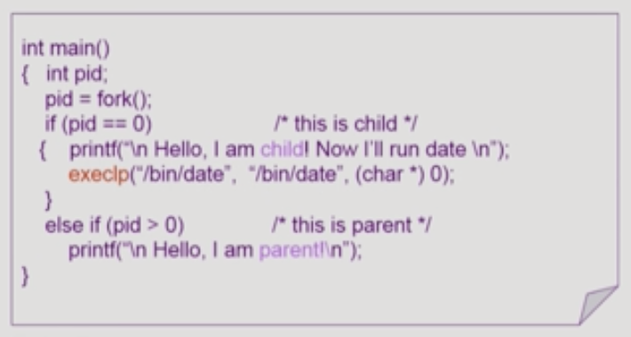

- exec()하고 나면, 새로운 프로그램이 된다. exec()이전으로 돌아올 수는 없다.

- 부모 P가 wait()에 도달하면 자식 P가 종료되는 경우까지 blocked된다.

- exit()는 프로그램이 자발적으로 종료될 때 실행된다.

- 비자발적 종료

  - 부모 P의 자식 P종료(abort()), ctrl+c, kill 이나 break친 경우, 부모가 종료하는 경우

10\. process간의 통신/협력 방법

- 원체 process는 독립적이지만, 통신/협력이 일어날 때가 있다. 두 가지 방법으로 존재.

  1\) 메시지 전송

  직접 P간 데이터를 전달할 방법은 없고, kernel을 통해서 진행된다. 아래의 두 가지 방법 존재

**Tip) Direct Communication 과 Indirect Communication**

공통점 : OS를 통해 이루어진다.

차이점 : Direct Comm는 전달받을 P와 메시지를 명시한다. Indirect는 메일 박스에 넣는다.(게시판)

2\) Shared memory

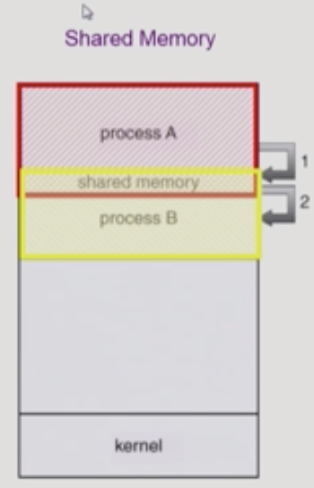

- PA가 적은 내용을 PB가 볼 수 있다. 일부 주소 공간을 공유한다. Shared M 사용시 시스템 콜을 보낸 후 커널이 부여해 주어야 한다.

  **Tip) thread간의 협력**

- Thread는 사실상 하나의 P이므로 P간의 협력으로 보기는 어렵다.

- 동일한 Process를 구성하는 thread들 간에는 주소 공간을 공유하므로 협력이 가능하다.

  11\. CPU 스케줄링

<!-- -->

- I/O bound job에게 CPU를 우선적으로, 더 많이 할당해야 한다.

  - I/O바운드 잡은 주로 사람과의 interaction이 많으므로 사람이 response를 기다려야 하는 경우가 많이 생긴다 즉, 지루하다고 느낄 확률이 증가한다. 따라서 CPU를 우선적으로 할당해 주어야 한다.

- CPU Scheduler : OS 내에서 스케줄링 하는 코드일 뿐.

  Ready 상태의 프로세스 중에서 이번에 CPU를 줄 프로세스를 고른다.

- Dispatcher : 역시나 OS내의 코드

  CPU 의 제어권을 CPU 스케줄러가 선택한 P에게 넘긴다.

  - 이 과정이 context switch

- **스케줄링이 필요한 대표적인 경우 (1, 4는 nonpreemptive 하다. 2,3은 preemptive즉, 자진반납)**

1)  Running-\> Blocked (ex: I/O를 요청하는 시스템 콜)

    어차피 I/O요청 받으러 가야 하므로 다른 P에게 CPU넘겨준다.

2)  Running-\>Ready (ex: 타이머 interrupt)

3)  Blocked-\>Ready (ex : I/O 완료 후 interrupt)

    I/O요청 전부 완료 했으니 다시 메모리로 load.

4)  Terminate ( 프로그램의 종료 )

12\. CPU 스케줄링 성능 척도 평가

- 시스템(CPU) 입장 = **이용률(utilization), 처리량(throughput)**

- 프로그램(user) 입장 = **소요시간(turnaround time), 대기시간(waiting time), 응답시간(response time)**

  - 소요시간 : 전체 시간

  - 대기시간 : 프로세스 완료 시까지 CPU를 선점하지 못한 총 시간

  - 응답시간 : 처음 CPU를 선점하기까지 걸린 시간

13\. 스케줄링 방법

1)  **FCFS(first-come first served)** : 먼저 온 것을 먼저 처리한다.

    - 단점 : 평균 waiting time 길다 (짧은 시간 걸리는 P가 늦게 도착하면 오래 기다려야한다. )

Tip) **Convoy effect** : 뒤에 도착한 짧은 프로세스가 오래 기다리는 현상

2)  **SJF(Shortest-Job-First)** : 짧은 시간 걸리는 P 먼저 처리한다.

    - 평균 waiting time이 가장 작다.

    - **Nonpreemptive(CPU burst가 완료될 때까지 CPU를 선점하지 않음)**

    - **Preemptive(현재 수행중인 P의 남은 burst time 보다 더 짧은 CPU burst time을 가지는 새로운 P가 오면 CPU뺏김)**

      **= SRTF(shortest-Remaining-Time-First) -\>average waiting time이 가장 짧아지는 방식**

    - 단점 : starvation문제(긴 P가 영원히 서비스를 못 받을 수 있다.)

    - 단점 : 정확한 CPU사용 시간을 미리 알 수 없다. **exponential averaging** 으로 추정만 가능

      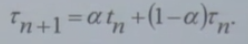//최근의 n이 가중치가 크고 과거일수록 점점 작아지는 구조

3)  **Priority Scheduling** : 우선순위가 높은 P먼저 처리한다.

    - Nonpreemptive와 Preemptive 존재한다.

    - SJF도 일종의 Priority Scheduling이다.

    - 단점 : 우선순위가 낮은 P의 starving

    - **Aging : P의 대기 시간이 증가할수록 우선순위를 높여준다.**

4)  **RR(Round Robin)** : 각 P는 동일한 크기의 할당 시간(time quantum)을 가진다.

    - 장점 : **response time(응답시간)이 빠르다.**

      = 어떤 P도 (n-1)\*q time 이상 기다리지 않는다.

    - 긴 시간이 걸리는 P는 waiting time 이 길어진다.

    - Q가 너무 크면 FCFS와 같아지고, Q가 너무 작아지면 context switch오버헤드가 커진다.

      = 10 ~ 100ms의 적당한 시간으로 Q를 정해야 한다.

    - CPU사용 시간이 모두 동일한 여러 개의 P를 실행할 때 안좋을 수도 있다.

14\. Multilevel Queue

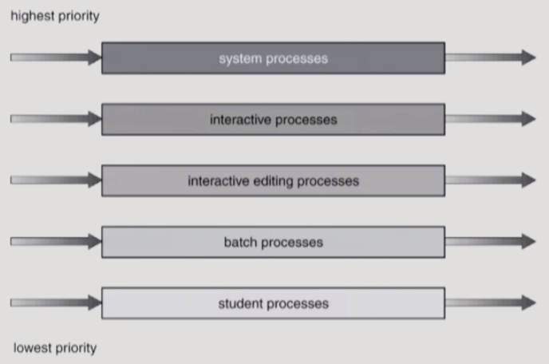//큐마다 우선순위와 스케줄링 기준이 있다.

\+ Multilevel Feedback Queue

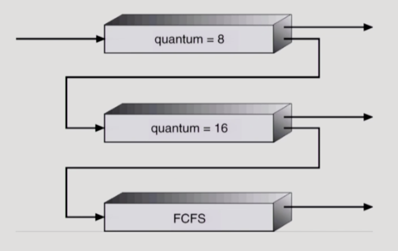

//처음에는 짧은 Q의 RR, 두번째는 긴 Q의 RR, 마지막은 FCFS

- Aging으로 해결할 수 있다.

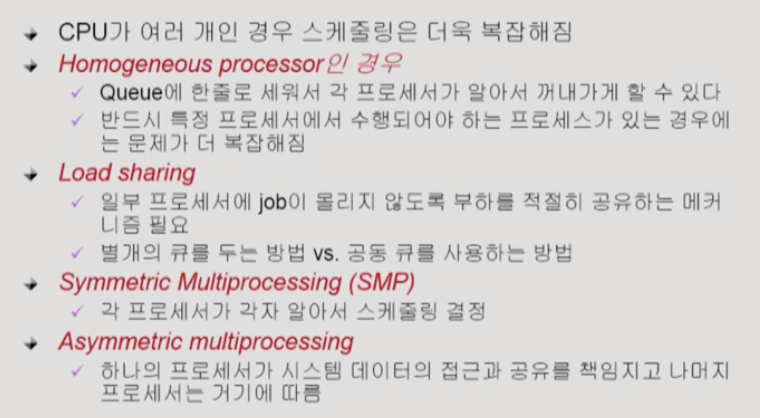

15\. Real-Time Scheduling : 정해진 시간 안에 반드시 실행 되어야 하는 일

- CPU 스케줄링에서도 deadline이 보장되는 것이 중요하다.

- Hard real-time system : 반드시 deadline이 지켜져야 하는 system

- Soft real-time system : 일반 프로세스에 비해 높은 priority를 갖도록 해야 하는 system

16\. Thread scheduling

- Local scheduling : User level thread의 경우 OS는 해당 P에게 CPU를 줄지만 결정, CPU할당 후에 어떤 thread에게 CPU를 줄지는 process내부에서 결정. 사용자 process가 결정한다.

- Global Scheduling : OS가 process scheduling 하듯 어떠한 알고리즘에 의하여 결정한다.

17\. 알고리즘 성능 평가 방법 3가지

1)  Queueing models : arrival rate와 service rate등을 통해 수행 index값을 계산 (이론)

2)  Implementation & Measurement : 실제 시스템을 구현하여 실제 작업(workload)에 대해 성능을 측정 비교

3)  Simulation : 예제를 만들어서 trace를 입력으로 하여 계산해본다.

18\. Race condition

: 두 개 이상의 프로세스가 공통 자원을 병행적으로(concurrently) 읽거나 쓸 때, 공용 데이터에 대한 접근이 어떤 순서에 따라 이루어졌는지에 따라 그 실행 결과가 달라지는 상황

- **race condition을 막기 위해서는 concurrent process는 동기화(synchronize)되어야 한다.**

<!-- -->

- Memory를 공유하는 CPU가 여럿 있는 경우 (**Multiprocessor system**)

- Address Space를 공유하는 Process가 여럿 있는 경우 (**Shared Memory**)

  (공유 M를 사용하는P간, 커널 내부 데이터를 접근하는 루틴들 간)

  \+ 시스템 콜을 통해 커널에 접근하는 P의 루틴이 겹치는 경우

1)  **Kernel 수행 중 interrupt 발생 시**

    Kernel안에서increase시 load-\>lncrease-\>store로 일어난다. 그러나 R에 load한 상태로 interrupt들어왔을 경우, interrupt handler로 넘어간다. 그러나 increase된 값이 반영되지 않음.

    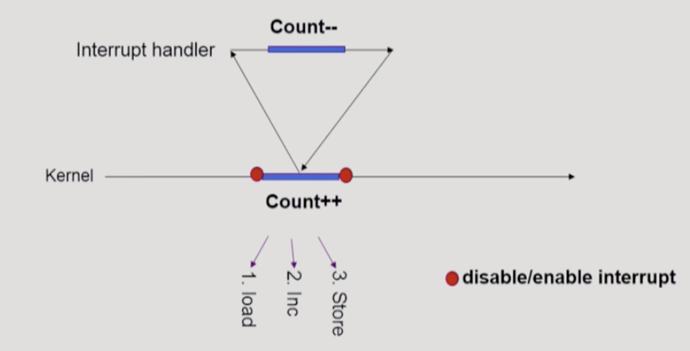

    - Critical section중(공유 데이터에 접근하는 코드를 실행하는 중)에서는 interrupt처리를 하지 않는 방법으로 해결한다.

2)  **Process 가 system call을 하여 kernel mode 로 수행 중인데 context switch가 일어나는 경우**

    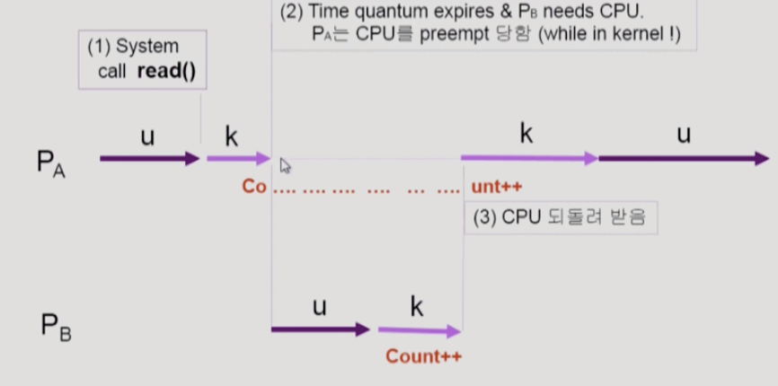

    Kernel code 실행 중 할당된 시간이 끝난 후 다른 P로 넘어가고 critical section 또 거치며 증가 완료되기 전에 또 context switch가 일어난 경우

    - 커널 모드에서 수행 중일 때는 CPU를 preempt하지 않음. User mode로 돌아갈 때 preempt

3)  **Multiprocessor에서 shared memory 내의 kernel data**

    이전의 방법처럼 단순히 interrupt enable/disable로 해결되지 않는다.

    CPU가 여러 개 있는 경우. Critical section의 데이터에 접근할 때 lock을 걸고 완료 후 풀어주어야 한다.

    - 한번에 하나의 CPU 만이 커널에 들어갈 수 있게 한다. ( 비효율적 )

    - 커널 내부에 있는 각 공유 데이터에 접근할 때마다 그 데이터에 대한 lock/unlock을 한다.

19\. SW적으로 critical section을 해결하기 위한 충족 조건

1)  Mutual Exclusion(상호 배제): 하나의 프로세스가 critical section 수행 중이면, 다른 모든 프로세스들은 들어가면 안된다.

2)  Progress: 아무도 critical section에 없을 때 들어가려는 프로세스가 있으면 허용한다.

3)  Bounded Waiting: critical section을 위한 대기 과정에서 지나친 starving이 없어야 한다.

20\. SW적인 해결

1)  본인의 차례가 아니면 while돌면서 기다리고, 본인 차례이면 critical section에 들어간다. 나올때 turn을 다른 Process로 바꿔준다.

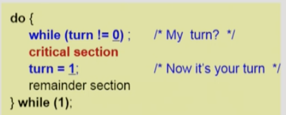

- Progress조건에 맞지 않는 코드( P마다 빈도가 다를 수 있다. )

2)  Process마다 flag변수가 있다. Critical section에 들어가고 싶을 경우flag를 1로 한다. 처음엔 0.

    상대방 flag가 0 일 때 들어간다. 빠져나올때 0으로 바꾼다.

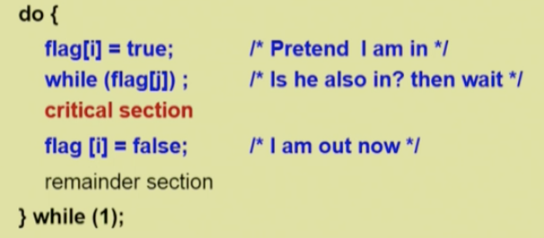

- 둘다 깃발을 들고 있을 수 있다. 아무도 못 들어갈 수 있다.

3)  Peterson’s Algorithm(피터슨의 알고리즘)

    : 상대방이 깃발을 들고있고 상대방의 차례일 때만 기다린다. 내 차례일 때 두 가지 중 상대방이 어느 하나라도 만족하지 못하면 내가 들어간다. 들어가면서 상대방의 차례로 바꿔주고 나올 때 내 깃발을 내린다.

    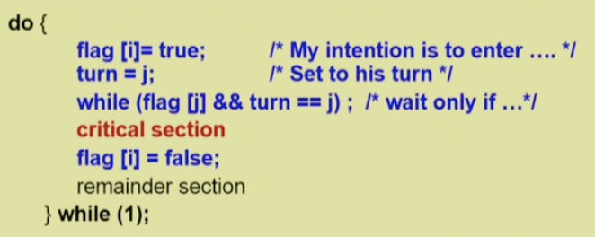

    - 3가지 충족 조건을 모두 만족한다. 최고야

    - But, Busy waiting(=spin lock)문제 발생

      = while문 도는 동안 계속 CPU와 memory를 쓰면서 wait하므로 비효율적.

21\. HW적인 해결 Test & Set

: 어떤 데이터를 읽고 쓰는 것이 하나의 instruction으로 실행이 가능하다면, 해결할 수 있다.

- Critical section 에 들어가기 전에 lock을 걸고, 나올 때 lock을 푼다.

  ( 화장실 문 같은 원리 )

  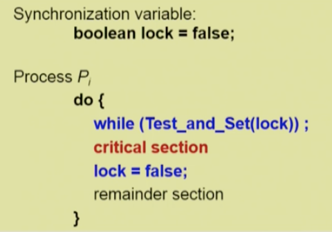

22\. Semaphores(세마포어)

: 정해진 변수 값 만큼 자원을 획득할 수 있다. P와 V는 atomic하다.(동일 연산)

( Semaphore는 일종의 추상 자료형 )

- P연산: 공유 데이터를 획득(lock을 거는 과정)

- V연산: 공유 데이터를 반환(lock을 푸는 과정)

- Busy-wait (=spin lock)코드

  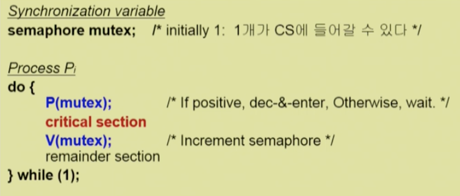

  - Critical section의 길이가 짧으면 사용해도 효율에 크게 차이 없음.

- Block & wakeup(=sleep lock)코드

  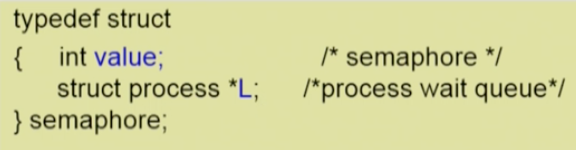

  세마포어를 기다리며 block된 process를 queue형태로 list에 매달아둔다.

  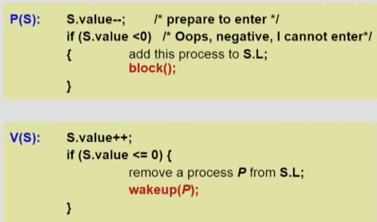

  따라서 잠들고 깨우는 코드가 추가된다.

  S.value가 음수면 누군가가 자원을 기다리고 있다는 것. 깨울것이 있는지를 나타낸다.

  -\> CPU 적으로 효율적이다. But, Block & wakeup의 overhead가 있다. 일반적으로는 더 좋음.

23\. 세마포어의 종류

1)  Counting semaphore

    : 자원의 개수가 정수로 주어진다. 자원이 여러개.

2)  Binary semaphore( =mutex)

    : 0또는 1값만 가질 수 있는 semaphore

    - 주로 상호 배제에 사용.

24\. Deadlock

: 세마포어의 문제점으로, 둘 이상의 프로세스가 서로 상대방에 의해 충족될 수 있는 event를 무한히 기다리는 현상

- A를 B로 copy하는 상황에선 A와 B를 모두 보유한 상황에서 A에서 읽어서 B에 쓴 후 둘 다 반환해야 한다. 이와 같이 Semaphore S, Q를 모두 획득한 상황에서 일을 하려는 작업을 두 프로세스가 하려고 할 때, S와 Q가 자원의 개수가 1인 semaphore라고 한다면 문제가 생긴다.

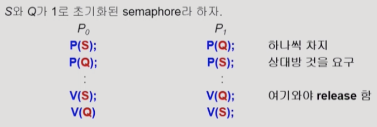

상대방이 가진 것을 영원히 기다리게 된다.

- 자원을 획득하는 순서를 맞춰주면 해결할 수 있다. 프로그래머가 코드 작성 시 유의해야 한다.

EX) 철학자들의 식사에서 모두가 왼쪽 젓가락을 들고 모두가 굶어 죽는 현상

25\. starvation

: 특정 프로세스들만 자원을 공유하고 다른 프로세스에게 기회를 주지 않는 것.

Ex) 철학자들의 식사에서 양쪽 두 명이 한 명을 굶겨 죽이는 현상

26\. Synchronous의 문제점

1)  Bounded-Buffer Problem: 버퍼의 크기가 유한한 환경에서 생산자 소비자 문제

    생산자 둘이 빈 버퍼 하나에 데이터를 동시에 넣으려 한다. -\> lock 필요

    소비자 둘이 찬 버퍼 하나에 데이터를 동시에 꺼내려 한다. -\> lock 필요

    +) 버퍼가 다 차면 생산자가 채울 수 없다. 빈 버퍼가 생길 때 까지 기다려야 한다.

    +) 소비자의 반대 상황도 마찬가지. -\> 가용 자원의 개수를 세는 Semaphore필요

    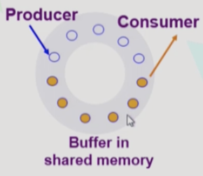

    - 빈/찬 버퍼가 있는지/없는지 + 꺼내는/넣는 다른 프로세스가 있는지/없는지의 2개의 세마포어로 해결

2)  Readers-Writers Problem: 한 Process가 공유 data에 write중일 때 다른 process가 접근하면 안되지만, Read는 동시에 여럿이 해도 된다는 문제

    - 마지막 읽는 프로세스면 lock을 풀어준다. Write가능하도록.

    - 읽을 때는 readcount++시킨다.

    - Starvation발생 가능한데, 신호등 만들면 된다.

3)  식사하는 철학자 문제: 생각하거나 밥 먹는다.

    - 4명의 철학자만이 테이블에 동시에 앉을 수 있도록 한다.

    - 젓가락을 두 개 모두 집을 수 있을 때에만 젓가락을 집을 수 있게 한다.

    - 짝수(홀수)철학자는 왼쪽(오른쪽) 젓가락부터 집도록 한다.

27\. 세마포어의 문제점

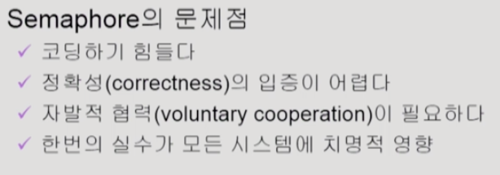

- 모니터를 제공하여 해결한다.

28\. 모니터

: 공유 데이터를 접근하기 위해서는 procedure를 꼭 거쳐야 한다. 하나만 가능하게 해주므로 lock걸 필요 없다.

- 모니터를 통해서 접근해야 한다.

- 공유 버퍼 자체가 모니터 안에 정의되어 있기 때문에 lock을 걸 필요가 없다. (세마포어코드 - lock)

- 모니터 안에서 하나의 프로세스만 활성화된다. (wait, signal)

29\. Deadlock (교착상태)

: 각자가 일부 자원을 점유하고 있으면서 상대방이 점유한 자원을 요청하는 상태

- 자원은 HW자원 일수도 SW자원 일수도 있다.

30\. Deadlock발생 조건 4가지

1)  상호 배제: 매 순간 하나의 프로세스만이 자원을 사용할 수 있음

2)  No preemption(비 선점): 프로세스는 자원을 스스로 내어놓을 뿐 강제로 빼앗기지 않음

3)  Hold and wait: 자원을 가진 프로세스가 다른 자원을 기다릴 때 자원을 놓지 않고 계속 기다리고 있음

4)  Circular wait: 자원을 기다리는 프로세스간에 사이클이 형성됨

-\> Resource-allocation grapgh(자원 할당 그래프)를 보고 알 수있다.

31\. Resource-allocation grapgh(자원 할당 그래프)

: Cycle이 없으면 deadlock이 아니다. 있으면 고민 해봐야함. Deadlock일수도 아닐수도 있다.

32\. Deadlock의 처리방법

1)  Deadlock prevention: Deadlock발생 조건 4가지 중 하나를 차단하여 예방하는 방법

- Hold and wait(시작 시 모든 필요한 자원을 할당, 필요할 경우 모두 놓고 다시 요청)

- No preemption(preemption으로 바꿈 그러나 context가 저장 및 보존되어야 함)

- Circular wait(모든 자원 유형에 할당 순서를 정하여 순서대로 할당)

  - 모두에 대하여, Utilization저하, throughput감소, starvation 문제 (비효율적)

2)  Deadlock Avoidance

    : 최대 자원을 미리 알아 놓고, Deadlock의 가능성이 없는 경우에만 자원 할당

    +) 자원 1개일땐 graph로 여러 개 일 땐 Banker’s Algorithm(최대-할당)으로 해결

3)  Deadlock Detection and recovery

    : 자원 1개일땐 graph로 여러 개 일 땐 Banker’s Algorithm(최대-할당)으로 detection

- Recovery1: 발생 시 다 죽여버린다.

- Recovery2: deadlock 없어질 때까지 하나씩 다 죽인다.

4)  Deadlock Ignorance: 매우 드물게 발생하므로 조치 자체가 overhead다. 무시( 대부분의 OS가 채택)

    \<5장 Memory management\>

1\. Address

1)  Logical address(=virtual address)

- 프로세스마다 독립적으로 가지는 주소 공간

- 각 프로세스마다 0번지부터 시작

- CPU가 보는 주소는 logical address이다.

2)  Physical address

- 메모리에 실제 올라가는 위치

  - 주소 바인딩(Address binding): 주소를 결정하는 것

  - 어떠한 프로그램이 실행되기 위해선 실데 물리 메모리 주소가 있어야 한다.

  - Symbolic Address(프로그래머의 변수) -\> Logical Address -\> Physical address

2\. 주소 바인딩이 일어나는 시점

1)  Compile time binding

    : 물리적 주소가 컴파일 시 정해진다.

2)  Load time binding

    : 로더의 책임 하에 물리적 메모리 주소가 부여된다.

3)  Execution time binding(=Run time binding)

    : 수행 시작 이후에도 프로세스의 메모리 상 위치를 옮길 수 있다.

    - 하드웨어적 지원이 필요하다 즉, MMU의 도움.

3\. **MMU(=Memory Management Unit)**

: 주소 변환을 해주는 **하드웨어**

- Relocation register(=base register): 시작 주소

- Limit register: 크기

  - 만약 limit register보다 큰 logical address요청이면 악의적이므로 trap

- 사용자와 CPU는 logical address만 알면 된다.

4\. 몇 가지 용어

1)  Dynamic Loading

    : 프로그램을 메모리에 동적으로 그때 그때 필요할 때 마다 올린다. \<-\> static loading(통째로 올림)

    - 프로그래머가 OS가 지원하는 라이브러리를 이용하여 load 구현

2)  Overlay

    : 초창기 프로그래머가 프로그램 쪼개서 올리고 내린 거

3)  Swapping

    : 프로세스를 일시적으로 메모리에서 쫓아내는거

4)  Dynamic Linking

    :Linking을 실행시간까지 미루는 기법\<-\> static linking(라이브로리가 프로그램의 실행 파일 코드에 포함됨)

    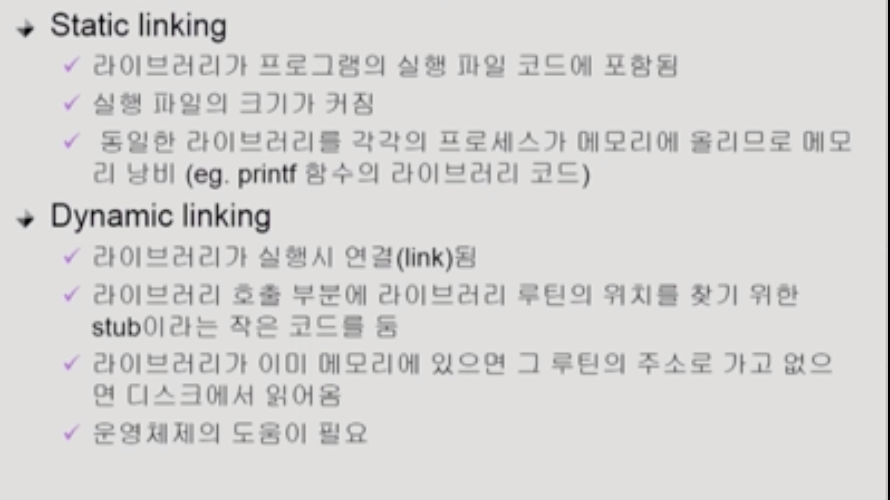

5\. Contiguous allocation(연속 할당)

: 각각의 프로세스가 메모리의 연속적인 공간에 적재되도록 하는 것

- External fragmentation: 프로그램보다 fragmentation이 작다.

- Internal fragmentation: 프로그램을 넣고 난 후의 fragmentation

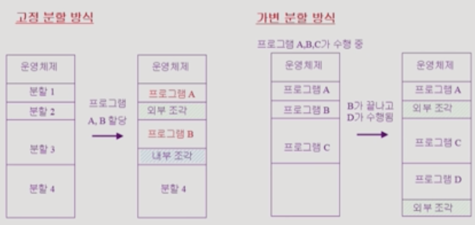//가변 분할에선 internal framentation안생긴다.

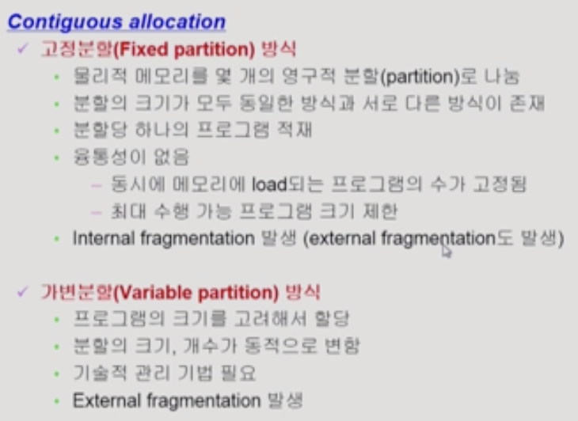

- Hole

  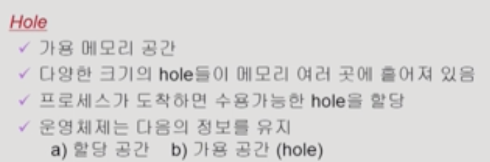

  Hole 중에서 어느 공간에 program을 넣어야 할까

  : **Dynamic storage-Allocation Problem**

  - **First-fit: 처음 발견한 hole**

  - **Best-fit: size가 n이상인 가장 작은 hole을 찾아서 할당**

  - **Wort-fit: size: 가장 큰 hole에 할당**

    **(First-fit과 best-fit이 효율적)**

- Compaction: 사용 중인 메모리 영역을 한 군데로 몰고 hole들을 다른 한 곳으로 몰아 큰 block을 만드는 것 (run time binding 이 지원 돼야 할 수 있다.)

6\. Noncontiguous allocation(연속 할당)

:하나의 프로세스가 메모리의 여러 영역에 분산되어 올라갈 수 있음

- Paging

  : 하나의 프로그램을 구성하는 주소 공간을 같은 크기의 page로 자른다. Physical M도 자른다.(page frame)

  Page 크기 = frame크기(internal fragmentation생길 수 있다 mod나머지때문에)

  - MMU에 의한 주소 변환이 복잡해진다.

- Segmentation

  : 프로그램의 주소 공간을 의미 있는 공간의 단위로 자른다.

  1\) code /data/stack 단위

  2\) 함수 단위

  -\> 크기 동일하지 않으므로 **Dynamic storage-Allocation Problem 발생 가능**

7\. paging

- Page table

  : logical memory의 page가 몇 번째 physical memory의 frame에 올라가 있는지 나타낸다.

  - Page number만 바뀌고 내부의 page offset은 변환이 없다.

    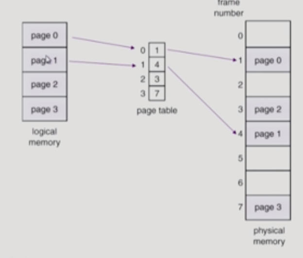

- Page table의 구현

  

  - PTBR: 페이지 테이블 시작 위치

  - PTLR: 페이지 테이블의 길이

  - 메모리 접근이 2번 필요 시간 너무 많이 든다.

  - M보다 빠른 M와 CPU사이에 존재하는 **TLB(= translation look-aside buffer)사용**

  - Valid/invalid bit이 있고, protection(접근 권한)

8\. TLB

: 컴퓨터 구조 시간에 cache memory와 같이 page table의 주소 변환을 위한 cache

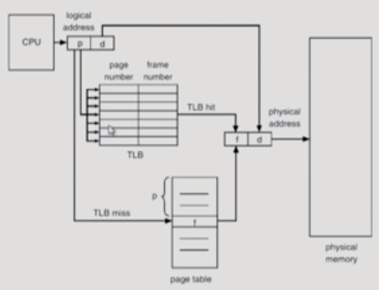

- TLB는 page number와 frame number쌍으로 이루어져 있다.

- TLB내부를 전부 찾아봐야 한다. 즉, parallel search가 가능한 associative register를 이용하여 구현

- TLB는 context switch때 flush( remove old entries) 되어야 한다.

9\. 2-level page table

: 공간적 효율을 위함 (주소 체계 32, 64bit이다 표현 가능한 정보는 2^32(4GB)-\> 메가 단위의 page table 생김, 2^64(8GB)는 더 크겠지 -\> 공간 낭비를 줄이고자 함)

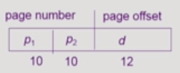 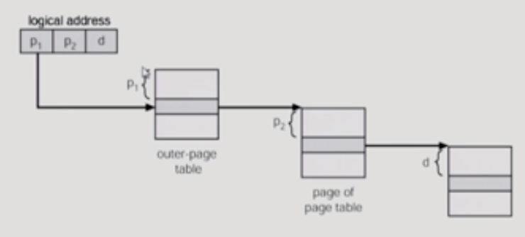

1 table에서 가리키는 2table가서 p2번째를 찾은 후 그 값은 frame \#이다. Frame# 물리적 주소에서 d번째 찾는다.

안쪽 페이지 table의 크기는 page크기와 같다.

- 첫 table은 전체 주소 table이지만, 사용되는 공간에만 2 table만든다.

10\. inverted page table

: 프로세스마다 존재하던 table을 시스템 안에 단 하나만 존재하게 한다. 즉 물리적 메모리의 frame개수만큼 존재한다.

- Idx를 이용할 수 없다. 전부 검색해서 몇 번째 떨어져 있는가로 찾아야 한다.

- 공간 효율적이지만 시간적 overhead 발생 (associative register 이용해야 한다.)

- Pid같이 저장해야 한다.

11\. shared pages example

: shared code에 대해 각각을 별도로 올리지 않고 1 copy만 올린다.

- Read-only 로 세팅해야 한다.

- 동일한 logical address에 위치해야 한다. (Shared code 이므로)

12\. Segmentation

: 프로세스의 주소 공간을 의미 단위로 쪼갠 것.

- Segment의 길이를 나타내는 limit이 추가된다.

  //base 만큼 떨어진 곳에 limit길이의 segment가 있고 d만큼의 offset이동하면 있다.

  (base 는 Byte단위의 주소로 주어져야 한다) -\> 아닐 경우 trap

  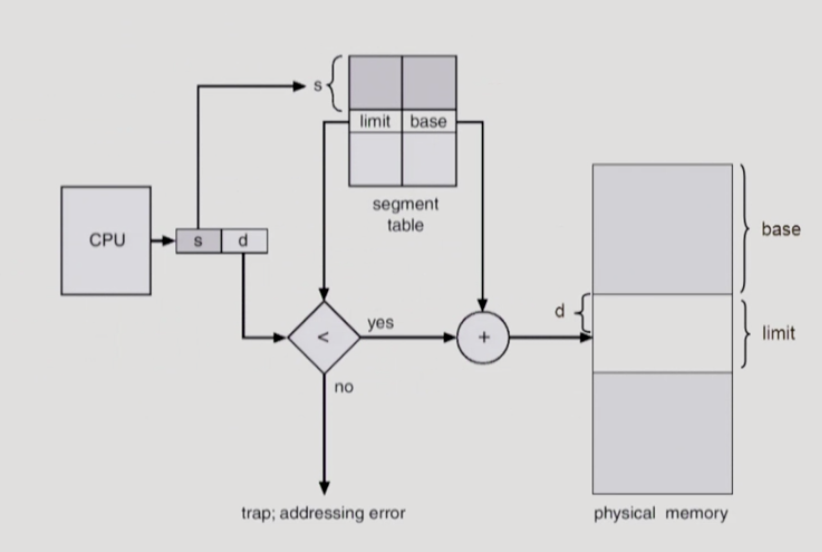

- Segmentation은 의미 단위로 이루어지므로 sharing과 protection에 있어서 paging보다 훨씬 효과적이다.

  +) table 낭비도 적다.

- But, 크기가 균일하지 않으므로 allocation 문제 발생한다.

- 마찬가지로 Sharing of Segments존재.\<-\> private segment

13\. Paged Segmentation

: Segment당 page table이 존재한다. Segment-table entry가 segment의 base address를 가지고있는 것이 아니라 segment를 구성하는 page table의 base address를 가지고 있다.

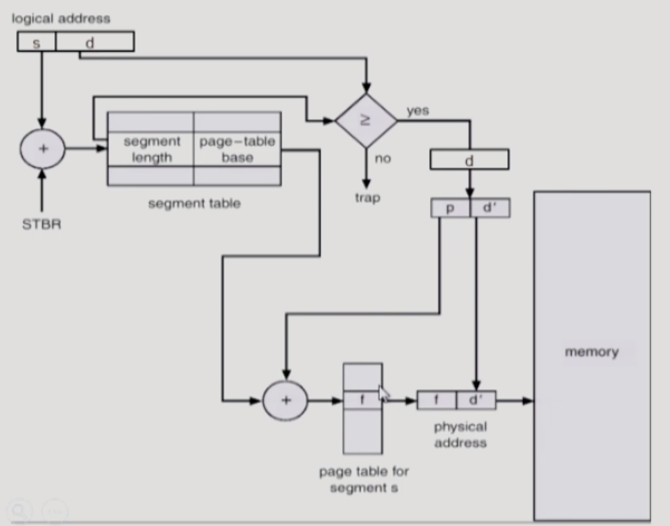

14\. Virtual Memory

- Invalid page를 접근하면, MMU가 trap을 발생시킨다. (Page fault trap) 그럼, kernel mode로 들어가서 page fault handler가 실행된다.

- Page fault의 처리(에만 OS가 관여한다)

  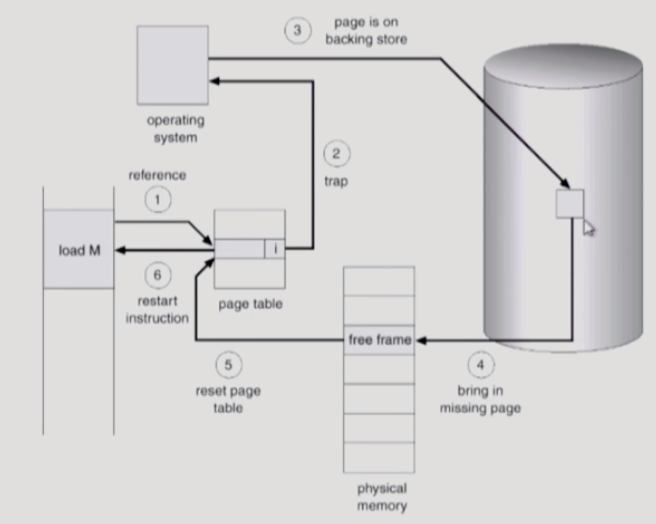

- 대부분의 경우 Page fault rate적다. But, 한번 나면 시간 오래걸린다.

15\. page replacement

: free frame이 없는 경우 어떤 frame을 빼앗아올지 결정해야 한다. 곧바로 사용되지 않을 page를 쫓아내는 것이 좋다. 변경사항이 있을 경우 backing storage update해줘야 한다.

- **Replacement algorithm** : page-fault rate를 최소화 하는 것이 목표이다.

16\. Optimal Algorithm

: 가장 먼 미래에 참조되는 page를 replace( 실현 불가능 ) -\> **upper bound**를 알 수 있다.

17\. FIFO(First In First Out)

: 먼저 들어온 것을 먼저 내쫓음

- 메모리 frame을 늘려주면 성능이 나빠진다.

18\. LRU(Least Recently Used)

: 가장 오래 전에 참조된 것을 지움

- Linked list형태로 관리 가장 최근에 참조되면 가장 아래로 이동하고, 쫓아낼 때는 가장 위의 것을 쫓는다.

- **O(1)** complexity

  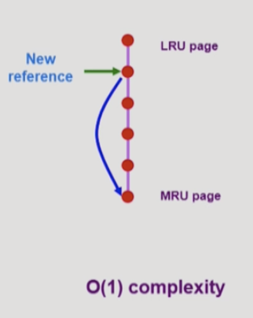

19\. LFU(Least Frequently Used)

: 참조 횟수가 가장 적은 페이지를 지움

- 참조 시점의 최근성을 반영하지 못한다.

- LRU보다 구현 복잡

<!-- -->

- **O(n)** complexity -\> 힙으로 구현 시 **O(log n)**

  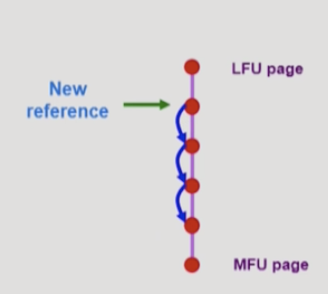 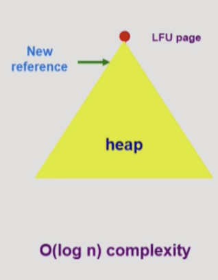 //아래로 갈수록 high frequency

  - **OS는 page fault가 나지 않았을 때는 정보를 알 수 없다.**

20\. Clock Algorithm (= Second chance algorithm)

: LRU의 근사 알고리즘. OS는 page 사용 정보 반밖에 모르므로 나온 알고리즘.

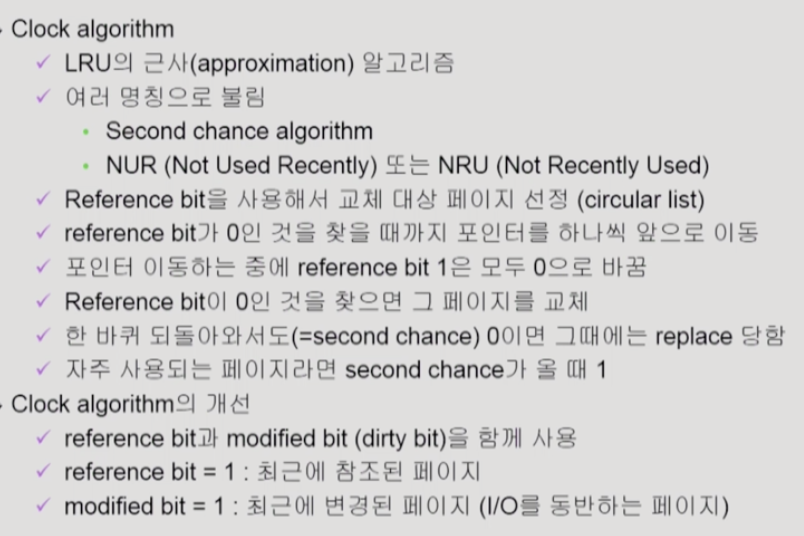

21\. page allocation

: locality 를 고려해서 page frame을 할당해야 fault가 덜 난다.

각각의frame에게 어느 정도의 page를 나누어 주자.

1)  Equal allocation: 모두 똑같은 개수로

2)  Proportional allocation: 크기에 비례

3)  Priority allocation : Priority따라 다르게 할당

22\. replacement

1)  Global replacement: 미리 할당하지 않고 replacement알고리즘에 맡긴다.

2)  Local replacement: 자신에게 할당된 frame 내에서만 replacement. 다른 frame에 영향 X

    Ex) window set algorithm, PFF

23\. Thrashing

: 프로세스의 원활한 수행에 필요한 최소한의 page frame수를 할당 받지 못한 경우 발생

- Page fault가 빈번하게 발생하므로 page fault rate가 높아짐.

- CPU utilization낮아진다. (fault시 IO해야하므로)

- 또 다른 프로세스가 추가된다. (**MPD: multi program degree 조절해줘야 한다.**)

- 더 빈번한 page fault

  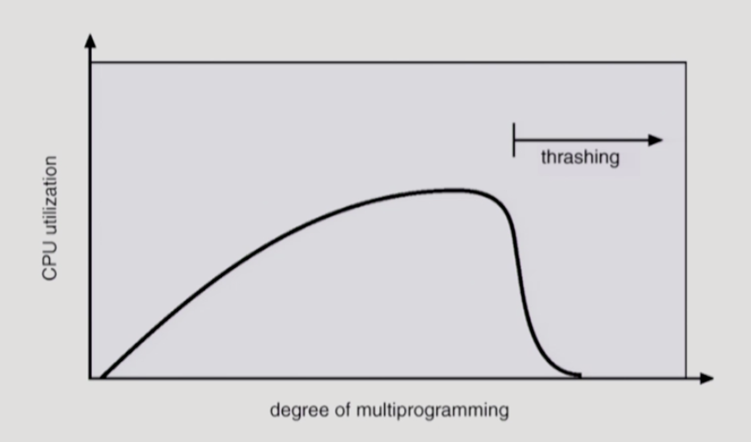

- **Working set알고리즘으로 MPD조절**

  : 현재부터 과거 window크기 이내의 page를 working set으로 유지한다.

  즉, 참조된 후 window size시간 동안 page를 메모리에 유지하고 버림.

  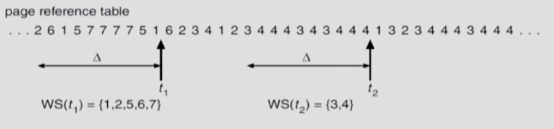

- **PFF(Page-Fault Frequency)**

  : page-fault rate의 상한값과 하한값을 둔다. 상한값 넘으면 frame 더주고, 하한값 이하면 frame 줄인다.

24\. Page size에 따른 정보

//디스크 입장에선 seek시간이 길어진다. 한번에 올라오는게 좋다.

- 최근엔 page size키워주는 추세

  \<6장 File System\>

1\. 접근 권한 3bit 씩 표시

1)  Owner

2)  Group

3)  Public

2\. File system 접근

1)  Contiguous Allocation(순차적 접근)

    : 연속해서 할당 된다.

    - 단: Free block(= external fragmentation)생긴다.

      File 크기를 키울 수 없다. ( 미리 공간 확보할 수 있다고 해도 그만큼뿐이다.+ 낭비가능성 internal fragmentation)

      **+) 할당 되었는데 사용 X: internal / 할당 못됨 : external**

    - 장: 빠른 I/O가능하다. 한번의 seek만 하면 된다.

      따라서, realtime용이나 swapping용으로 사용 가능

      **Direct access(= random access)가능 (중간 위치 블럭 idx처럼 바로 볼 수 있다.)**

2)  Linked Allocation

    : linked list형태

    - 단: random access 불가능

      한 sector고장 나면 뒤로 다 잃는다. (reliability 문제)

      포인터 저장해야해서 공간 효율성 떨어진다. -\> FAT(File allocation table) 따로 만들면 해결

    - 장: external fragmentation안 생긴다.

3)  Indexed Allocation(직접 접근)

    : 블럭 하나에 idx위치 정보 저장

    

+) linked scheme: idx 블록 2개 / 이중idx: 또 다른 idx가리킨다.

3\. Free-Space (빈 블럭)관리: file system 이 한다.

+) Bit map or bit vector: 연속 공간 찾는데 효과적

4\. 파일 시스템

//page cache와 buffer cache비슷하지만 다르다.

+) buffer cache M에 있다.

- Page는 OS가 반만 알지만, buffer cache는 OS가 다 안다.( I/O의 시스템 콜)

5\. 프로그램의 실행

 

프로그램이 file system에 실행 파일 형태로 저장되어 있다가, 실행시키면 process가 되고 독자적인 주소 공간이 생긴다. 즉, Virtual memory가 만들어진다. (code, data, stack) 주소 변환을 해주는 HW에 의해서 당장 필요한 부분이 physical M에 올라가고 쫓겨나는 애들은 swap area로 간다. Code는 이미 file system에 있으므로 swap area로 가지 않는다.

6\. 디스크를 사용하는 이유

1)  M의 volatile(휘발성)한 특성 -\> file system 필요

2)  DRAM M의 공간이 한정적 -\> Swap space의 용도로 사용

    +) RAID: 여러개의 디스크를 묶어서 사용 ( 속도 향상, 신뢰성 향상)
