**\[파트1. Javascript와 web\]**

1.  Javascript, HTML, CSS

웹 페이지는 HTML, CSS, JavaScript(.js파일)로 구성된다.

1)  HTML: 문서의 구조

2)  CSS: 각 요소의 스타일

3)  JavaScript: 정적인 문서의 구조와 스타일에 변화를 주거나 로직을 추가한다.

- 브라우저는 자바스크립트 코드를 실행시키면서 HTML, CSS가 변화가 생기면 다시 브라우저에 해당 내용을 반영하여 렌더링 한다.

2.  Window object

: 브라우저에서 제공하는 객체로, JS는 윈도우 객체를 통해 각종 HTML, CSS에 접근하고 조작할 수 있다.

1)  This = Window

> 객체에 바인드 된 메소드로 실행하지 않은 경우의 this는 window이다. 즉, 브라우저에서 JS실행 시 가장 상위에 있는 객체이기 때문이다. 따라서 일반 변수 및 객체 앞에 window.이 생략되었다고 봐도 무방
>
> +) 아래 예시에서 console도 window객체가 제공하는 API이다.
>
> 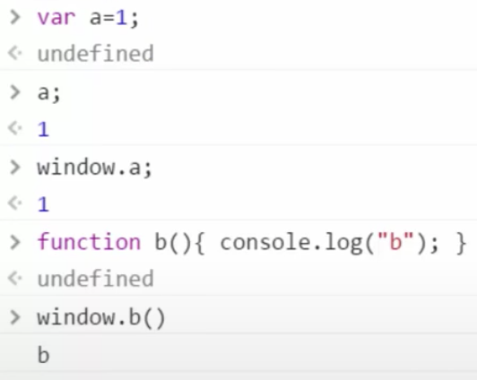

2)  Window.document

> : 아래와 같이 실제 HTML과 CSS가 모두 저장되어 있다. 따라서 이 객체를 통해 접근 가능하다.
>
> HTML의 경우 .body 등으로 접근 가능, CSS의 경우 styleSheets로 접근 가능하다.
>
> 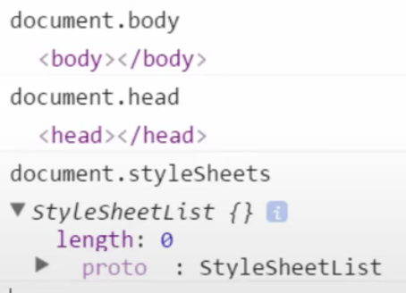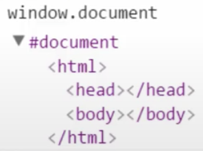 //현재는 빈 페이지라 내용이 없다.

3.  CSS 다루기

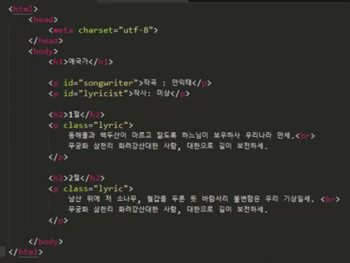

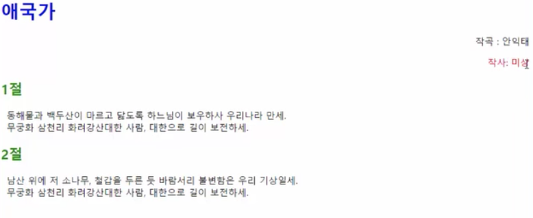

1)  위 html.html 을 CSS로 변경하기 위한 CSS의 작성

> ① 가장 먼저, Style을 적용할 element의 selector (tag,id,class 중 선택)를 적는다.
>
> ② 중괄호 안에 style property : 값 의 형태로 기술 후; 붙인다.

2)  HTML문서에 적용하는 3가지 방법

<!-- -->

1.  head tag에 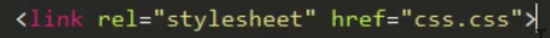 처럼 링크 테그 추가

2.  head tag에 style tag를 이용하여 적용

> 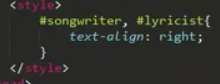

3.  테그 안에 직접 style속성을 이용하여 적용

> 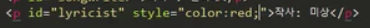

**\[파트2. DOM + JS\]**

1.  DOM 소개 및 탐색

: JS를 통해 HTML에 접근이 가능한 것은, HTML문서가 DOM(Document Object Model)에 따라 기술되고, 이 DOM 인터페이스를 통해 기술된 HTML element가 Object, 즉 객체로서 JS와 연결되기 때문이다.

1.  DOM이란?

> : 컴퓨터가 문서를 잘 처리할 수 있도록 문서에 대한 구조를 약속한 것으로, Tree형태로 문서를 표현한다. 즉, 테그가 중첩되는 구조이다. 즉, html이 haed와 body의 부모가 된다.

- children속성으로 접근 가능 + parentNode속성으로 html접근 가능

> 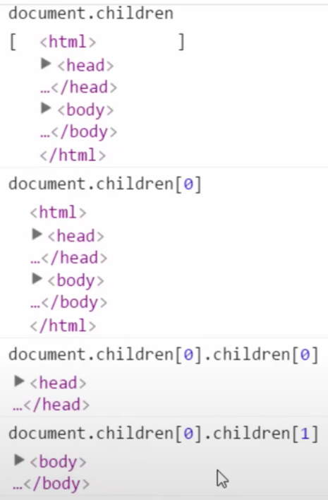 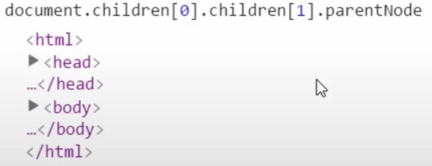

- firstElementChild, lastElementChild, nextElementSibling, previousElementSibling 등으로 테그 접근

2.  단일 Element 선택

    1.  getElemenetById의 주요 기능

> : id로 접근하여 해당 id를 가진 테그를 반환
>
> 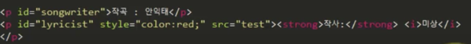
>
> 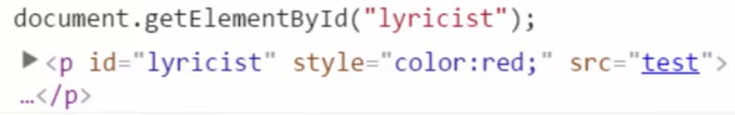

1.  원하는 부분 가져오기

> 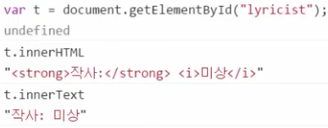

2.  원하는 부분 바꾸기 단, innerText는 “”안의 테그도 텍스트로 인식한다.

> 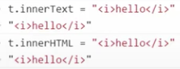

3.  스타일 변경하기

> 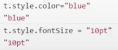

2.  getElemenetById의 추가 기능

> : Element의 속성 값을 변경 및 추가 가능
>
> 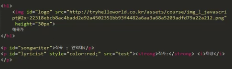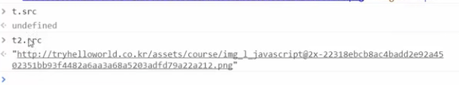

- t1과 t2모두 src 속성이 있지만, 이미지에만 접근이 가능하다. 그 이유는 이미지 속성에 대해서는 API가 소스 속성을 동기화 해주지만, 원래 소스가 정의되지 않는 테그에 대해서는 속성을 동기화 해주지 않는다.

- 그러나 getAttribute, setAttribute로 해결 가능!

> 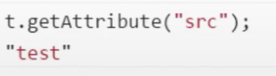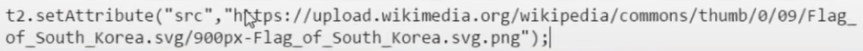

3.  다중 Element 선택

    1.  document.getElementsByTagName(“p”)

> : p테그의 모든 내용이 배열로 반환된다

2.  document.getElementsByClassName(“messsage”)

3.  document.getElementsByName(“author”)

<!-- -->

4.  CSS Selector를 이용한 Element선택

:조금 복잡하지만 편리하다

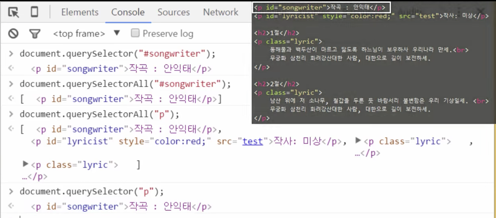

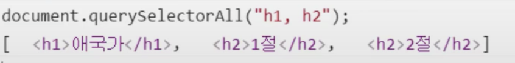

5.  Element 추가/삭제

    1.  document.createElement(“hr”): 여러개 추가시 여러번 쓴다.

> +) 그러나, hr.cloneNode();하면 복제된다.

2.  appendChild: 원하는 테그의 가장 마지막에 추가

> 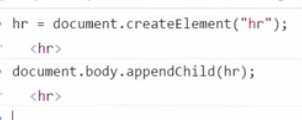

3.  원하는 곳에 추가(특정 위치는 \[몇번째 줄\])

> 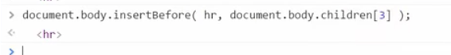

4.  document.removeChild(hr2): 삭제된다.

**\[파트3. Event + JS\]**

1.  Callback function

: 타이머를 설정하여 해당 시간이 지난후 혹은 시간마다 콜백 함수 호출

+) 콜백 함수: 조건을 등록해두고 그 조건을 만족한 경우, 나중에 호출해 주는 함수

1)  콜백 함수 생성

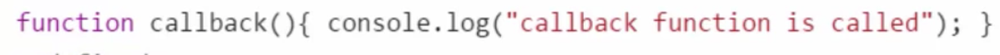

2)  setTimeout

> 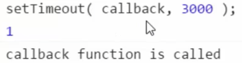

3)  setInterval

> 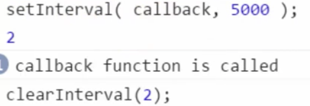

2.  HTML Tag 속성에 Event Handler 추가하기

    1.  이벤트의 종류

> 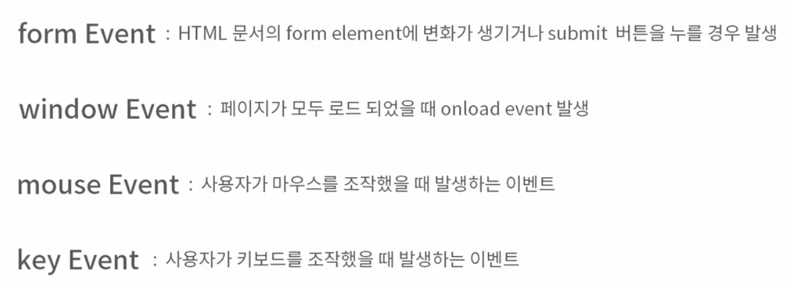

2.  html에 추가

> 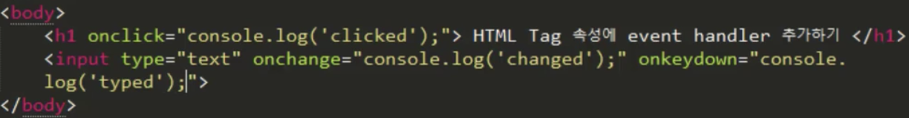

3.  JS에서 Event Handler 설정

    1.  a.html에서 b.html로 데이터 전달하기

> 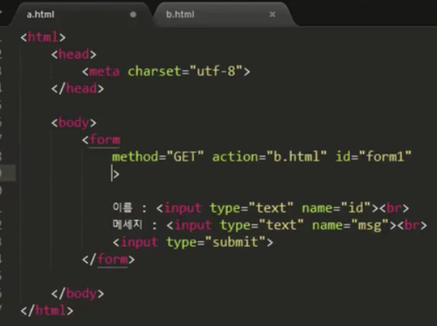

2.  return false

> : 해당 이벤트가 동작되지 않도록 한다.
>
> 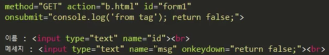

3.  script를 이용해서 onsubmit 이벤트 등록

> : 여러 개 등록 시 덮어씌워진다.
>
> 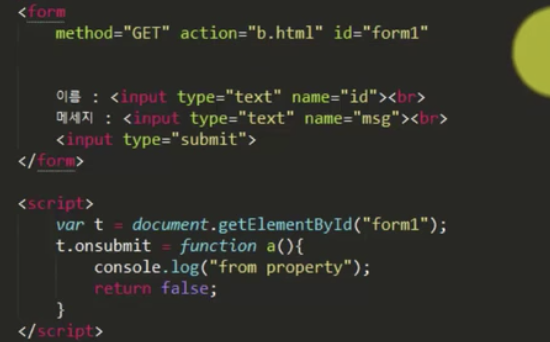

4.  addEventListener();

> : 여러 개 등록 시 전부 실행된다. 지우고 싶은 이벤트는 removeEventListner
>
> 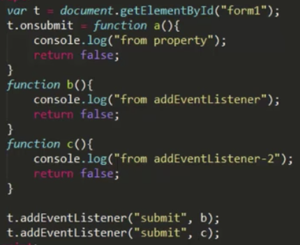

**\[파트4. Networking\]**

1.  AJAX – Request 보내기

    1.  AJAX(Asynchronous JavaScript and XML)

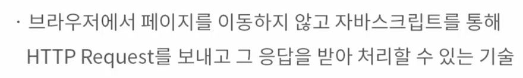

- 사용자에게 더 나은 사용 경험 제공 및 최근 대부분의 웹사이트에서 사용 되는 기술

  1.  data 파일에서 받아오기

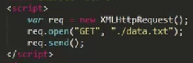

req.open(“HTTP request의 method”, “얻어올 리소스나 url”) // 어떤 서버에 요청을 보낼 지 설정

req.send() //http request 전송

- 주의!! 비동기로 처리되기 때문에, 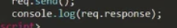 와 같이 출력해도, 브라우저에서 출력된 내용을 볼 수 없다. 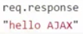와 같이 나중에 접근해야 볼 수 있다.

- 이벤트 핸들러를 등록해야 바로 접근이 가능하다!!

2.  AJAX – Response 받아서 처리하기

    1.  req.readyState

> : AJAX 요청에 따라 0~4까지 변화한다.
>
> 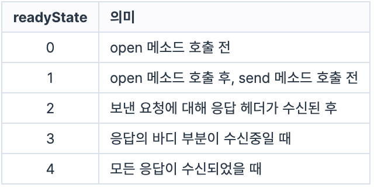 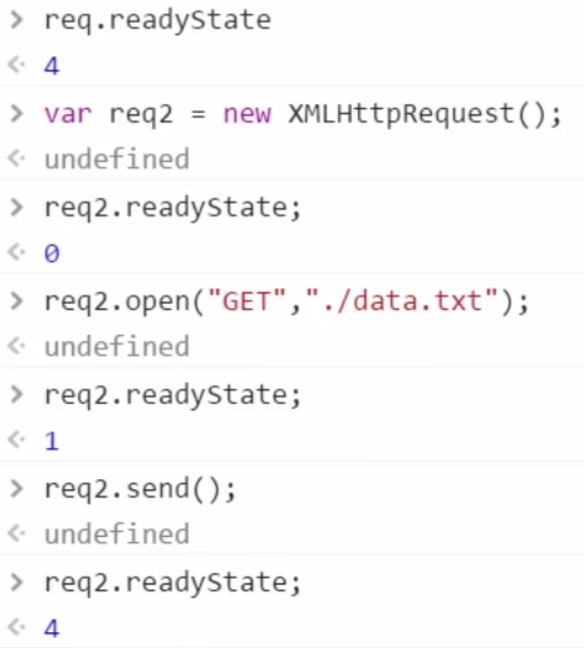

2.  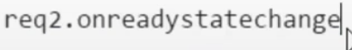

> :readystate 의 숫자가 변할 때 마다 호출된다.
>
> ex)
>
> 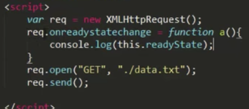 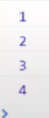

- req객체에 대해 readyState가 변할 때 마다 해당 메소드가 호출되며 this.readyState가 출력

  1.  this.status

> 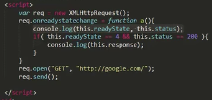

2.  status 속성

> : HTTP response의 응답 헤더에 기록된 코드
>
> 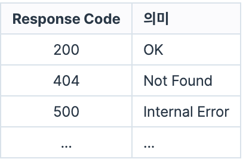

3.  JSON(JavaScript Object Notation)

: 자바스크립트의 객체를 문자열로 표현하는 방법

- 전달이 편리하다. 특히 서버에서 데이터를 받아와서 브라우저에서 표시할 때 주로 사용

- 서버에서 보낼 데이터를 JSON형태로 전송-\>데이터를 수신한 브라우저는 자바스크립트를 통해 해당 데이터를 파싱하고 문서에 반영한다.

  1.  자바스크립트 객체를 문자열로 변경하고 다시 객체로 변경하기

> 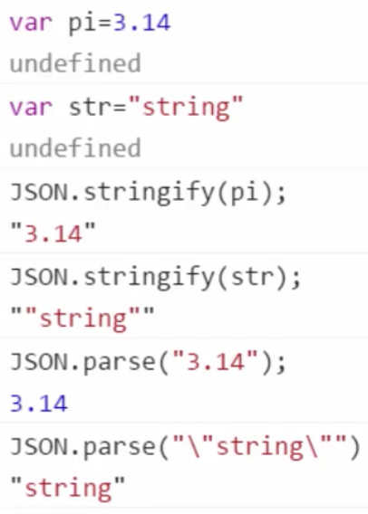

2.  JSON은 자바스크립트 객체에 담긴 데이터만 문자로 변환하고, 다시 객체로 변환하므로 객체에 정의되어있던 메소드나 undefined는 변환되지 않는다.

> 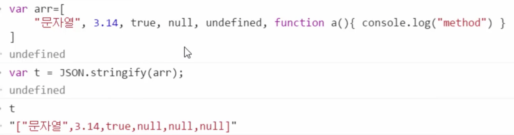

3.  JSON객체-\>자바스크립트 객체

> 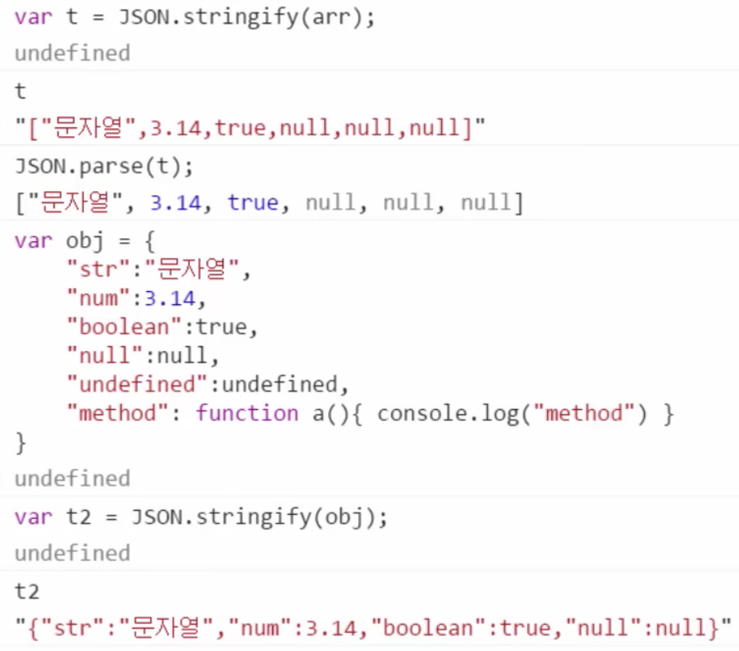
>
> 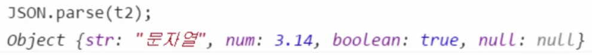

4.  AJAX + JSON

    1.  데이터를 json_data.txt에 넣어준다.

> 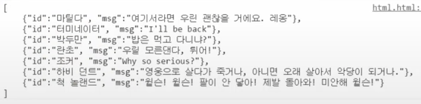

2.  스크립트 작성해준다.

> 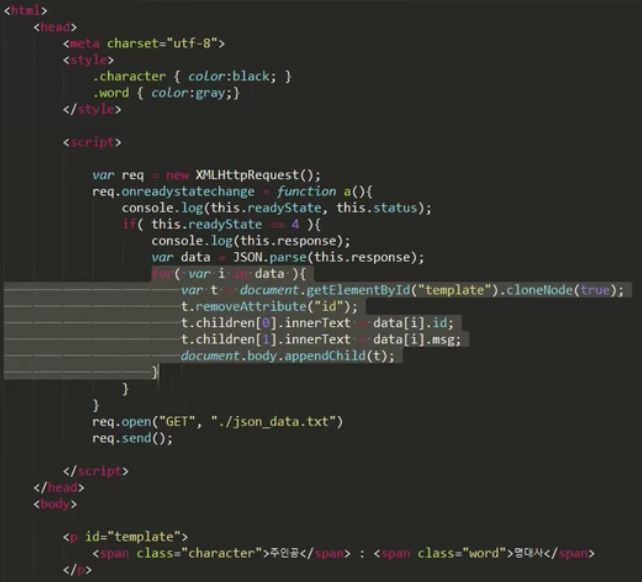

3.  실행

> 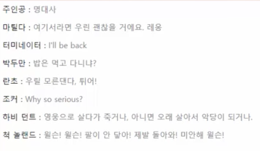

**\[파트5. Extra\]**

1.  Script 위치에 따른 실행

: 페이지가 위에서부터 읽으며 로드 되다가 script실행 부분을 만나면, 실행된 후 다시 페이지가 로드된다.

따라서, JS에서 HTML페이지의 특정 element에 접근하려면, 해당 element가 먼저 파싱이 되어있어야 한다. 즉, body가 script보다 먼저 나와야 한다. 더불어 이렇게 해야 로딩 속도가 빨라진다.

2.  Chrome 디버거 활용

: 프로그램 작성시 오류를 쉽게 고치기 위함. 원하는 부분에 도달 시 실행 잠시 멈추고 변수 확인  
1) 문법적 오류(Syntax Error): 해당 구문이 실행되지 않아 쉽게 발견 및 수정 가능

2\) 논리적 오류(Semantic Error): 실행은 되지만 의도한 결과가 나오지 않는 경우. 오류의 발견과 수정이 어렵다.

3.  익명함수와 함수 즉시 호출

    1.  Anonymous function

> : 변수의 scope를 분리하기 위한 함수 사용에서 이 함수는 한번 사용되며, 정의한 부분에서 호출된다. 따라서 정의한 곳에서 호출하며 이름이 필요없다.
>
> ex1)
>
> 
>
> ex2)
>
> 

4.  예외처리

: 프로그램 실행 도중 예상치 못한 결과가 일어나도 해당 루틴만 동작하지 않고 이후의 동작은 진행되어야 한다. 이를 조절하기 위함.

1.  Try

> : 원래 정상적으로 돌아갔을 때 작동될 코드를 모두 작성

2.  Catch

> : try구문에서 error가 발생했을 때 실행될 코드를 작성

3.  Finally

> : try가 정상적으로 실행되거나, try의 에러 이후 catch가 실행되었을 때 즉, 항상 가장 마지막에 실행될 코드

4.  throw

> : try 안에서 에러를 핸들링 하고 싶은 경우 사용한다.

- throw “error의 종류”-\> “”안의 값은 catch(e)의 e로 받아진다.

5.  예외처리 예제

ex1)

**\[파트6. 실습\]**

1.  이미지 갤러리 만들기

2.  이미지 선택 기능 만들기

3.  전체선택 기능 만들기

4.  자세히 보기 기능 만들기

5.  사진 슬라이드쇼 기능 만들기
